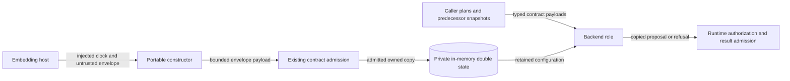

# Backend port API additions proposal

Status: accepted. The user selected option 1 on 2026-11-17.
Approval covers additive entry points and preserves existing signatures.
The source baseline is `e039884f818e5eb7d3a20cc0cdffa3d4723c2735` on `go-cutover`.

## Decision needed

The fixed public API cannot carry all inputs that issue #1790 needs.
The [public API reference](issue-1825-public-go-api.md) requires ports to use that API.
Approve new entry points in the same packages before the design check.
Keep each existing signature and the six manifest flags.

## Constructor inputs

Python's provisioner accepts a full realization envelope.
Its orchestrator, evaluator, and participant doubles accept an injected wall clock.
The declared Go constructors accept neither input.
The default API cannot set a test clock.
It cannot set the full envelope for refusal tests.

Add these declarations to `backend/stub`:

```go
type Configuration struct {
    Clock clock.Clock
    Envelope *binding.RealizationEnvelopeV1
}

func NewProvisionerWithConfiguration(Configuration) (Provisioner, error)
func NewOrchestratorWithConfiguration(Configuration) (Orchestrator, error)
func NewEvaluatorWithConfiguration(Configuration) (Evaluator, error)
func NewParticipantRuntimeWithConfiguration(Configuration) (ParticipantRuntime, error)
```

`clock` is the existing public `base/clock` owner.
`binding` is the existing generated contract owner.
Only the provisioner consumes `Envelope`; the other doubles consume `Clock`.
Each constructor checks and copies its envelope before use.
Each existing constructor uses an empty configuration.
A nil clock selects the existing system-clock default.
No global clock replacement or implicit envelope lookup is introduced.

## Remaining behavior owners

| Behavior missing from current declarations | Proposed owner and boundary |
| --- | --- |
| General envelope subsumption | Extend `contract/admission`; reuse its bounded domain and closure interpretation. Membership remains with the existing native SDL seam. |
| Witness and positive/negative probes | Extend `sdl`; use ordinary native construction, instantiation, and admission. Backend packages do not import SDL. |
| Inventory, recovery, augmentation, mixed services, and invocation-tool roles | Add small optional interfaces under `backend`, with shared native data under `contract/runtime` and existing published bindings. |
| Manifest construction and capability comparisons | Reuse `contract/admission` checks through narrow backend helpers. No duplicate capability catalog or schema validator is introduced. |
| Live registration, dispatch, trial adapters, and target factories | Keep with the existing runtime owner and extraction issue #1894. |

Declare each new typed API in the model before code changes.
This proposal keeps existing interfaces and published payloads.

## Protection boundaries



The host owns native resources and credentials.
This code makes no network calls.
It writes no files and starts no processes.
A method's presence grants no right to run it.
An envelope ID does not replace the full checked envelope.
A refusal keeps the prior state and hides rejected values.
Runtime checks who can act.
It owns stored state, grants, and published results.

## Evidence and verification

The Python references are `raes_backend_stubs/stubs.py` and `raes_backend_protocols/participant_runtime_base.py` under `implementations/python/packages/`.
Other role references are the inventory, recovery, augmentation, mixed-backend, and invocation-tool modules in `raes_backend_protocols`.
The current Go API is in `implementations/architecture-api/planned/rae/`.
The [design check note](issue-1790-backend-contracts-preflight.md) lists the missing inputs and set relations.

The baseline architecture design check passes.
The three selected reference tests pass.
They check manifest form, backend operations, and envelope joins.
These results show which code this port can reuse.
They do not prove that this proposal has shipped.

The design follows [Effective Go](https://go.dev/doc/effective_go) interface composition and explicit initialization guidance.
It follows [Google Go best practices](https://google.github.io/styleguide/go/best-practices) for focused test doubles.
The module specifies Go 1.27.3.
Review preserves explanatory purpose, short sentences, and technical meaning.
