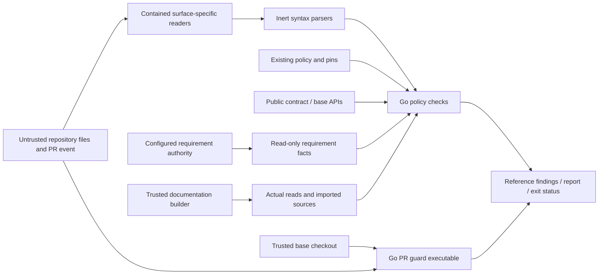

# Go repository governance checks

Issue #1799 ports the repo checks. It keeps the same policy authority.
Python remains the enforced reference until #1804.
Existing policy data, ADR pins, identity records, published schemas and historical evidence remain unchanged.

## Owners and public interfaces

The tooling layer owns `governance` and `cmd/policycheck`.
`Check(context.Context, Request)` evaluates one check and returns a `Report`.
Private functions group checks by their authority rather than by Python file boundaries.
Authority-boundary checks preserve canonical roots and artifact families, category overlap, filesystem placement and ADR/README drift.
Assurance checks keep the FM level floor, future-level ordering and category bindings.
ADR ledgers and fulfilled evidence retain separate acceptance rules.
Repository policy combines unchanged Rego with guarded changed paths, inert Python syntax checks, module boundaries and existing size rules.
File-local and full modes retain their distinct inspection scopes.
Checks share the file reader. They use one finding type. They share exception handling and report output.
The model records each package API. It lists the allowed imports.

| Interface | Contract |
| --- | --- |
| `Request` | Named check, repository, changed paths, base/staged selection, requirement context and explicit modes |
| `Mode` | Evaluation, non-gating inventory or read-only closing-issue audit |
| `Finding` | Reference rule, message, nullable path and optional unavailable-governance status |
| `Report` | Ordered findings, evaluation status, report text and reference exit status |
| `Documentation` | Actual builder read records, source root, imported module files and approved module roots |
| `DocumentRead` | Document name and the file actually read |

The command keeps the same flags. It checks built output. It keeps report modes and issue audits.
Local issue fixtures use an explicit flag. The normal lookup does not use them.
An event cannot select a fixture or supply authoritative issue facts.
Reports say when governance was not checked. Optional mode may still exit with status zero.
Inventory and closing-issue audit modes never mutate issues.
Explicit PR event, commit-message and fixture files may be outside the repository.
The body guard refuses final symbolic links; title inputs follow checked links to regular files.
Audit output binds a writable regular-file descriptor before truncation, preserving file permissions and hard links.
Branch and base flags preserve explicit empty values, so detached checkouts and merge handling retain their reference behavior.
Optional vocabulary verification uses the reviewed artifact locks and one shared native acquisition adapter.
This PR also ports the existing artifact-policy helper; no Python subprocess remains in this verification path.
One private selector validates the whole lock and admission shapes, then only the selected source-snapshot dependency closure and its profiles.
It preserves policy/evidence joins, locator screening, denied hashes, checked-in snapshot hashes and cycle rejection.
Its fixed manifest-path restriction has a private predicate adapter.
Issue #1983 uses string and character checks for this restriction; configurable patterns use standard-library `regexp`.
Host, installation and OCI selection modes are outside this vocabulary consumer. Unsupported selection shapes are refused.
Go invokes the existing qualified absolute curl executable with its unchanged scrubbed environment and transfer budgets.
Standard-library file descriptors, byte limits and SHA-256 admit both local and transferred objects before use.
Explicit input paths resolve their parents through the checked root walker, then use `os.OpenFile` with `O_NOFOLLOW` for the final file.
Inode identity is checked before content is read and again afterward; bounded artifact reads also retain exact opened size.
The rooted file API follows final links, so it is not used as a substitute for this explicit no-follow open.
Explicit local artifacts never cause a network fallback.
Workbook parsing uses standard ZIP and XML readers with the reference's selected-member checks.
The XML adapter admits UTF-8 and UTF-16, rejects duplicate expanded attributes, and enforces XML framing whitespace.
Encrypted workbook members are refused before opening.
Policy XML rejects DTD declarations; the user approved this compatibility change on 2026-11-07.
Current workbook snapshots and generated sitemaps need no DTD.

The tooling module imports the public contract and base packages delivered by #1892.
Its version pins the merged commit. It needs no workspace or local-path replacement.
`contract/admission` owns semantic model validation; generic JSON Schema is not its replacement.
`base/clock` supplies the command's injected date.
`base/fault` classifies expected input and operational errors. Unexpected failures use value-free diagnostics and exit status 70.
`base/ingress` supplies contract admission limits. `base/canonjson` owns admitted finite canonicalization.
Governance readers keep their distinct legacy profiles through private adapters.
The tooling module imports no runtime code.

Vocabulary source positions keep the existing model's integer conversions.
Lossless JSON normalization preserves member and string identity before contract admission.
Ordered policy comparisons retain the original member order.
Each checker reuses one immutable contract validator. Candidate files remain separate inputs.
Concept-authority governance uses that same validator for both catalogs.
Native-family null authority fields retain the legacy model's absent-field meaning before strict admission.
Whitespace-only family identifiers normalize to the empty name that the existing schema refuses.
Nonblank identifiers and the ordered policy view retain their original bytes.
It then checks sorted family identifiers against inert ADR text, with word and hyphen boundaries.
Relation rules resolve only explicit inline-code identifier tokens, in source order, once per family.
An invalid family catalog stops the check; invalid vocabularies retain earlier ADR findings.
Catalog validation messages use the existing Go validator's diagnostic codes.
They preserve the rejection, rule identifier, file path and finding order.
The user approved this message change on 2026-11-07; Python-specific error counts are not reconstructed.
The existing `contract/admission` owner also corrects its blank-family-key test to include U+001C through U+001F.
This internal repair adds no public interface or dependency.

## Parsers and compatibility

The standard library handles files, Git processes, JSON transport, HTTP and hashing.
Maintained parser libraries supply syntax that the standard library does not support:

| Parser | Purpose |
| --- | --- |
| `go.yaml.in/yaml/v3` 3.0.5 | YAML syntax nodes, followed by each reference surface's scalar and alias rules |
| `gotreesitter` 0.56.0 and its packaged Python grammar | Inert Python syntax trees, compatible with the existing CGO-disabled architecture check |
| `goldmark` 1.8.7 | CommonMark links, images, code boundaries and reference definitions |
| `jsonschema/v6` 6.0.3 | Offline Draft 2020-12 validation of supplied candidate schema bytes |
| `go-toml/v2` 2.4.3 | Existing TOML parser dependency for package metadata |
| `x/net` 0.61.0 | Existing Go supplementary international-domain validation for the frozen format profile |
| `x/text` 0.43.0 | Go supplementary case folding and source-identifier normalization |
| OPA 1.15.1 | The exact Rego engine used by locked Conftest 0.68.0 |

Parser types stay inside the package.
The parser reads Python source. It never runs it. Errors, incomplete trees and cancellation stop the check.
AST adapters preserve import, annotation and literal-assignment semantics, including the reference's negative cases.
The Markdown adapter handles MyST directive bodies without executing them.
It recurses only through bodies that the reference treats as Markdown.
A field-list container uses Goldmark's child-block parser and shared reference context.
Leading MyST metadata stays inert; directive target scans retain their independent conservative rules.

Each reader keeps its surface's rules and limits.
Ordinary JSON retains last-member behavior; bounded object readers reject duplicate members.
Numbers retain their reference identity, including the integer digit limit.
JSON containers are read without recursive calls. String syntax uses standard-library validation.
The adapter keeps the existing Go ingress limit of 65,000 levels.
Python's C-stack failure point varies with process state; that margin does not expand the native limit.
Depth fixtures cover arrays, objects and mixed nesting on both sides of the bound.
The publication adapter keeps the legacy non-finite hash rules. Product ingress and canonicalization stay unchanged.
Publication hashing delegates finite scalars and strings to the public canonicalizer.
A private container writer supplies sorted keys and separators, and the three legacy non-finite spellings.
It preserves float identity and surviving string identity without passing whole deep containers through a scalar owner's syntax bound.
Stable-schema checks retain the reference's separate structural-equality and enum-identity rules.
The recursive compatibility walks keep a fixed 1,000-call depth budget, separate from JSON decoding.
YAML dates are not timestamps. Constructor failures are not programming defects.
Requirement phase patterns use Go's standard `regexp` syntax and match from the start of the identifier.
The current policy's `^DSL-`, `^SEM-` and `^ACT-` prefixes retain their verdicts.
A pattern outside the standard library's supported syntax is a configuration error.
The checker refuses that policy before evaluating requirements.
Fixed checks use ordinary string and character operations where a regex is unnecessary.
Requirement policy contains no pattern translator or separate matching engine.
Issue #1983 removes the candidate-schema spelling adapter and its Python parser call.
Configurable patterns use Go `regexp` syntax without translation, including its character classes, dot and anchor rules.
Malformed or unsupported patterns refuse evaluation as configuration errors.
The schema compiler's existing regexp callback owns this boundary; it adds no matching engine or upstream patch.
Finite floats reach schema validation as their exact binary values, preserving mixed integer comparisons.
The schema engine's existing extension interface retains the reference's floating-point `multipleOf` arithmetic.
The engine still owns schema syntax, branching and error locations; no parallel schema evaluator is added.
Declared coverage always uses Draft 2020-12, independent of a candidate root dialect annotation.
Schema validation rejects non-finite numbers and unpaired Unicode surrogates explicitly.
It resolves references during compilation, including references in unused branches.
The user approved both compatibility changes on 2026-11-07; current checked-in artifacts pass.
Other governance readers retain their separate legacy JSON profiles.
Worker counts, identifier boundaries and format checks retain the reference interpreter's Unicode 16 assignments.
These non-pattern checks do not define configurable regex semantics.
Schema format assertions retain the validators available in the frozen Python environment.
The artifact command also retains its explicit time and date-time checks.
Unknown root dialect annotations keep the reference's Draft 2020-12 fallback after original metadata validation.
Large schema cardinality bounds retain their meaning within native collection capacity.
Some reference readers have no byte ceiling. The port adds none to those readers.
Coverage retains its source, carrier, schema, pointer and source-count limits.

Changed schemas come from the requested repo.
Coverage must not substitute the embedded base schema when inspecting a changed schema.
One loader reads legacy and sharded publication catalogs.
The artifact router supplies coverage routes; coverage does not maintain another route table.
Corpus discovery and coverage evidence reject symbolic links at every path component.
The shared router retains versioned, authoring-adapter, fixture and historical-record routes and their order.

OPA compiles and evaluates the unchanged Rego locally.
No policy service, telemetry or runtime policy retrieval is introduced.
The adapter keeps Conftest's namespace. It checks result metadata. It keeps the finding order.
It evaluates named deny, violation and warning rules through OPA's own compiled module syntax.
Conftest rule exceptions retain their existing meaning.
Network and environment-inspection builtins are unavailable to candidate policy.
The ADR-117 Python structural ratchet remains its independent existing gate; this port does not replace that owner.
Compile and evaluation failures cannot become successful empty evaluations.
The original Python tool and verified Conftest installation remain unchanged and enforced.

## Issue 1983 pattern boundary

This section records the #1983 architecture preflight against revision `e71ddbc29e9e06658ddbe2b2c12edf8ed424f044`.
It gives the target design. It does not show that the code has passed checks.
The supplied issue is the contract. It has no formal requirement UID.
The issue's scope fits this change.

### Owners and reuse

`implementations/tooling/go/governance` owns the change.
Its public `Check`, `Request`, `Report` and `Finding` interfaces stay unchanged.
`cmd/policycheck` remains the command and error boundary.
The architecture model already declares these packages, imports and entry points.
This preflight updates design prose and its bound architecture evidence.
It adds no package, exported identifier or dependency edge.

| Concern | Existing owner to reuse |
| --- | --- |
| Configurable patterns | `requirement_policy.go:orderPhase` already uses `regexp.Compile`; `schema_validation.go:schemaCompiler` supplies the schema engine callback. |
| Candidate schema semantics | `compileCandidate`, `checkCandidateMeta`, `schemaTransport`, `schemaNumericProfile` and `frozenSchemaFormats` retain their separate responsibilities. |
| Schema and artifact selection | `json_routes.go` owns artifact routes; `coverage_evidence.go` reads actual candidate schemas; `artifact_authority.go:toolingRecord` validates tooling records. |
| Contract model admission | `contract.go:validateContract` continues to use public `contract/admission.Validator`; generic schema validation cannot replace it. |
| Failure classification | `policyInputError`, `errors.go:classifyPolicyError` and public `base/fault` retain the existing categories. |
| Reporting | `Check` and `cmd/policycheck:run` retain ordered findings, report modes and command exit behavior. |

The configurable pattern seam is the existing `UseRegexpEngine` callback.
Compile unchanged source with `regexp.Compile`.
Use `MatchString` for schema search semantics.
Requirement patterns retain their separate match-from-start behavior.
Do not add anchors, translate escapes, or share a matcher that changes either contract.
Go-supported flags, Unicode properties and quoted literals must remain available.
Go's [regexp syntax reference](https://pkg.go.dev/regexp/syntax) defines supported syntax and repetition limits.
Lookaround, backreferences and Python-only escapes fail compilation.
ASCII shorthand classes and strict end anchors can change verdicts for patterns that compile in both languages.
These are deliberate syntax-profile changes, not reasons to retain translation.

The current `python` parameter also controls schema dialect and root-shape behavior.
Removing regex profiles must preserve those controls and format assertion choices.
Keep those choices at existing compiler callers. Name each choice for its purpose.
A new pattern in supported Go syntax needs only data and tests.
It needs no edit to a pattern allowlist.
The exact fixed tooling-path exception belongs only in `compileToolingPattern`, never the general candidate compiler.
Changed exception syntax must refuse evaluation rather than select an approximate predicate.

### Security and failure boundaries

| Layer | Required boundary |
| --- | --- |
| Source and filesystem admission | Retain `openRepository`, `repositoryPath`, `regularRepoFile`, bounded readers and selected-file checks. A successful pattern match grants no file access. |
| JSON and schema shapes | Retain `decodeJSON`, `boundedJSONObject`, `checkSchemaJSON` and engine metaschema validation. Keep finite-number, Unicode-scalar, duplicate-member and per-surface size rules. |
| Reference resolution | Retain `offlineSchemas` and `nonlocalToolingReference`. Metaschema-only checks must not start resolving candidate references or retrieving schemas. |
| Artifact policy | Retain `selectSourceSnapshot`, `sourceLock.validate`, `portableManifestPath`, digest/size checks and dependency/profile joins before acquisition. |
| Environment shapes | `jsonWorkerSetting` still validates `RAES_JSON_SCHEMA_WORKERS` through `pythonIntegerText`. Regex cleanup must not change this integer grammar. |
| Auth and secret handling | This local compiler adds no principal or authentication surface. Keep existing read-only GitHub/requirement clients, secret-path refusal and `secretArtifactLocator` screening. |
| Host processes and argv | Pattern evaluation stays in-process. Retain qualified curl, scrubbed environment, fixed argument arrays, locator screening and transfer budgets; no pattern or credential subprocess. |
| Errors and observability | Return a value-free `policyInputError` through `Check`. The command prints known errors and exits 1; unexpected errors remain generic and exit 70. |
| Persistence and workflow authority | No schema, policy, historical record, artifact lock or evidence rewrite. No new cache, store, telemetry, service or publication route. |

Normalize every configurable-pattern compile failure to the existing input-error family.
Do not return raw `regexp` errors: their text can contain candidate pattern values.
The existing `errSchemaPattern` provides a reusable, value-free classification.
Capture callback failures for each compiler call before library errors hide their category.
Both compiler failures and metaschema validation can carry callback refusals.
`jsonArtifacts` and `coverageValidated` must propagate them rather than create ordinary validation findings.
`toolingRecord` replaces the compiler callback and currently collapses errors into operational `errArtifactSelection`.
Its pattern configuration failures must instead preserve `fault.InvalidInput` before acquisition.
Keep ordinary artifact rejection and payload validation failures distinct from pattern configuration failures.
Do not add another exception hierarchy, error envelope, logger configuration or schema validator.

### Removal boundaries and evidence

Remove `schema_pattern_escape.go`, the pattern writer and regex-only Unicode class construction.
Remove the schema compiler call to `admission.ParsePythonPattern`, not the public parser or semantic admission owner.
Inert Python source parsing still uses that API to resolve named string escapes; it performs no policy pattern matching.
`schema_unicode.go:pythonAssigned` also serves integer parsing, authority-word boundaries and IDN format checks.
Preserve those non-regex uses and their Unicode assignment profile; do not delete shared support by filename.
`artifact_curl.go:supportedCurlVersion` also calls the schema-pattern adapter.
Its fixed version grammar must use standard matching without retaining Python Unicode regex support.
Remove only dependencies that become unused; `contract/admission` and `x/text` still have other consumers.
Product `contract/validation` and `contract/admission` pattern compatibility is outside this governance issue.

Fixed path restrictions need string or character checks and explicit tests for NUL, prefixes, separators and dot components.
Keep schema-path predicates separate from `portableManifestPath`, which owns admission of selected manifest paths.
The current predicate has LF-sensitive lookahead behavior; compare embedded and trailing newline cases explicitly.
Do not silently broaden path admission or retain a general Python lookaround/anchor emulator to preserve those cases.

Eleven published schema files contain negative lookahead at the reviewed revision.
Examples include `contracts/schemas/plans/evaluation-plan-v1.json` and `contracts/schemas/sdl/sdl-authoring-input-v1.json`.
Their `$(?![\s\S])` suffix currently relies on the spelling adapter.
Standard compilation must refuse these unchanged schemas.
`TestCandidateSchemaRepository` and `TestJSONArtifactRepository` therefore need precise expectations for native refusals, with supported-schema success cases retained.
This is a cutover constraint. It does not authorize schema edits, restored translation or weaker validation.
The retained Python gates stay enforced until #1804.

Existing tests include `schema_pattern_test.go`, `schema_validation_test.go`, `schema_coverage_test.go` and `artifact_pattern_test.go`.
`requirement_pattern_test.go` supplies the existing public-boundary assertion for `fault.InvalidInput`.
Cover supported matches and nonmatches, malformed syntax, unsupported constructs, `patternProperties`, nested schemas and metaschema-only checks.
Exercise configuration refusals through `Check` and the command, including inventory mode and tooling selection before network access.
Keep payload `format: regex` mismatches distinct from invalid schema pattern configuration.
Do not restrict supported Go constructs merely to satisfy old compatibility tests.
Retain recorded Python verdicts as evidence; update native expectations for intentional divergences without rewriting the reference tools.
Reuse the existing native-refusal handling where applicable, with precise case-level expectations rather than broad parity skips.
Check unchanged repository schemas and locked source selections, plus worker, IDN, authority and curl regressions affected by shared helpers.
Local verification selects explicit cases; CI owns full parity, race, coverage, fuzz and mutation verification under ADR-121.
Keep `.ground-control.yaml`, `.gc/plan-rules.md`, `noxfile.py` and `.github/workflows/canonical-verification.yml` as the workflow owners.
The existing `archcheck -design` checks the declared design. `.vale.ini` and the `docs-prose` lane check changed prose.
This change needs no new workflow, check runner or requirement record.

The non-goals are a repository-wide regex migration, new engine, schema dialect redesign, runtime change or workflow cutover.
Published schemas, Python tools, policy data, ADR pins and historical records remain unchanged.
No implementation code or tests are changed by this preflight.

## Documentation boundary

#1803 owns replacing Sphinx and consumes the native documentation checks.
#1799 checks source, output and actual reads. It does not replace the Sphinx engine.
The unchanged Sphinx guard remains enforced until the cutover.

The native builder records its actual reads. It supplies these and imported module sources through `Documentation`.
Candidate markup cannot create these records. It cannot grant module exemptions.
Path checks resolve each read against the source root. They keep the approved module-source exception.
The checks still cover routes and redirects. They check search indexes and the sitemap. Published assets must keep identical bytes.
A refused read stays refused on later builds. A cached result cannot hide it.
The source scan and build records protect different boundaries. Both are needed.
`CheckDocumentationURL(value string) error` supplies the pre-read URL guard for raw and CSV directives.
The trusted builder calls it before opening a URL, records literal-include diff inputs, and retries refused pages.
The native builder owns cache invalidation; the existing Sphinx guards remain enforced through that replacement.

## Trust and data flows

Repository reads use `os.OpenRoot` and reject unsafe paths before inspection.
Root selection and link targets are checked one component at a time before following them.
Internal parent components apply after preceding links; caller-supplied repository paths still refuse parent traversal.
Git calls use fixed argument arrays. They check revisions, use explicit paths and support cancellation.
No candidate title, body or path is interpolated into a shell command.
Requirement lookup uses the configured authority. This can be the repo or HTTP. Bad local records never trigger an HTTP fallback.
GitHub issue lookup remains read-only and repository-scoped.
Credentials and transport bodies never appear in operational logs or unexpected errors.

The PR guard executes only the event's base revision.
An additional Go job retains the existing base checkout and read-only permissions.
The introducing PR cannot execute a Go guard absent from its base.
Later missing or damaged validators fail rather than taking that bootstrap path.
The Python guard and its independently hashed two-file migration bundle remain intact.
The introducing PR keeps the Python guard when the base has no native job.
An established native job fails if its validator is missing.

The runtime split creates no additional normative owner.
`OpenRAE/rae` owns SDL and contracts; runtime owns its implementation.
Source identities include the repo and revision where the ownership plan requires them.
No source is transferred. No new repo, hosting service or duplicate authority is added.

## Acceptance and verification

The design commit comes before business logic. Native checks record that order.
`TestDeclaredDesign` exercises the actual model and a violating dependency fixture.
Other acceptance tests fail on missing policy behavior or missing workflow jobs.
`TestBaseRevisionGuard` runs the production validation step against base/head Git fixtures with an executable head sentinel.
`TestReferenceParity` compares full ordered findings and exit status against Python-recorded fixtures.
`TestLiveReferenceParity` runs the retained Python checks and Go checks on the same temporary repositories in CI.
The hosted comparison uses the frozen Python environment and the pinned Conftest binary.
Repository policy uses the frozen tooling interpreter, which supplies Conftest's file-lock dependency.
The other reference checks use the frozen product interpreter.
The larger recorded case sets also run in the native test lane without Python.
The JSON artifact CLI has no machine-readable report. Its live comparison checks failing batches and affected paths.
Each schema engine supplies its own human-readable validation details.
`TestHostedGates` inspects the concrete workflow jobs, commands and reference interpreter.
The source-to-test inventory lists all 37 in-scope reference files and their related test modules.
It is a review aid, not a second policy authority.

Boundary fixtures cover parser errors, duplicate profiles, real documentation reads and refused traversal.
Implementation adds cases for each input limit and error. It covers each applicable issue regression.
Positive cases prevent refusal-only implementations from satisfying parity.
Local checks select explicit cases. CI runs complete differential, race, coverage, mutation and fuzz checks.
No Python gate is removed, weakened or replaced before #1804.
The user approved updating the reviewed OSV Scanner pin from 2.4.0 to 2.7.0 on 2026-11-07.
This restores Go 1.27 call analysis; artifact hashes and sizes remain enforced for every supported platform.

## References

- [ADR-009](adrs/adr-009-normative-artifact-authority-and-repository-structure.md)
- [ADR-059](adrs/adr-059-adr-amendment-policy-and-pin-gate.md)
- [ADR-096](adrs/adr-096-identity-cutover-and-historical-record-boundary.md)
- [ADR-121](adrs/adr-121-go-engineering-standards.md)
- [ADR-122](adrs/adr-122-go-architecture-model.md)
- [Public package delivery](issue-1892-public-go-packages-design.md)
- [Runtime ownership](issue-1891-runtime-repository-boundary.md)
- [Contained filesystems](https://pkg.go.dev/os#Root)
- [Pure Go syntax trees](https://github.com/odvcencio/gotreesitter/tree/v0.56.0)
- [CommonMark parser](https://github.com/yuin/goldmark/tree/v1.8.7)
- [Conftest's engine version](https://github.com/open-policy-agent/conftest/blob/v0.68.0/go.mod)
- [OPA integration](https://www.openpolicyagent.org/docs/integration)

<!-- go-api implementations/tooling/go/governance 0e817c435ceef160bbdb309e4aad3695eb95fe2f521db42ae1357aeffbb87534 -->

<!-- go-api implementations/tooling/go/cmd/policycheck dd92019f9ac35814436893305a3163d7a7ce002936e9c6037a734e820cc1c2fa -->
