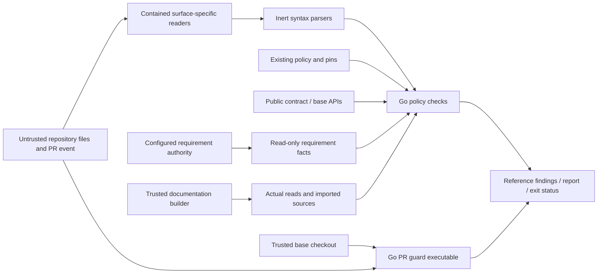

# Go repository governance checks

Issue #1799 ports the repo checks. It keeps the same policy authority.
Python remains the enforced reference until #1804.
Existing policy data, ADR pins, identity records, published schemas and historical evidence remain unchanged.

## Owners and public interfaces

The tooling layer owns `governance` and `cmd/policycheck`.
`Check(context.Context, Request)` evaluates one check and returns a `Report`.
Private functions group checks by their authority rather than by Python file boundaries.
Checks share the file reader. They use one finding type. They share exception handling and report output.
The model records each package API. It lists the allowed imports.

| Interface | Contract |
| --- | --- |
| `Request` | Named check, repository, changed paths, base/staged selection, requirement context and explicit modes |
| `Mode` | Evaluation, non-gating inventory or read-only closing-issue audit |
| `Finding` | Reference rule, message, nullable path and optional unavailable-governance status |
| `Report` | Ordered findings, evaluation status, report text and reference exit status |
| `Documentation` | Actual builder read records, source root, imported module files and approved module roots |
| `DocumentRead` | Document name and the file actually read |

The command keeps the same flags. It checks built output. It keeps report modes and issue audits.
Local issue fixtures use an explicit flag. The normal lookup does not use them.
An event cannot select a fixture or supply authoritative issue facts.
Reports say when governance was not checked. Optional mode may still exit with status zero.
Inventory and closing-issue audit modes never mutate issues.

The tooling module imports the public contract and base packages delivered by #1892.
Its version pins the merged commit. It needs no workspace or local-path replacement.
`contract/admission` owns semantic model validation; generic JSON Schema is not its replacement.
`base/clock` supplies the command's injected date.
`base/ingress` owns the strict object profile, and `base/canonjson` owns admitted finite canonicalization.
The tooling module imports no runtime code.

## Parsers and compatibility

The standard library handles files, Git processes, JSON transport, HTTP and hashing.
Maintained parser libraries supply syntax that the standard library does not support:

| Parser | Purpose |
| --- | --- |
| `go.yaml.in/yaml/v3` 3.0.5 | YAML syntax nodes, followed by each reference surface's scalar and alias rules |
| `gotreesitter` 0.56.0 and its packaged Python grammar | Inert Python syntax trees, compatible with the existing CGO-disabled architecture check |
| `goldmark` 1.8.7 | CommonMark links, images, code boundaries and reference definitions |
| `jsonschema/v6` 6.0.3 | Offline Draft 2020-12 validation of supplied candidate schema bytes |
| OPA 1.15.1 | The exact Rego engine used by locked Conftest 0.68.0 |

Parser types stay inside the package.
The parser reads Python source. It never runs it. Errors, incomplete trees and cancellation stop the check.
AST adapters preserve import, annotation and literal-assignment semantics, including the reference's negative cases.
The Markdown adapter handles MyST directive bodies without executing them.
It recurses only through bodies that the reference treats as Markdown.

Each reader keeps its surface's rules and limits.
Ordinary JSON retains last-member behavior; bounded object readers reject duplicate members.
Numbers retain their reference identity, including the integer digit limit.
The publication adapter keeps the legacy non-finite hash rules. Product ingress and canonicalization stay unchanged.
YAML dates are not timestamps. Constructor failures are not programming defects.
Some reference readers have no byte ceiling. The port adds none to those readers.
Coverage retains its source, carrier, schema, pointer and source-count limits.

Changed schemas come from the requested repo.
Coverage must not substitute the embedded base schema when inspecting a changed schema.
One loader reads legacy and sharded publication catalogs.
The artifact router supplies coverage routes; coverage does not maintain another route table.

OPA compiles and evaluates the unchanged Rego locally.
No policy service, telemetry or runtime policy retrieval is introduced.
The adapter keeps Conftest's namespace. It checks result metadata. It keeps the finding order.
Compile and evaluation failures cannot become successful empty evaluations.
The original Python tool and verified Conftest installation remain unchanged and enforced.

## Documentation boundary

#1803 owns replacing Sphinx and consumes the native documentation checks.
#1799 checks source, output and actual reads. It does not replace the Sphinx engine.
The unchanged Sphinx guard remains enforced until the cutover.

The native builder records its actual reads. It supplies these and imported module sources through `Documentation`.
Candidate markup cannot create these records. It cannot grant module exemptions.
Path checks resolve each read against the source root. They keep the approved module-source exception.
The checks still cover routes and redirects. They check search indexes and the sitemap. Published assets must keep identical bytes.
A refused read stays refused on later builds. A cached result cannot hide it.
The source scan and build records protect different boundaries. Both are needed.

## Trust and data flows

Repository reads use `os.OpenRoot` and reject unsafe paths before inspection.
Git calls use fixed argument arrays. They check revisions, use explicit paths and support cancellation.
No candidate title, body or path is interpolated into a shell command.
Requirement lookup uses the configured authority. This can be the repo or HTTP. Bad local records never trigger an HTTP fallback.
GitHub issue lookup remains read-only and repository-scoped.
Credentials and transport bodies never appear in operational logs or unexpected errors.

The PR guard executes only the event's base revision.
An additional Go job retains the existing base checkout and read-only permissions.
The introducing PR cannot execute a Go guard absent from its base.
Later missing or damaged validators fail rather than taking that bootstrap path.
The Python guard and its independently hashed two-file migration bundle remain intact.

The runtime split creates no additional normative owner.
`OpenRAE/rae` owns SDL and contracts; runtime owns its implementation.
Source identities include the repo and revision where the ownership plan requires them.
No source is transferred. No new repo, hosting service or duplicate authority is added.

## Acceptance and verification

The design commit comes before business logic. Native checks record that order.
`TestDeclaredDesign` exercises the actual model and a violating dependency fixture.
Other acceptance tests fail on missing policy behavior or missing workflow jobs.
`TestBaseRevisionGuard` runs the production validation step against base/head Git fixtures with an executable head sentinel.
`TestReferenceParity` compares full ordered findings and exit status against Python-recorded fixtures.
`TestHostedGates` inspects the concrete workflow jobs, commands and reference interpreter.
The source-to-test inventory lists all 37 in-scope reference files and their related test modules.
It is a review aid, not a second policy authority.

Boundary fixtures cover parser errors, duplicate profiles, real documentation reads and refused traversal.
Implementation adds cases for each input limit and error. It covers each applicable issue regression.
Positive cases prevent refusal-only implementations from satisfying parity.
Local checks select explicit cases. CI runs complete differential, race, coverage, mutation and fuzz checks.
No Python gate is removed, weakened or replaced before #1804.

## References

- [ADR-009](adrs/adr-009-normative-artifact-authority-and-repository-structure.md)
- [ADR-059](adrs/adr-059-adr-amendment-policy-and-pin-gate.md)
- [ADR-096](adrs/adr-096-identity-cutover-and-historical-record-boundary.md)
- [ADR-121](adrs/adr-121-go-engineering-standards.md)
- [ADR-122](adrs/adr-122-go-architecture-model.md)
- [Public package delivery](issue-1892-public-go-packages-design.md)
- [Runtime ownership](issue-1891-runtime-repository-boundary.md)
- [Contained filesystems](https://pkg.go.dev/os#Root)
- [Pure Go syntax trees](https://github.com/odvcencio/gotreesitter/tree/v0.56.0)
- [CommonMark parser](https://github.com/yuin/goldmark/tree/v1.8.7)
- [Conftest's engine version](https://github.com/open-policy-agent/conftest/blob/v0.68.0/go.mod)
- [OPA integration](https://www.openpolicyagent.org/docs/integration)

<!-- go-api implementations/tooling/go/governance 432c69eff6366cbd81537560f5462e5c3cf86ded5e530cae5ae3367699abf3f0 -->

<!-- go-api implementations/tooling/go/cmd/policycheck dd92019f9ac35814436893305a3163d7a7ce002936e9c6037a734e820cc1c2fa -->
