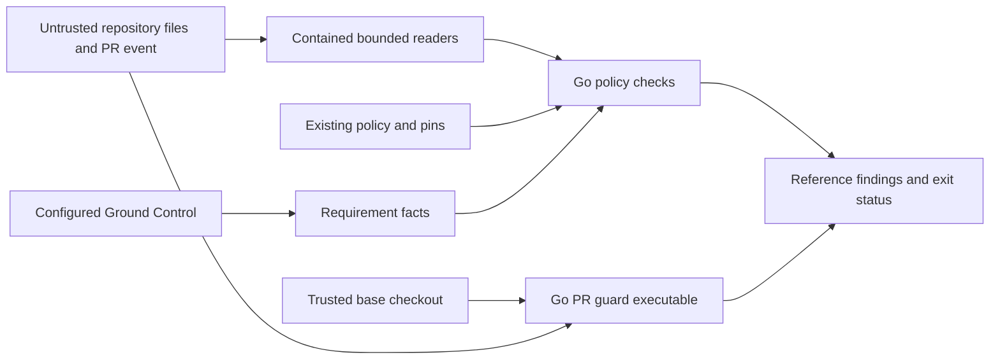

# Go repository governance checks

Issue #1799 ports repository checks without changing their policy authority.
Python remains the enforced reference until #1804.
The existing policy files, ADR pins, identity records and published schemas remain unchanged.

## Ownership and interfaces

The tooling layer owns `governance` and `cmd/policycheck`.
`governance.Check` checks one named policy through a typed `Request` and returns a `Report`.
`Finding` preserves `rule_id`, `message` and nullable `path` in reference order.
The command preserves each reference check's flags, status and JSON output.
Private helpers group checks by their authority, rather than by Python file boundaries.
The architecture model declares both packages and their exact interfaces.

The shared reader uses `os.OpenRoot` to contain file access.
It rejects absolute paths, traversal, secret-file components and escaping symlinks before reading.
JSON readers preserve each surface's number, duplicate-member, depth and byte rules.
One global strict-reader policy must not change reference verdicts.
YAML uses the existing maintained `go.yaml.in/yaml/v3` dependency.
Compatibility tests cover the reference parser's scalar and alias behavior.
The shared reporter applies existing exceptions with an injected date.
Nonwaivable findings remain nonwaivable.

The tooling module remains independent of product runtime code.
It must reuse the public contract and base APIs delivered by #1892.
The current implementations remain internal to the product module and cannot be imported here.
Generic JSON Schema validation does not replace the existing contract model checks.
The planned owners are `contract/admission`, `contract/validation`, `base/ingress`, `base/canonjson` and `base/clock`.
The command obtains its injected date through the established clock owner.
Declare and validate the exact tooling dependency after those public APIs exist.
Do not duplicate validators, bypass internal-package rules or add a temporary executable bridge.
This dependency must be delivered before the implementation design can be completed.
Published JSON validation remains offline.
The existing `arch` package owns Go dependency and interface checks.
The existing verified Conftest binary evaluates unchanged Rego policy.
The Go port retains applicable Python source checks while Python remains in the repository.
It does not treat the Go architecture checker as evidence about Python source.

## Design review repairs

The independent review requires structural repairs before business logic starts.
Full `archcheck` now validates actual APIs, imports and rule coverage.
Unused dependency permissions have been removed until their boundaries are wired.
The separate `archcheck -design` evidence remains part of the pre-implementation checks.

After #1892, complete the following boundaries against the available public APIs:

- Define the native documentation read boundary for the replacement builder owned by #1803.
  Keep the original Sphinx extension and its gate unchanged until cutover.
  Cover actual file reads, approved module sources, generated output and repeated builds.
- Select and declare a maintained Python syntax parser for the remaining source checks.
  Preserve syntax and AST behavior without substituting regular-expression scans.
- Complete typed request modes for build output, coverage reports, issue audits and check sets.
  Preserve unavailable-governance status in machine-readable output.
  Keep fixture facts separate from the production authority lookup.
- Add the executable base/head sentinel and compare complete ordered reference findings.
  Check specific workflow jobs and their invocations instead of global text matches.
  Record design chronology through native validation and commit evidence.
- Apply each reference reader's compatibility rules and limits at its own surface.
  Preserve duplicate-member behavior where the reference permits it.

The initial acceptance cases remain incomplete structural fixtures.
They do not establish the issue's full coverage or parity requirements.

## Trust and data flows

The PR guard executes only code checked out at the event's base commit.
The candidate contributes event data and repository bytes, never executable guard code.
The existing Python guard and its two independently hashed migration blobs remain intact.
An additional Go job uses the same base checkout and read-only permissions.
The introducing PR cannot execute a Go guard absent from its base.
Tests must distinguish that bootstrap from a later missing or damaged validator.
They plant an executable sentinel in a candidate head and verify it never runs.

Git calls use fixed argument arrays, validated revisions, explicit paths and context deadlines.
No input is interpolated into a shell command.
Ground Control and GitHub access retain the reference endpoints, authentication and read-only operations.
Redirects cannot forward credentials to another origin.
Transport failures remain distinct from policy success and from optional unavailable governance.
Errors and logs do not disclose event contents, tokens or file values.

## Check families

| Family | Preserved authority and behavior |
| --- | --- |
| Repository and requirements | Existing Rego, module ownership, exceptions, requirement ordering, scope and traceability |
| ADR and identity integrity | Canonical ADR hashing, amendment comparisons, exact historical content and occurrence counts |
| Contract publication | Publication and removal ledgers, stable-schema compatibility, fixture routing and coverage evidence |
| Authority and assurance | Approved roots, classification, formal evidence, deprecation records and documentation consistency |
| Concepts and vocabularies | Existing catalogs, linkage, reference resolution, provenance and identity rules |
| Documentation and PRs | Public-document containment, markup targets, redirects, conventional titles, body sections and issue scope |

The runtime split does not create another normative owner.
`OpenRAE/rae` owns SDL and contracts; runtime owns its implementation.
Cross-repository identities include their repository and revision where the existing ownership plan requires them.
The checks consume existing source identities and never fetch or publish another repository.

## Acceptance and verification

Each issue criterion maps to an executable test in `governance/acceptance_test.go`.
The initial structural commit refuses unsupported checks and contains red acceptance assertions.
Implementation adds table-driven tests beside each private check family.
A source-to-test crosswalk accounts for every in-scope reference guard and issue regression.
Differential fixtures compare complete machine findings, order and verdicts against unchanged Python.
Positive fixtures prevent an implementation that merely refuses all inputs from passing.
Boundary tests cover paths, malformed inputs, limits, pins, credentials and failed dependencies.
The base-revision test must exercise an executable candidate sentinel.

Local checks select explicit Go tests and file-local repository policy.
CI retains the existing full tests, race, coverage, lint, architecture and regression checks.
Exhaustive mutation and fuzz suites run only in CI under the existing configured lanes.
No new service, policy waiver, replacement authority or schema change is introduced.

## References

- [ADR-009](adrs/adr-009-normative-artifact-authority-and-repository-structure.md)
- [ADR-059](adrs/adr-059-adr-amendment-policy-and-pin-gate.md)
- [ADR-096](adrs/adr-096-identity-cutover-and-historical-record-boundary.md)
- [ADR-121](adrs/adr-121-go-engineering-standards.md)
- [ADR-122](adrs/adr-122-go-architecture-model.md)
- [Runtime ownership](issue-1891-runtime-repository-boundary.md)
- [Go contained filesystem API](https://pkg.go.dev/os#Root)
- [Maintained YAML library](https://go.yaml.in/yaml/v3/)
- [GitHub pull request event](https://docs.github.com/en/actions/reference/workflows-and-actions/events-that-trigger-workflows#pull_request)

<!-- go-api implementations/tooling/go/governance 5c3b9c2e641e39fa7ca224aa0920db3179898d76edc98109f7100137b31e7289 -->

<!-- go-api implementations/tooling/go/cmd/policycheck dd92019f9ac35814436893305a3163d7a7ce002936e9c6037a734e820cc1c2fa -->
