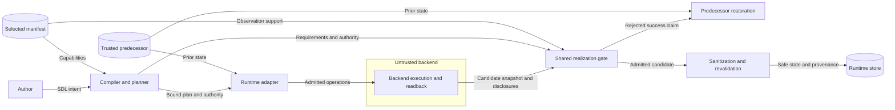

# Open concern readback

## Architecture

SEM-218 owns realization semantics.
The processor owns concern validation and corroboration.
The runtime owns backend result acceptance and storage.
ADR-036 preserves these package boundaries.

The shared evaluator serves both public planner interfaces:
`realization_disclosure` and `realization_authority_disclosure`.
An applicable open concern with a verification floor requires an explicit report.
A missing value does not establish an empty concern.
An explicit empty collection uses the existing concern validator and corroboration checks.
A valid reported value produces backend realization provenance.
An absent report produces no success provenance.

The requirement's verification scope and observation strength select the evidence contract.
Concerns without a verification floor retain their existing omission behavior.
Missing operations and DELETE operations retain their existing applicability rules.
The planner still admits authored-empty open concerns without observation capability.
Planning admission does not establish successful execution.

The concern registry owns payload paths and safe projections.
The existing observation matcher owns identity matching.
The manifest checker owns capability, posture, scope, and source compatibility.
No parallel concern registry or backend-specific rule is needed.

## Data flows and trust boundaries

The runtime validates result shape, identity, authority, and change accounting before semantic acceptance.
Sanitization and revalidation precede storage.
Observation disclosures remain transient.
Existing snapshot codecs preserve accepted provenance.
No new deployment component requires another diagram.

## Security and failure behavior

The protected assets are realization integrity, provenance, prior state, and confidential values.
The backend result crosses the trust boundary shown above.
An omitted report can conceal a backend addition.
Explicit readback and corroboration prevent omission from becoming a success claim.
Behavioral tests exercise both public interfaces and the runtime adapter.

Malformed reports use the existing closed validators.
Insufficient disclosures use the existing scope, source, identity, and manifest checks.
Diagnostics contain concern identifiers and coarse reasons.
They contain no reported values or credentials.
Existing credential sanitization and post-sanitization validation remain binding.

Rejected success claims retain the trusted predecessor and clear candidate changes and details.
Unchanged resources retain their trusted provenance.
Failed apply inventory remains available for cleanup without acquiring success provenance.
Failure still cannot change resource identity, closed authority, or protected values.

The public planner interface `realization_cleanup_diagnostics` validates failed apply inventory.
It first validates the original plan authority.
Its local comparison projection removes verification floors only for omitted, unstructured open concerns.
All supplied concern values retain their original checks.
The submitted plan remains unchanged.
Cleanup validation returns diagnostics without success provenance.
The runtime selects this interface only for a failed result.
No caller-controlled evidence bypass flag is added to successful disclosure interfaces.

A dishonest backend can falsify both its report and its observation metadata.
This correction does not establish independent observer isolation or physical rollback.
No new observer, collection service, network transfer, or authentication surface is needed.

## Supporting artifacts

The SEM-218 specification and its reference explanation describe the explicit-report rule.
The existing module policy already enforces ownership and import direction.
No policy configuration or architecture configuration change is required.
No new ADR is required because ADR-036 already assigns these responsibilities.
No published schema or carrier changes are required.
Concern descriptors remain the extension point for future concern kinds.

## References and document review

[Python constants](https://docs.python.org/3.14/library/constants.html), Python 3.14, defines `None` as an absence value.
The existing identity sentinel keeps omitted values distinct from explicit values and Python truthiness.
[NIST SP 800-160](https://csrc.nist.gov/pubs/sp/800/160/v1/r1/final), Volume 1 Revision 1, Appendix E, describes mediated access and protective failure.
The runtime gate applies these design principles before accepting state.
[ASD-STE100](https://www.asd-ste100.org/assets/files/ASD-STE100_ISSUE9.pdf), Issue 9, sections 1, 3, 4, 6, and 9, guides document review.
The review checks technical nouns, active verbs, short sentences, paragraph scope, and document purpose.
Implementation tasks and test commands belong in the issue plan.
