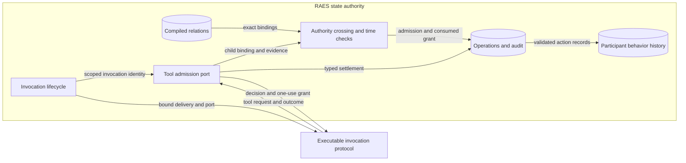

# Participant delivery invocation and tool actions

Issue: #1829. Status: proposed implementation design.

## Scope

The issue acceptance criteria define RAES behavior.
The design covers SDL, validation, compiled intent, public contracts and the Python runtime.
It assumes no particular application, transport or deployment.
Implementation choices follow the core semantics and the existing architecture.

## Required behavior

A delivery invocation can host tool actions without an autonomous policy.
Delivery, control acceptance, invocation dispatch and each tool action remain separate facts.
A delivery receipt is not a tool action grant.
Each child requires exact binding, current authority, crossing and temporal checks before dispatch.
Each dispatch grant can be consumed only once.
Each admitted child retains its own identity, outcome and behavior history.
Unknown effects remain fenced until explicit resolution.

## Existing owners to reuse

- `raes_contracts` owns neutral contracts, validation and history semantics.
- `raes_processor` owns exact compiled participant, action, tool, observation and target relations.
- `raes_backend_protocols` owns executable invocation and tool-port interfaces.
- `raes_runtime` owns admission, dispatch, state authority, settlement, recovery and audit.

ADR-104 supplies the single runtime owner and profiled store guarantees.
ADR-108 supplies independent action permission and exact-cut evaluation.
ADR-110 separates control occurrences from concrete effects.
ADR-112 separates delivery from world execution.
ADR-113 supplies bounded execution adapters under runtime semantic authority.
ADR-118 supplies injected wall timestamps.
ADR-121 supplies package dependency direction.

## Invocation contract

`invoke_participant_delivery` accepts a typed request and authenticated principal.
The request names a retained delivery operation and an implementation manifest and selection.
The runtime resolves all other coordinates through installed compiler context and retained records.
It checks the delivery's original actor and audience, the live episode, and current authority.
An exact request key returns its retained receipt without invoking again.
A different request under that key conflicts.
A delivery can establish only one invocation in its original scope.

The invocation is a `COMPOSITION_PHASE` operation in the existing operation ledger.
Its retained binding names the delivery, participant, episode, implementation and execution generation.
Generation comes from the runtime execution owner.
It is not a clock segment, history index or snapshot revision.
A running claim is stored before the executable invocation protocol is called.
The protocol returns a typed outcome, not a replacement runtime snapshot.

The runtime supplies one invocation tool port to that call.
It closes the port on return, invalid outcome, raised failure, timeout and cancellation.
A failed or invalid enclosing call does not erase accepted child history.
The existing store and recovery owners retain uncertain effects without redispatch.

## Tool action composition

The new composition is `participant-invocation-tool-actions/v2`.
The published v1 composition retains its autonomous-only meaning.
V2 admits delivery invocations without claiming autonomous scheduling support.
Registration requires the executable delivery invocation method for that claim.
Both versions retain finite action and concurrency bounds.

The compiler exposes tool relations independently of autonomous policies.
A relation contains the authored participant, affordance, action, boundary, targets and interaction footprint.
The runtime uses that public compiled relation and the admitted manifest execution offers.
It does not construct an autonomous policy for a delivery invocation.

Each child receives an identity derived from the invocation, episode, generation and tool call identity.
Admission validates its binding and resolves an exact live authority cut.
The installed resolver supplies control order, active grants, scope and evidence.
Its request reference must name this exact child.
Crossing evidence remains distinct from the authority cut.
The existing crossing and final sink owners evaluate the exact child request.
Admission and dispatch use distinct, content-bound crossing references.
They retain one child action identity; dispatch includes the actual dwell evidence.
A transformed request is revalidated.
A transformation that replaces the child identity is refused.
The port returns the exact canonical binding only after admission.
The original request cannot consume a grant for a different governed subject.

The runtime commits crossing authorization through the existing participant transition transaction.
A dispatch rechecks live authority, current crossing policy, time and conflicting effects.
The consumed child grant commits before the port acknowledges dispatch.
Unknown effects keep their reservation and close further effect admission.

## State ownership and progress

The existing mutation authority issues a private invocation-child scope.
It is bound to the parent's held effect reservation and revoked when the invocation closes.
Only runtime-owned tool handlers receive that scope.
It gives those handlers short state-writer cuts while the parent waits outside the writer.
Ordinary extension callbacks still cannot start arbitrary runtime mutations.
Each handler verifies parent liveness and immutable actor, target and run scope.

A leaf state lock protects only local port bookkeeping.
It never spans an installed resolver or executable callback.
Concurrent operations on one port are bounded and conflicting state transitions refuse.
The parent and child handlers use the existing bounded execution and store adapters.
They create no private executor or unbounded work queue.
Cut revision and scope liveness are checked again after foreign callbacks.
A late callback cannot publish after the invocation scope closes.

## Shared time and history

The temporal compiler supplies the exact bindings of each authored child action.
The runtime derives child-specific contexts from authoritative clock state at admission.
The port returns the bound request so temporal evidence can name that exact context.
Pre-dispatch checks use current clock state and the declared bounds.
Dwell evidence must establish the bound condition before dispatch.
Each terminal child observation carries runtime-owned assessments against retained clock history.
No wall timestamp or native success substitutes for shared logical-time evidence.

V2 history context names the invocation and its delivery operation.
It does not claim that delivery was an outer participant action.
Each child retains the existing ordered three-event action history.
The runtime commits settled child history together with its terminal record and audit.
History publication uses current authoritative state and history-head checks.
No outer result can replace it with a stale snapshot.
Withheld and unknown outcomes retain their actual native disposition.

## Security and data flow

Assets are dispatch authority, native effect knowledge, private content and immutable history.
Every request and outcome across the executable protocol boundary is untrusted.
The runtime validates detached copies through the canonical contract models.
The port grants only the exact authored and currently permitted action.
It holds no tool credentials or arbitrary native payload.
Refusals and isolated foreign failures use existing fixed diagnostic categories.

The executable protocol is a trust boundary, not another semantic state owner.
RAES records reported native effects and evidence; it cannot prove an implementation reports honestly.

## Architecture and policy

The design retains ADR-104's single state owner and ADR-113's bounded execution machinery.
The new private child scope must not become a general mutation bypass.
ADR-121's contract, protocol, compiler and runtime layers remain in force.
The existing import policy enforces package direction without a new policy gate.
V2 extends the invocation composition specification and public support documentation.
Published shape changes require fixtures, publication change records and schema generator equality.
Release Please retains version and changelog ownership.
The issue plan contains implementation tasks; this document states system behavior.
The prose review checks short sentences, consistent terms and document purpose.

## Qualification

Use executable tests through the public runtime boundary.
Exercise exact binding, authority denial, crossing decisions, time evidence and expiry.
Exercise replay, conflicting identity, concurrency, cancellation and invalid outer results.
Exercise failed store writes and durable recovery without native redispatch.
Replay the applicable contract and history validators on retained records.
Use targeted local checks; broad, integration and fuzz suites belong to CI.

## Reference patterns

Primary sources were read on 2026-11-01.
These establish patterns rather than RAES conformance.

- Python 3.14 `contextlib`: unconditional cleanup across exceptional paths.
  <https://docs.python.org/3.14/library/contextlib.html>
- NIST SP 800-207, August 2020: authenticate and authorize resource access before establishing permission.
  <https://csrc.nist.gov/pubs/sp/800/207/final>
- Temporal Python asynchronous activities: execution and its tracked lifecycle can be separate.
  <https://docs.temporal.io/develop/python/activities/asynchronous-activity>
- Envoy external authorization: later transformations can invalidate an earlier permission decision.
  <https://www.envoyproxy.io/docs/envoy/latest/configuration/http/http_filters/ext_authz_filter>

## Acceptance evidence for issue 1829

- [x] Delivery-owned execution without an autonomous policy: `implementations/python/packages/raes_runtime/participant_delivery_invocation.py:36`; public boundary test in `implementations/python/tests/test_issue_1829_delivery_tool_actions.py:125`.
- [x] Exact binding, live authority, originating control and one-use grants: `implementations/python/packages/raes_runtime/participant_delivery_tool_admission.py:140` and `implementations/python/packages/raes_runtime/participant_delivery_tools.py:265`; gate tests in `implementations/python/tests/test_issue_1829_delivery_tool_gates.py:115`.
- [x] Child time contexts, proof checks and assessments: `implementations/python/packages/raes_runtime/participant_temporal_binding.py:11` and `implementations/python/packages/raes_runtime/participant_delivery_tool_settlement.py:26`; dwell and deadline tests in `implementations/python/tests/test_issue_1829_delivery_tool_gates.py:45`.
- [x] Independent child history through outer failure and cancellation: `implementations/python/packages/raes_runtime/participant_delivery_tool_settlement.py:26`; public tests in `implementations/python/tests/test_issue_1829_delivery_tool_actions.py:310`.
- [x] Exact retries, conflicting identity refusal and recovery without effect replay: `implementations/python/packages/raes_runtime/participant_delivery_tools.py:179` and `implementations/python/packages/raes_runtime/participant_delivery_tool_recovery.py:15`; restart test in `implementations/python/tests/test_issue_1829_delivery_tool_actions.py:349`.
- [x] Single-writer ownership, scope closure, reservations and bounded supervision: `implementations/python/packages/raes_runtime/control_plane_mutation.py:304` and `implementations/python/packages/raes_runtime/participant_delivery_invocation.py:118`; timeout and conflict tests in `implementations/python/tests/test_issue_1829_delivery_tool_gates.py:291`.
- [x] Executable public-boundary tests and retained-record validators: the three `test_issue_1829_delivery_*` modules; settlement calls the existing participant-state and temporal-history validators.
- [x] Public behavior and contracts documented: `docs/public/guides/invocation-tool-actions.md`, the delivery-tool formal contract, ADR-092 section 10 and the published schema fixtures. The feature delivery uses the existing Release Please process.

The release part of the last criterion remains pending until the reviewed
change is merged and the existing release workflow publishes the Python
artifact. PR readiness does not establish that release criterion.
