# Cloud audit log configuration

Issue: #1831. The normative owner is `specs/sdl/cloud-resource-access.md`.

## Architecture and decision

`RuntimeIdentityResourceScope.audit_logs` contains optional typed recording requirements.
Each record has `audit_log_id`, `service`, `log_type`, and optional `exempted_principal_refs`.
The record ID is local to its scope.
The service and log type retain native spelling and provider meaning.
They are not endpoint references or portable enumerations.
Each service and log-type pair occurs at most once per scope.
Exemptions name exact identity subjects, including subjects from other scopes.
An omitted or empty collection adds no recording requirement.
Existing explicitness and closure rules still apply.
Core does not calculate effective inheritance or expand native wildcards.

The public model lives in `raes.runtime_identity_resources`.
The directory-identity and runtime-configuration facades export it.
The runtime-family registry supplies nested collection identity and exact addresses.
The cloud validator checks exemption references.
The cloud composition helper rewrites only those references.
The existing `runtime-identity-authorities` concern retains every setting.
Compilation, plan transport, snapshot storage, and materialized descriptions use existing carriers.
No new backend, persistence layer, credential resolver, or top-level section is needed.

Backend manifests and validation admit supported configuration before effects.
An older identity backend must refuse an audit setting it cannot implement.
Support for the broad concern does not permit silent omission.
Readback must retain the requested configuration and exemptions.
Configuration readback does not require traffic generation or log retrieval.
Provider mutations must preserve unrelated policy and use native concurrency controls.
A provider that needs additional undeclared settings must refuse the request.

## Data flows and security

```mermaid
flowchart LR
  Author[Scenario author] -->|Untrusted SDL| Parser[Parser and cloud validator]
  Parser -->|Typed scope recording requirements| Compiler[Compiler and planner]
  Manifest[Backend manifest] -->|Support declarations| Admission[Runtime admission]
  Compiler -->|Portable plan| Admission
  Admission -->|Admitted settings only| Backend[External backend]
  Backend -->|Configuration readback| Results[Result admission]
  Results -->|Accepted typed state| Store[(Snapshot and materialized SDL)]
  Store -->|Authorized view| Reader[Operator or participant]
```

The parser separates untrusted text from typed configuration.
Runtime admission separates authored intent from permitted native effects.
Result admission separates backend claims from accepted state.
Existing caller authorization and information-flow policy govern these boundaries.

| Threat | Control | Verification |
| --- | --- | --- |
| Invalid settings or conflicting rules enter a plan. | Closed bounded models and duplicate checks. | Invalid shapes and collisions after binding. |
| An exemption names the wrong resource. | Exact subject references. | Dangling and wrong-kind reference rejection. |
| Import rewriting changes provider meaning. | Rewrite reference fields only. | Repeated imports preserve native strings. |
| An older backend ignores logging requirements. | Concern admission and backend validation before effects. | Refusal with zero apply calls. |
| A backend reports success with weaker settings. | Existing typed configuration comparison. | Missing rules and altered exemptions fail comparison. |
| Settings disclose credentials or authorize log export. | Metadata-only records and existing authorization. | Unknown-field rejection and safe parser diagnostics. |

Audit configuration grants no access right or collection authority.
It does not prove that a log event exists.
No log destination, retention policy, or live-provider qualification is added.
Residual risks include native operational failures and dishonest backend evidence.

## Existing patterns and governance

The #1653 cloud design supplies ownership and lifecycle patterns.
`SDLModel`, `NativeIdentity`, `PortableIdentifier`, and `reject_duplicates` supply model checks.
The registry, cloud validator, and composition helper remain the reference owners.
The realization concern registry and runtime admission remain the execution owners.
Published schemas remain authority under ADR-009.
Their publication entries record each changed hash and contract summary.
The model generator must produce identical schemas.
Existing parser and schema checks supply policy as code.
Portable schemas reject blank native names and repeated exemption references.
The scope publishes its uniqueness rules through the existing semantic-invariant profile.
The invariant calls the public scenario model validator, which checks each scope.
The typed models and registry supply architecture as code.
No new structural gate or requirement UID is introduced.
ADRs 032, 105, 115, 117, and 121 retain their current meaning.
No ADR change is needed because the existing owners cover this extension.

## Sources and document review

Sources were read on 2026-11-01.

| Source | Version and section | Use |
| --- | --- | --- |
| [GCP AuditConfig](https://docs.cloud.google.com/resource-manager/reference/rest/Shared.Types/AuditConfig) | REST v1, AuditConfig and AuditLogConfig | Native service, type, and exemption meaning. |
| [GCP configuration guide](https://docs.cloud.google.com/logging/docs/audit/configure-data-access) | Current, configuration overview | Preserve native inheritance; separate recording from retrieval. |
| [Enterprise foundations](https://docs.cloud.google.com/architecture/blueprints/security-foundations) | Reviewed 2025-05-15, defense in depth | Separate detective controls, policy, and resource hierarchy. |
| [AWS EventSelector](https://docs.aws.amazon.com/awscloudtrail/latest/APIReference/API_EventSelector.html) | Current API, contents | Do not equate provider log categories. |
| [Azure diagnostic settings](https://learn.microsoft.com/en-us/azure/azure-monitor/data-collection/diagnostic-settings) | Current, sources and destinations | Refuse unsupported destination requirements. |
| [ASD-STE100](https://www.asd-ste100.org/assets/files/ASD-STE100_ISSUE9.pdf) | Issue 9, rules 1, 5, and 6 | Technical nouns, short sentences, and gradual descriptions. |

The review checked approved verbs, technical nouns, sentence length, and document purpose against the official standard.
Automated prose checks supplement this review.
