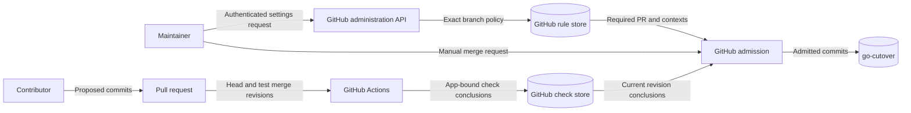

# Go integration branch admission

## Design

GitHub owns branch admission. An active `merge-policy-go-cutover` ruleset matches
only `refs/heads/go-cutover`. It requires pull requests and successful checks.
The existing legacy protection remains in place. Its administrator enforcement,
force-push prohibition, deletion prohibition, and non-strict check policy remain.

No bypass actors are configured. Administrators must meet the checks.
An administrator can change repository settings; that authority remains a residual risk.
The maintainer selects each merge manually. Zero required review approvals preserve
the single-maintainer model. Automatic merging remains disabled.

Use the existing workflow graph without copying its commands or module inventory.
`verify` covers mutation, architecture, and parity through the canonical aggregate.
`sonar` remains a separate quality check. Require the observed security, compatibility,
fuzz, and PR-policy contexts separately. Bind each context to its observed GitHub App.
Keep the existing non-strict base-update policy. A new head still needs its own checks.

## Security and data flows

The API credential crosses the local host boundary through existing CLI authentication.
Do not record credentials. The rules and check stores cross the contributor trust boundary
at admission. Required PRs prevent direct updates. App bindings reduce check impersonation.
Existing workflow review and base-loaded PR validators protect the check producers.
The aggregate rejects failed, cancelled, or unexpectedly skipped dependencies.
GitHub can accept neutral or skipped individual checks; document this platform limitation.

Read back the effective rules and legacy protection through the API.
Observe a mergeable, non-draft PR with a failed or pending required check and blocked merge state.
Conflicts alone do not prove check enforcement. Never attempt a merge as a test.

## Existing owners and limits

The preflight identifies the canonical workflow, security, architecture, and parity owners.
No product module, public interface, schema, or runtime architecture changes.
The native ruleset is the policy model; no reconciliation service is needed.
ADR-014 and the existing Go ADRs remain authoritative and need no new decision.
Go push Sonar guards exclude this branch; same-repository PR analysis supplies admission evidence.
Fork and Dependabot secret restrictions remain in force.

## References

- [GitHub REST rules API](https://docs.github.com/en/rest/repos/rules), current REST documentation:
  Create a repository ruleset; Get rules for a branch. Defines native fields and effective rules.
- [GitHub branch protection](https://docs.github.com/en/rest/branches/branch-protection), current REST documentation:
  Get branch protection. Defines the incumbent protection evidence.
- [Protected branches](https://docs.github.com/en/repositories/configuring-branches-and-merges-in-your-repository/managing-protected-branches/about-protected-branches),
  Require status checks. Defines merge admission and administrative authority.

The official STE website returned HTTP 403 during research. The prose uses short,
direct sentences; this is not a claim of certified STE compliance.

## Live enforcement evidence

On 2026-11-03, the API returned active ruleset `26422222` for exactly
`refs/heads/go-cutover`. Its bypass list was empty. The authenticated administrator
received `current_user_can_bypass: never`. Legacy administrator enforcement remained active.
The repository returned `allow_auto_merge: false`.

[PR #1879](https://github.com/OpenRAE/rae/pull/1879) targets `go-cutover`.
At head `9856498860d5e38fac785e924c691f91f0a039f9`, GraphQL returned
`isDraft: false`, `mergeable: MERGEABLE`, and `mergeStateStatus: BLOCKED`.
Its check rollup was `PENDING`. Required contexts included in-progress
`title-guard`, `body-guard`, `supply-chain`, `fuzz`, and language analysis jobs.
These check runs identified GitHub Actions App `15368`. GitGuardian App `46505`
had passed. The PR had no automatic merge request. The rule required zero approvals.
Thus neither conflicts, draft state, nor missing approvals explained the blocked state.
No merge or direct push was attempted as a test.

The user authorized publication before review to obtain this live evidence.
The remaining review and hosted checks still apply before readiness.

## Delivery finalization

The existing Ground Control Phase E workflow must include `go-cutover` in its
closed-PR branch filter. Its current filter includes only `main` and `dev`.
Without that event, a merged Go delivery cannot automatically close its issue.
Extend only the branch filter. Retain the merged-PR guard, pinned executable,
merged-revision checkout, permissions, trusted handoff, and manual dispatch path.
The existing finalizer owns this behavior; no new interface or service is needed.

The data flow adds a GitHub closed-PR event to the existing finalizer process.
That process reads the trusted handoff and writes the final report and issue state.
Its existing merge and provenance checks remain the security boundary.
A targeted workflow test must reject omission of the Go branch and preserve the merge guard.

The reference is [GitHub workflow events](https://docs.github.com/en/actions/reference/workflows-and-actions/events-that-trigger-workflows),
current documentation, `pull_request` closed events and branch filters.
