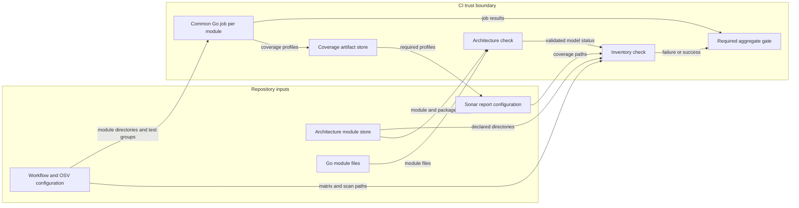

# Go module verification coverage

## Architecture

The module list in `implementations/architecture.json` is the authority.
The existing `archcheck` reconciles this list with discovered `go.mod` directories.
The inventory adapter reads declared module directories after that check succeeds.
It reads the model with the same 4 MiB limit as `archcheck`.
It adds no module discovery or architecture schema parser.
It requires equal module sets in the `go` matrix and the OSV scan targets.
It requires one unique matrix name and at least one test group per module.
Each module must have exactly its declared number of rows in the `go-test` matrix.
Each test group row must name its module and the module path.

The ADR-123 workflow tests own the gate commands.
The adapter owns the reach of those commands.
A module step runs in `${{ matrix.path }}` in the `go` or `go-test` job.
Each module step must reach every module and fail the job on error.
A condition on a workflow input applies to all modules alike.
A condition on the matrix module can exclude a module.
An excluded module then needs the same script in another required job, in its module directory.
For example, product fuzzing runs in the `go-architecture` job.
The adapter rejects any other step condition.
Each module must run `go build ./...` in a module step.
The compiler-cycle proof uses this command.

The `go`, `go-test`, and `go-architecture` jobs must be required by the aggregate gate.
Each of these jobs uses the admitted readonly toolchain without a workspace.
The adapter also reconciles coverage uploads, Sonar downloads, and Sonar report paths.
Missing coverage files fail artifact upload.
The required `go-architecture` job runs the adapter after its architecture check.

The Python `tools.check_go_module_inventory` module owns the check.
Its public interface is `check_inventory(root, scan_targets)` and its module command.
It reuses the closed workflow parser and the existing OSV configuration.
Small private functions check module paths, matrix settings, step reach, coverage, and scan targets.
They return the same policy failures through the public inventory check.
A missing or invalid workflow entry fails with the name of that entry.
The command adds checkout package paths before it imports repository code.
`--scan-reports` requires each expected OSV report after successful scans.
No Go package, schema, architecture dependency, or runtime interface changes.
ADR-123 and ADR-124 already require these gates; this change enforces their coverage.

## Security and data flows

The protected asset is the CI verdict.
A module omitted from a list can bypass compiler and dependency checks.
The equality check blocks this omission at the source configuration boundary.
The common job uses the admitted toolchain, `GOTOOLCHAIN=local`, and readonly dependency resolution.
The check reads repository files. It neither executes module contents nor sends data outside CI.
Pull request code remains untrusted. Go and inventory jobs use read-only tokens.
A reviewed workflow change can change the enforcement itself. Review and the workflow tests cover this residual risk.

## Integration branch

This Go cutover change targets `go-cutover`.
The Ground Control workflow sets `base_branch` to `go-cutover` on this branch.
An absent value defaults to `dev` and starts an incorrect merge during publication.
The explicit value keeps synchronization and PR creation on the same base.
Reset this value when the cutover branch returns to the normal integration path.

## Verification and references

Focused fixture tests add a declared module without matrix or scan entries.
Other tests remove coverage paths, test groups, and module steps.
Other tests add module conditions, unsupported conditions, and soft failures.
The check also reconciles Sonar source roots and OSV report uploads.
Explicit lint configuration supports module directories at different depths.
`GOWORK=off` prevents a local workspace from changing dependency resolution.
ADR-124 version 2 rejects declared package cycles in `archcheck`.
A two-package code import cycle must fail the common compiler command.
The `go-architecture` job runs that proof with `RAES_GO_COMPILER_GATE=required`.
In that mode, a missing toolchain fails the proof instead of a skip.
The fixture reads its Go version from the tooling module.
Local runs use focused tests only. CI runs full module and mutation verification.

- [Go Modules Reference](https://go.dev/ref/mod), Go 1.27: module roots and readonly build commands.
- [GitHub matrix jobs](https://docs.github.com/en/actions/how-tos/write-workflows/choose-what-workflows-do/run-job-variations): matrix includes and job failure behavior.
- [ADR-123](adrs/adr-123-go-engineering-standards.md): common module gates.
- [ADR-124](adrs/adr-124-go-architecture-model.md): module discovery and compiler enforcement.

The document uses short sentences and consistent technical names.
The official STE website refused automated access with HTTP 403; no claim of certified STE compliance is made.

## Migration reference refresh

New verification tests change the source identity of the frozen Python input set.
Use the existing CI capture and frozen-input replay path to refresh that reference.
Import only a complete capture from the current source identity after its credential scans pass.
Keep the exact reproduction check and the Go comparison gates enabled.
The next CI run must accept the frozen inputs and reproduce the imported cases.
Issue #1872 removes the corpus and its migration harness after the hard cutover.
