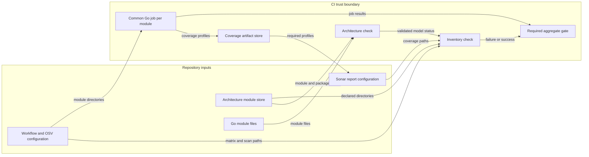

# Go module verification coverage

## Architecture

The module list in `implementations/architecture.json` is the authority.
The existing `archcheck` reconciles this list with discovered `go.mod` directories.
The inventory adapter reads declared module directories after that check succeeds.
It adds no module discovery or architecture schema parser.
It then requires equal module sets in the Go matrix and OSV scan targets.
It requires one unique matrix name per module.
Tooling and product modules keep their existing names and paths.
Each matrix entry runs the same compiler, dependency, lint, analyzer, test, coverage, fuzz, mutation, and regression gates.
The check also reconciles coverage uploads, Sonar downloads, and Sonar report paths.
Missing coverage files fail artifact upload.
The required `go-architecture` job runs this check after its architecture check.
The aggregate gate requires both the architecture job and every matrix job.

The Python `tools.check_go_module_inventory` module owns the check.
Its public interface is `check_inventory(root, scan_targets)` and its module command.
It reuses the closed workflow parser and the existing OSV configuration.
The command adds checkout package paths before it imports repository code.
`--scan-reports` requires each expected OSV report after successful scans.
No Go package, schema, architecture dependency, or runtime interface changes.
ADR-121 and ADR-122 already require these gates; this change enforces their coverage.

## Security and data flows

The protected asset is the CI verdict.
A module omitted from a list can bypass compiler and dependency checks.
The equality check blocks this omission at the source configuration boundary.
The common job uses the admitted toolchain, `GOTOOLCHAIN=local`, and readonly dependency resolution.
The check reads repository files. It neither executes module contents nor sends data outside CI.
Pull request code remains untrusted. Existing read-only CI tokens and secret boundaries remain in force.
A reviewed workflow change can change the enforcement itself. Review and the workflow tests cover this residual risk.

## Integration branch

This Go cutover change targets `go-cutover`.
The Ground Control workflow sets `base_branch` to `go-cutover` on this branch.
An absent value defaults to `dev` and starts an incorrect merge during publication.
The explicit value keeps synchronization and PR creation on the same base.
Reset this value when the cutover branch returns to the normal integration path.

## Verification and references

Focused fixture tests add a declared module without matrix or scan entries.
Other tests remove coverage paths and required lanes.
The check also reconciles Sonar source roots and OSV report uploads.
Explicit lint configuration supports module directories at different depths.
`GOWORK=off` prevents a local workspace from changing dependency resolution.
A two-package import cycle must fail the common compiler command.
Local runs use focused tests only. CI runs full module and mutation verification.

- [Go Modules Reference](https://go.dev/ref/mod), Go 1.27: module roots and readonly build commands.
- [GitHub matrix jobs](https://docs.github.com/en/actions/how-tos/write-workflows/choose-what-workflows-do/run-job-variations): matrix includes and job failure behavior.
- [ADR-121](adrs/adr-121-go-engineering-standards.md): common module gates.
- [ADR-122](adrs/adr-122-go-architecture-model.md): module discovery and compiler enforcement.

The document uses short sentences and consistent technical names.
The official STE website refused automated access with HTTP 403; no claim of certified STE compliance is made.
