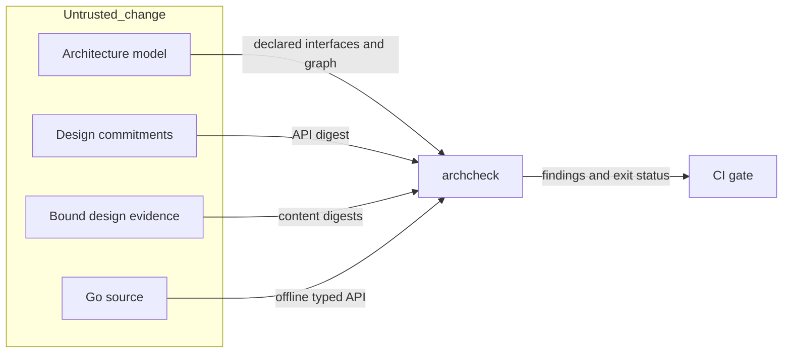

# Go architecture contract checks

## Scope and ownership

Issue #1859 extends ADR-122. The `arch` package owns all checks.
The `archcheck` command remains the public command interface.
`Model.CheckDesign`, `Model.CheckDocuments`, and `Model.CheckAPI` separate the three checks.
`LoadAPI` reads actual type information. `Model.View` renders the current model.
No product package or runtime schema changes.

## Interface contract

Model version 2 records build configurations and each package's intended API.
The API records the declared package name.
It uses standard `go/types` object and type strings, sorted by identity.
Constants include exact values. Variables include inferred types.
Types include aliases, generic constraints, exported fields, tags, and embedded members.
Reachable private types and exported pointer/value method sets are included.
Dependency-owned types reached through aliases and embedded fields are included.
Private function bodies and unrelated private declarations are excluded.
Struct snapshots record comparability and private-field restrictions on positional literals.

Each package links its owning design. That design commits to its API digest.
The digest covers every declared build configuration.
Use Go encoding/json.Marshal bytes, including its default HTML escaping.
A snapshot update without that design commitment fails.
The design check needs only the model and design files, never product code.
The normal check loads each configuration with the admitted Go package loader.
Go resolution is offline and read-only. No proposed code runs.
Every production source file must appear in a supported configuration.
An uncovered platform or build tag fails and requires an explicit configuration.

The existing package graph rejects cycles before code exists.
It remains separate from the permitted layer graph.

## Current system view

The current overview is `docs/develop/go-architecture.md`.
Its generated block contains layers, package ownership, status and dependency edges.
The checker compares that block with deterministic output, without writing it.
Source commitments bind authored trust views to contracts, ADRs and threat evidence.
Changed or missing evidence fails until its binding and the view are reviewed.
Issue #1825 owns all downstream API decisions. Those operations remain planned.
The overview distinguishes consumer importability from internal layer visibility.

## Security and failure behavior

The protected asset is the CI architecture verdict.
Repository metadata and proposed source are untrusted inputs.
Rooted file access prevents references from escaping through symlinks or traversal.
Model input is bounded to 4 MiB and 128 nesting levels. Duplicate keys fail.
References must name clean relative files. They cannot trigger commands or downloads.
API extraction uses Go's parser/type checker, not a new signature language.
Findings carry a stable rule, location, problem and fix.
Read failures return errors and fail the command.
Architecture checks grant no runtime authorization or semantic admission.

CI runs mutation tests for each Go module with changed source files.
It compares production `.go` paths with the resolved merge base.
Data, documentation, and test-only changes have no source lines to mutate.
An empty source diff skips that module's mutation command.
Git errors fail the step. Changed source retains the existing mutation thresholds.

CI also checks release tooling and runtime budget tests.
Reuse the release ancestry fix from `dev` commit `8b7238c0a`.
Its pinned release adapter prevents missing older-dated merged commits.
The release workflow calls this adapter and tests its complete ancestry range.
This supplies real JavaScript for the existing CodeQL scan on this branch.
The repository-wide scan policy stays in place for all branches.

The local control delivery test must own its budget clock before admission.
Freeze that clock during setup, then advance it during the claim commit.
The provider must receive no call after this advance exhausts the allowance.
Production budget limits and clock checks stay in place.

| Threat | Control | Verification |
| --- | --- | --- |
| Undesigned export change | Typed snapshot plus design digest | Changed signature, field, constant and missing-design tests |
| Cyclic design | Declared package DFS | Same-layer and disconnected cycle tests |
| Stale overview | Generated block comparison and source digests | Changed model, evidence and view tests |
| Host file disclosure | Rooted reads and clean file references | Traversal and escaping-symlink tests |
| Hidden platform exports | Explicit configurations and source coverage | Tagged-file tests |

Residual risk: snapshots prove structural agreement, not semantic compatibility or reviewer approval.
Review checks the authored security explanation and operation semantics.

## Reuse and references

The existing model loader, findings, graph traversal and command own this extension.
The tooling module cannot import product `internal` helpers.
Use `crypto/sha256`, `encoding/json`, `go/types`, and admitted `golang.org/x/tools/go/packages`.
No new library or architecture framework is required.
The overview records product primitive owners and compatibility adapters before later slices reuse them.

References read for Go 1.27.3:

- [Go specification](https://go.dev/ref/spec): exported identifiers, method sets, constants, aliases and type parameters.
- [Go types](https://pkg.go.dev/go/types): ObjectString, TypeString, NewMethodSet and underlying types.
- [Go packages](https://pkg.go.dev/golang.org/x/tools/go/packages): Load modes and explicit environments.
- [Go module layout](https://go.dev/doc/modules/layout): internal packages and public library packages.
- [ASD-STE100](https://www.asd-ste100.org/about_STE.html): Issue 9, writing rules and technical terms.

Use short active sentences and consistent technical names. Do not claim automated STE certification.

## Intended package API commitments

These digests commit this design to the typed API in the architecture model.
Review each interface change before changing its digest.

<!-- go-api implementations/go/internal/base/address 1ff9daf3a2cd7b3fe11f75514362e5d546cafaa872c0a4bf021399860a9fa736 -->
<!-- go-api implementations/go/internal/base/canonjson 0e2c3043b65e8d2fc2039404227223f0acd6c80b1bee5198d42ecf3f57281d04 -->
<!-- go-api implementations/go/internal/base/digest aaf372dbbacd35fa5c22f9c6841ef09ce0f1c1934464ed36951afc77eb03db6d -->
<!-- go-api implementations/go/internal/base/ingress 9d82f448fa16114a6e1da8c27f68870bd207b8ff9479a67a5f7be5ae6997fc87 -->
<!-- go-api implementations/go/internal/base/jsonpointer 44d069d984b7b4cd519a3481ad25ef1f76bc568818f62d27b65304c7e4a3d4e7 -->
<!-- go-api implementations/go/internal/base/randstream 06452bf0a8d69c8ea109834dd58e24ddd3fc65a94598a720eb6a947cf421930a -->
<!-- go-api implementations/go/internal/base/urisafety a31c041a65c2eac38a9e7568935516a08e94d536f628a673e2d5b725ba6ef836 -->
<!-- go-api implementations/go/internal/parity e0db1d9b34d0312c792ed380c20d67bbf2052b81672ad290edeb3339c247cfdf -->
<!-- go-api implementations/tooling/go/arch e9cbfd3477f836e3fae0b38882b78808fdf07c33f0496b2a9f793c65cf2dba05 -->
<!-- go-api implementations/tooling/go/cmd/archcheck dd92019f9ac35814436893305a3163d7a7ce002936e9c6037a734e820cc1c2fa -->
<!-- go-api implementations/tooling/go/cmd/raesvet dd92019f9ac35814436893305a3163d7a7ce002936e9c6037a734e820cc1c2fa -->
<!-- go-api implementations/tooling/go/cmd/regressiontest dd92019f9ac35814436893305a3163d7a7ce002936e9c6037a734e820cc1c2fa -->
<!-- go-api implementations/tooling/go/lint/getprefix c6a56b0b09274767c93640cd8be81c11f582c27dd0ceb7d2bd1de251f011054c -->
<!-- go-api implementations/tooling/go/lint/gotwant 309d62d129a57293322ebc6633d36ee8851422c28453c536ec0ebf9d824f8eeb -->
<!-- go-api implementations/tooling/go/lint/wrapverb 50e75182197d17658e03c10030be33ddf46f601e7439ddf91911b4e147077370 -->

Contract bindings use the bounded API snapshot storage described in the [contract design](issue-1780-contract-validation-design.md).
The complete expanded declarations remain the comparison and commitment input.
