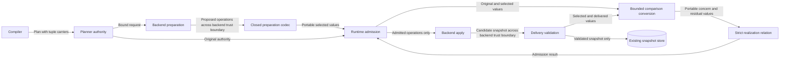

# Preparation comparison of portable values

## Context and ownership

Issue [#1865](https://github.com/OpenRAE/rae/issues/1865) exposes a tuple-to-list conversion during backend preparation.
The compiler creates tuples for ordered controller addresses.
The preparation codec converts those tuples to JSON arrays.
Both carriers describe the same ordered values.

The [preflight](issue-1865-domain-topology-equality-preflight.md) identifies the existing owners and protection boundaries.
`raes_processor.semantics.realization_comparison` owns the portable conversion through `portable_realization_value`.
The planner preparation boundary uses that public helper for comparison values.
Its public interfaces remain `prepared_realization_violation` and `prepared_delivery_violation`.
The existing `project_realization_concern` interface also uses the helper for processor-derived concerns without descriptor projectors.
This keeps original-authority readback consistent with preparation admission.
`raes_contracts.realization_structure` retains strict JSON equality and recursive evaluation.

## Comparison design

Each comparison first validates its values with `validate_realization_value` and the existing plan limits.
The comparison then uses `pydantic_core.to_jsonable_python` with the existing `jsonable_fallback` codec.
This produces temporary portable values without changing the submitted plan or stored snapshot.
Existing concern projections retain their meaning.
Concern constraints, residual payloads, and selected delivery use the same portable conversion.

Ordered arrays retain length, member positions, duplicates, and scalar types.
Booleans remain distinct from integers.
Missing fields remain distinct from null or empty values.
The comparison does not use digest equality as permission.
Invalid carriers fail before codec conversion.
Existing runtime handling converts validation failures to value-free diagnostics.

## Data flow and security

The protected assets are plan authority, controller membership, account bindings, and trusted snapshots.
Backend proposals and delivered snapshots cross the existing backend trust boundary.
Altered topology can violate author intent.
Strict comparisons preserve every field and ordered controller member.
Runtime refusal tests verify that altered proposals never reach apply.

Serializer coercion can conceal invalid input.
Bounded validation rejects unsupported carriers, invalid keys, cycles, nonfinite numbers, and excessive values before conversion.
Nested scalar tests verify that conversion preserves boolean and integer distinctions.
Existing manifest, request, predecessor, topology graph, profile, and backend validation gates remain required.
No new credential access, endpoint, logging payload, service, or persistent store is required.
The protocol cannot prove backend honesty or successful directory operation.

## Related artifacts

The existing tests provide a machine-checkable comparison and admission model.
Focused mutations check transport adaptation, scalar type checks, and sequence order.
The preparation specification documents portable comparison behavior.
ADRs 082 and 105 already define exact topology and preparation authority.
No new decision, schema, policy rule, or import dependency direction is required.
The existing release workflow remains authoritative.
Release publication is outside this comparison change.
This change requires no version, changelog, or release workflow edit.

## References and writing review

- [Python 3.14 JSON documentation](https://docs.python.org/3.14/library/json.html), encoder conversion table: tuples and lists represent arrays.
- [Pydantic 2 serialization documentation](https://docs.pydantic.dev/latest/concepts/serialization/), Python and JSON modes: transport conversion.
- [RFC 8259](https://www.rfc-editor.org/rfc/rfc8259), sections 1, 5, and 9: ordered arrays and parser limits.
- [ASD-STE100 Issue 9](https://www.asd-ste100.org/assets/files/ASD-STE100_ISSUE9.pdf), sections 1, 3, 5, 6, and 8: terminology, active voice, sentence length, and document purpose.

Writing review uses consistent technical names, active descriptions, and one subject per sentence.
This document describes the system; the issue plan records implementation tasks.
