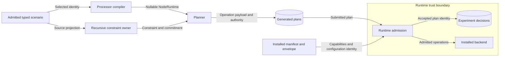

# Preserve optional node identity

## System contract

A sparse node keeps the values that the author left absent.
The fix adds no chosen architecture or OS distribution.

RAE defines the portable source, plan, and runtime contracts.
All backends must conform to those contracts.
The design follows RAE semantics and package boundaries.
No specific backend sets the field types, defaults, validation rules, or public interfaces.

The [preflight](issue-1866-node-identity-absence-preflight.md) defines the boundaries for issue #1866.
`Node.os_distribution` and `Node.architecture` use `None` for absent values.
`NodeRuntime` keeps those values through compilation.
`resource_payload()` uses the existing dataclass projection.
The desired resource and submitted operation therefore contain JSON `null` for an absent identity.
Explicit values retain their canonical form.
`os_version` keeps its existing empty string default.

The public interfaces remain `compile_runtime_model()`, `plan()`, and `realize_admitted_trial_entry()`.
The compiler and resource models own value preservation.
The planner owns capability checks and prepared-node consistency.
The runtime retains its existing admission checks.
No backend-specific rule enters the processor.

`realization_constraint_binding()` is the existing executable integrity model.
Each operation value must reproduce its source commitment.
The existing constraint evaluator also checks permitted values.
An altered value with its original commitment fails admission.
The processor does not rebuild a commitment to accept an altered payload.

## Data flow and security

The protected assets are admitted source intent, plan integrity, and backend state.
The processor-to-runtime boundary treats the submitted payload as untrusted.
Binding comparison detects substitution before backend effects or experiment admission records.
Manifest, envelope, actor, scope, and plan authorization checks remain active.
Regression tests verify refusal and absence of backend apply calls.
No new secret, network, storage, or authentication surface is introduced.

Prepared-node admission compares each nullable identity with its typed specification.
It still rejects inconsistent pairs.
The existing OS capability checker accepts partial identity through empty comparison strings.
Preparation maps only absent distribution to that comparison form.
It does not change the submitted payload or its commitment.
Malformed values and unsupported joint OS choices remain refused.

The residual risk is an internal path that assumes every optional identity is a string.
RAE's public admission tests and prepared-node tests cover the processor and runtime paths.
The reference stubs exercise the portable boundary without selecting a concrete backend.
Concrete backend behavior remains outside this design.

## Existing architecture

ADR-105 already defines recursive value semantics.
ADR-036 and ADR-121 define the package boundaries.
No new ADR, schema, policy rule, or deployment component is required.
Existing plan payload schemas permit JSON null.
Existing models and constraint tests supply the architecture checks.
No stored plan, historical digest, or version file changes in place.
Old refused plans must be compiled again.

## References and writing review

- [Python 3.14 JSON documentation](https://docs.python.org/3.14/library/json.html), conversion table: `None` serializes as JSON null.
- [RFC 8785](https://www.rfc-editor.org/rfc/rfc8785), sections 3.2.2.1 and 3.2.2.2: literals and strings have distinct canonical representations.
- [ASD-STE100, issue 9](https://www.asd-ste100.org/assets/files/ASD-STE100_ISSUE9.pdf), writing rules 1, 3, 5, and 6: terminology, verbs, and sentence limits.

The writing review uses one fact per sentence and short descriptive sentences.
Code identifiers are project technical terms.
Automated prose checks supplement the terminology review.
