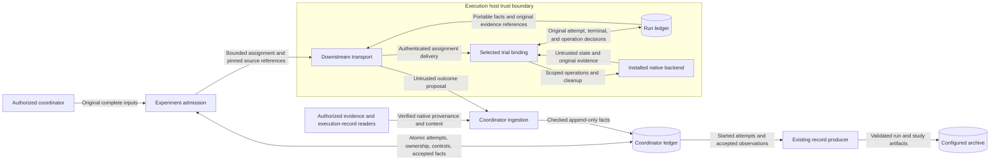

# Assigned trial execution

Issue: #1870. This design extends the existing experiment runtime.
The [preflight](issue-1870-assigned-trial-execution-preflight.md) defines its constraints.

## Components and interfaces

The coordinator admits the complete experiment once.
`RuntimeControlPlane.assign_trial()` assigns an existing entry to an explicit execution owner.
The assignment retains the original plan, attempt, deadline, target, and processor commitments.
The assignment does not confer authentication or contain a credential.

`RuntimeControlPlane.bind_assigned_trial()` binds one assignment on the execution host.
The host receives the original realization inputs through existing portable source carriers.
It reconstructs only the selected entry through `realize_admitted_trial_entry()`.
It compares the complete plan and all processor commitments before effects.
It installs a scoped trial binding, rather than another experiment.
`AssignedTrial.advance()` advances that binding through the existing trial lifecycle.
`AssignedTrial.outcome()` exports retained facts, including incomplete work.
`RuntimeControlPlane.advance_trial()` advances only the selected coordinator policy.

`RuntimeControlPlane.ingest_trial_outcome()` checks facts against the retained assignment.
An explicitly installed outcome verifier reads original execution records and evidence.
It must establish native validation provenance, cessation, and cleanup through their existing owners.
Matching JSON or a worker assertion cannot satisfy that verification contract.
Trial evidence checks and structural result validation remain required.
Accepted facts feed the existing run and study producer.
Terminal, retry, archive, and replacement decisions remain in the coordinator.

`raes_contracts` owns the versioned assignment and outcome carriers.
Their child contracts retain existing schema versions.
`raes_runtime` owns admission, conversion, progress, ingestion, and retained decisions.
`raes_processor` retains hydration, allocation, and replacement compilation.
`raes_backend_protocols` retains the existing in-process `BackendTrialUnit` interface.
No transport-specific interface enters these modules.

## Decisions, concurrency, and recovery

The existing decision store gains an atomic append with an expected decision set.
The memory, SQLite, and PostgreSQL providers retain their existing transaction boundaries.
Assignment admission commits its attempt and ownership together.
The same transaction checks cancellation, current ownership, and occupied capacity.
The admitted schedule and allocator grant bound capacity.
Unknown work and unverified cleanup retain their capacity.
Canonical entry order controls assignment admission.
Completion can arrive in any order.

An assignment has one execution owner and one immutable generation.
This interface does not reassign an uncertain attempt.
Duplicate delivery reads the original attempt and deadline.
Host recovery restores completion from the retained terminal decision.
Later retry preparation cannot rewrite that decision.
Installation uses a lock for each assignment and publishes only attached bindings.
Read-only outcome export includes operations whose native phases have not settled.
Conflicting content under an existing identity is refused.
Outcome revisions extend retained facts without changing previous observations.
Cancellation closes new admission and remains observable through a public control query.
The execution host applies delivered cancellation through the existing stop and cleanup path.
Stop acknowledgement does not release capacity.
Retry preparation uses an explicit control under the existing retry policy.
Potential retry work retains its entry's slot until the coordinator resolves that policy.

The coordinator holds no experiment lock during evidence or archive calls.
Short ledger transactions serialize decisions.
Each execution host retains its target reservation and run store.
Separate assignments do not relax exclusion for shared native resources.
The host retires a verified clean run through `retire_run()` before it reuses that target.
Durable recovery requires the original scope-bound stores and installed owners.

## Data flow and protection

| Asset and threat | Boundary and control | Verification |
| --- | --- | --- |
| Allocation and settings change | Whole-plan reconstruction and retained assignment commitments | Reject changed plans, entries, projections, and settings before effects |
| Another owner uses an attempt | Explicit runtime identity and immutable owner binding | Reject wrong actor, owner, attempt, or generation |
| Duplicate effects after lost delivery | Original operation ledger, attempt identity, and deadline | Redeliver pending and terminal assignments without extra dispatch |
| False cleanup releases resources | Existing cleanup receipt checks and trusted content verification | Reject unverified cleanup and retain occupied capacity |
| Forged remote success | Installed native provenance verifier and trial evidence verification | Reject altered snapshots, receipts, statuses, and evidence |
| Sensitive data disclosure | Bounded closed carriers, value-free failures, and authorized readers | Reject credentials and Python objects at ingress |
| Concurrent capacity oversubscription | Atomic existing-store admission | Race assignments and cancellation, then recover retained claims |

Transport authentication and live host leases remain downstream protection needs.
The runtime does not infer isolation from an owner name or reference string.
Missing evidence remains unresolved.
Private trial history is retained only in the explicitly scoped handoff projection.
The generic snapshot API keeps its existing omissions.
No external effect has an exactly-once guarantee.

## Architecture and policy

Typed bindings, closed carriers, and atomic store operations express the architecture in code.
Existing package boundaries and structural checks remain authoritative.
Published schemas need publication entries and generator parity.
No SDL syntax, native operation kind, deployment service, or ADR changes are needed.
ADR-104/113 already assign execution and result authority to the shared runtime.
ADR-065/068 already assign run identity, archival validation, and replacement lineage.
Release-please owns package versions and release notes.

## Reference basis

- [Python 3.14 dataclasses](https://docs.python.org/3.14/library/dataclasses.html), frozen instances and replacement: reconstruct local request/result values.
- [Pydantic 2 serialization](https://docs.pydantic.dev/latest/concepts/serialization/), JSON mode: export closed portable child contracts.
- [Python 3.14 sqlite3](https://docs.python.org/3.14/library/sqlite3.html), transaction control: retain atomic local decision admission.
- [PostgreSQL 18 explicit locking](https://www.postgresql.org/docs/18/explicit-locking.html), table locks: serialize decision admission across connections.
- [NIST SP 800-160 Volume 1 Revision 1](https://csrc.nist.gov/pubs/sp/800/160/v1/r1/final), system security engineering: connect assets, threats, controls, and verification.
- [ASD-STE100 Issue 9](https://www.asd-ste100.org/assets/files/ASD-STE100_ISSUE9.pdf), sections 1, 5, 6, and 8: terminology, sentence length, and document purpose.

The writing review uses consistent technical nouns and short descriptive sentences.
Implementation tasks and verification commands belong in the issue plan.
