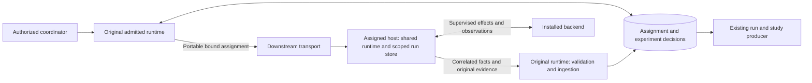

# Issue #1870 — Assigned single-trial execution preflight

Date: 2026-11-03. The supplied issue is the delivery contract. This note records
architecture constraints, not an implementation plan or an available API.
The #1627, #1629 and #1630 implementations are present in this checkout.
Their native GitHub prerequisite relationships remain the readiness authority;
source inspection does not certify that those prerequisites are delivered.

## Decision and boundaries

Extend the public runtime composition to select an entry, bind its authorized
attempt to an execution owner, advance that entry independently, and ingest
checked observations/results. Keep one original experiment admission and its
allocation. An execution host owns scoped run execution; it does not admit a
new experiment. The coordinator's admitted runtime retains attempt, cancellation,
retry, replacement and aggregate accounting decisions. Each scope has one state
writer. Transport delivery and host allocation supply no semantic authority.

No new ADR is needed. ADR-036/117 govern module ownership and public interfaces;
ADR-104/113 govern shared runtime authority and supervised execution; ADR-115
keeps concrete backends downstream; ADR-065/068 govern archival identity and
replacement lineage; ADR-116 governs errors and logging. Build on the existing
[#1629 shared runtime design](issue-1629-shared-runtime-design.md) and
[#1630 accounting design](issue-1630-run-accounting-design.md).

The downstream transport crosses a process boundary. Neither it nor the backend
can write the original runtime's decisions; ingestion checks their proposals.

Package paths below start at `implementations/python/packages/`.

| Owner and canonical incumbent | Required boundary |
| --- | --- |
| `raes_runtime/control_plane.py::RuntimeControlPlane`, `runtime_experiment.py::RuntimeExperiment` | Public selected-entry binding, progress, cancellation observation and ingestion belong here. Delegation must retain runtime ownership and actor checks. Callers must not access `_experiments`, `_units`, `_run`, stores or private decision classes. |
| `raes_processor/trial_realization.py::realize_admitted_trial_entry()` | Own exact-entry hydration and processor projections, including capture demands. Reuse its source/manifests/task/capture checks. Reconstruct executable state from pinned portable inputs through the existing SDL/compiler/planner owners; do not serialize `TrialRealization`, `TrialRealizationInputs` or `ExecutionPlan`. |
| `raes_backend_protocols/trial_unit.py::BackendTrialUnit`, `raes_contracts/trial_unit.py` | Preserve the released in-process request/result interface and its join validator. A portable composition belongs in neutral contracts, with runtime-owned conversion and admission. The protocol remains independent of runtime/processor implementations. |
| `raes_runtime/runtime_trial_unit.py`, `runtime_trial_services.py`, `runtime_run_driver.py`, `runtime_module_step.py` | Reuse configuration, native execution phases, observation, capture-before-teardown, cleanup and retry preparation. Installed services apply/observe/verify; they do not choose run IDs, attempts or scenario ordering. |
| `raes_processor/trial_scheduler.py`, `raes_contracts/contracts/batch_execution.py` | Own canonical dispatch coordinates, admitted ceiling, allocator decision carriage and receipt joins. Host ownership and live lease proof remain downstream. |
| `raes_runtime/runtime_experiment_progress.py`, `runtime_experiment_replacement.py` | Local and assigned paths must share terminal, retry, archive and replacement decisions. Do not fork their workflow rules into an external executor. |
| `raes_runtime/runtime_experiment_records.py`, `runtime_record_assembly.py`, `runtime_record_validation.py`, `runtime_record_publication.py` | Both execution paths feed existing record production, content checks, immutable versions and exact archive readback. Records are derived from retained facts, not just returned terminal results. |

## Binding, ownership and concurrency invariants

The binding identifies the complete sealed plan and digest, exact entry and
entry commitment, preallocated run ID, admitted attempt and original deadline,
hydrated scenario and processor commitments, and assigned execution owner.
Retain the original actor's authority separately from the execution owner's
authority. Distinguish experiment, entry, run, trial attempt, native invocation,
operation, delivery and ownership generation. An assignment ID is not a secret,
capability or permission to choose another attempt.

The worker reconstructs and validates this binding before effects. It checks
the exact original entry, applied participant settings, task/capture requirements,
manifests, realization envelope, execution controls and cleanup obligations.
A newly sealed edited plan is still a different admission. A digest that checks
itself is not proof of derivation or authorization. Preserve target/run and
instantiation scopes in the processor projections and generated-value bindings.
Host placement must not silently change a logical target or configuration
commitment. An incompatible installed target must refuse before effects.

The current `RuntimeTrialUnit` constructor requires an experiment and attempt
already registered with its engine. Its `execute_trial()` cannot independently
reconstruct a remote admission. Add the supported binding at the public
composition boundary; do not fake registry membership, copy private dictionaries,
call `admit_experiment()` on every worker, or construct a one-entry plan slice.
Reconstructing the selected admitted entry is not permission to enumerate,
randomly select, normalize participant settings again, reseed, or allocate a run.

Independent assignments need independent progress and result ingestion. Today
`advance_experiment()` returns after the first pending slot, and
`RuntimeExperiment._advance_lease()` serializes experiment work. Neither is the
external coordinator's required progress mechanism. Keep shared decision
sections short; effect calls, evidence reads and archive I/O must not hold an
experiment-wide progress lock that blocks unrelated entries.

`RuntimeEngineResources.reserve()` intentionally excludes other runs on the
same target, including unknown effects. `RuntimeResourceClaim` also binds backend
components and ledger ownership. Preserve both protections. Independently owned
execution hosts can use separately scoped runtime compositions under the same
experiment admission; merely opening two runs in one reserved target does not
provide independence. Do not remove exclusion or treat distinct target names,
threads or stores as proof of isolated host resources.

Use `plan_batch_schedule().admitted_parallelism_ceiling`, serial by default.
The embedded isolation proof must authorize the selected entries and their
cleanup-owned resource boundaries. The actual bound is no greater than that
ceiling, current downstream ownership and installed capacity. Preserve canonical
dispatch decisions while allowing out-of-order completion. Record the allocator's
decision through `AllocatorGrant` and existing batch receipts; their reference
strings do not prove that leases are live.

Assignment admission must atomically check cancellation, existing assignment,
attempt permission and occupied capacity before recording ownership. Independent
`claim_runtime_decision()` inserts give uniqueness, not an atomic global capacity
check. Reuse the canonical store transaction boundary for this invariant; a
process-local lock or counting terminal replies cannot enforce it after recovery.
Retain occupied capacity for unknown effects and failed/unverified cleanup until
the existing release gates permit reuse. Restoration must recover those claims
before new admissions. Do not add a separate scheduler, queue or assignment DB.

Duplicate delivery selects/reconciles the same attempt with the same content,
deadline and ownership binding. It must not redispatch a consumed effect or
refresh a budget. Conflicting content under the same identity is refused.
Owner-generation checks fence stale publication; they alone do not establish
native cessation. Retry/reassignment after uncertainty requires the existing
reconciliation and effect-release authority, not a lost reply or expired lease.

Cancellation records intent and closes new assignment admission. Already started
work still owes stop observation, capture and cleanup under admitted policy.
The existing experiment cancel method reaches local contexts only: the assigned
path must expose the retained cancellation to its execution owner through the
public composition. Downstream transport delivers controls; this issue adds no
transport. An acknowledgement never proves cessation. A late valid result must
reconcile the original attempt without erasing cancellation or contradicting a
committed outcome. Failed cleanup must not block ingestion of another independent
entry's facts, or become evidence that the failed host is reusable.

## Portable handoff and truthful ingestion

Reuse these released carriers rather than defining parallel child schemas:

| Information | Incumbent |
| --- | --- |
| Original allocation, entry settings, controls and cleanup | `AdmittedTrialPlanModel`, its entry, `ParticipantConfigurationResultModel`, `AdmittedExecutionControlModel`, `TrialCleanupPlanModel` |
| Hydrated SDL and identity | `raes.canonical.InstantiatedScenarioSnapshot`, `canonical_instantiated_sdl_bytes()` / digest, and `admit_instantiated_scenario()`; keep the declared canonicalization profile |
| Executable projections and installed support | `ProvisioningPlanModel`, `OrchestrationPlanModel`, `EvaluationPlanModel`, processor/backend/participant manifests and `BackendRealizationEnvelopeModel` |
| Checked execution state and native work | `RuntimeSnapshotEnvelopeModel`, `OperationReceiptModel`, `OperationStatusModel`, existing operation admission/binding/request/response and effect-evidence contracts where native invocations are involved |
| Experimental facts and cleanup | `ExperimentEvidenceRecordModel`, `TrialCleanupReceiptModel`, `BatchExecutionReceiptModel`, existing provenance and run accounting contracts |

The genuinely missing portable composition is the assignment's binding to the
original admission and authorized attempt, plus the correlated lifecycle facts
needed to reconstruct its outcome/accounting. Reuse existing identity, digest,
budget and reference types. Carry a field only if the existing children or
trusted retained admission do not supply it. Keep runtime targets, resolver
functions, credentials, locks, stores, engine objects and private decisions out
of this carrier. No pickle, generic object dump or unversioned metadata bag.
Artifact references must resolve through explicitly installed authorized readers.

`TrialUnitResult` requires a cleanup receipt and cannot alone describe work lost
before cleanup. It also does not carry every configuration/capture observation,
observed timestamp, native status or cessation fact consumed by #1630. Preserve
those original facts through existing child contracts and the smallest missing
portable fields; do not fabricate a result, receipt or terminal timestamp for an
incomplete attempt. Explicit absent/partial/indeterminate facts must remain
recordable. `TrialOutcome` has no `indeterminate` member: use unresolved accounting
without inventing a terminal cleanup receipt or overloading a failure outcome.
Do not publish `TrialObservationDecision` or the durable store codec
as an integration format. Keep trial outcome, capture, scientific evaluation,
cleanup and operation status separate.

At ingestion, reconstruct nested carriers, join them to the retained assignment,
and verify the original plan/configuration/projection commitments, exact attempt,
owner/generation, target/run, operation request commitments and evidence versions.
`validate_trial_unit_result()` checks structural joins; it explicitly does not
prove authorization, evidence content, cessation or snapshot transitions.
Reuse the native result/effect validators and trusted evidence owners for those
claims, including failed, partial and late work. A final snapshot alone cannot
prove all intermediate transitions. Preserve the native validation provenance
and evidence necessary to check the claim; never mark runtime state valid merely
because a remote runtime says it is valid. Only the receiving state owner commits
accepted semantic facts. No worker write credentials for the coordinator ledger.

Feed accepted facts into the existing `ExperimentRecordSource`/record producer
path, without making that internal source object a wire format. Record durable
starts even if no complete result arrives. Keep original evidence bytes and
digest/version references, failed attempts, unresolved work and replacement
parents. `validate_admitted_trial_run()`, task evidence validation and study
membership checks retain their authority. Archiving is not scoring or resource
release. Replacement remains `ExperimentReplacementBinding` and
`compile_replacement_trial()` under the root policy and original lineage;
workers cannot allocate replacement entries or lower the planned population.

## Cross-cutting layers the design must pass

| Layer | Canonical gate and required fit |
| --- | --- |
| Untrusted bytes and mutable models | `json_ingress.parse_bounded_json_object()`, `parse_admitted_trial_plan_json()`, `revalidate_admitted_trial_plan()`, `ContractModel`, canonical digest helpers and `runtime_value_limits.py`. Bound the whole aggregate before copy/hash, then reconstruct children; reject duplicate JSON members, non-finite numbers, coercible identities/booleans, unknown fields, excessive depth/items/bytes and changed nested models. Whole-plan validation precedes lookup. Do not use a detached-entry parser or duplicate its validation. |
| Installed composition, SDL and config shapes | `RuntimeTarget`, `registry_target_validation.py`, `ControlPlaneConfiguration`, `control_plane_composition.py`, `control_plane_profiles.py`, `runtime_experiment_admission.py::admit_trial()`, `require_trial_control_capability()` and native plan/policy admission. Recheck component call shapes, manifest compatibility, declared guarantees, scoped resolvers, explicit `run:<allocated-id>`, store/profile capabilities and contextual willingness on the assigned host. Structural SDL admission does not replace semantic admission. Preserve unsupported mixed-composition refusal. No discovery fallback, backend-name switch or silent profile upgrade. |
| Actor and execution authority | `operation_actor_scope()`, `control_plane_admission.py`, `control_plane_plan_authorization.py`, runtime owner/generation checks and the invocation claim/reconciliation machinery. P0 is a trusted embedder boundary; never deserialize caller-supplied actor fields as an authenticated identity. Dispatch, ingestion, cancellation, cleanup and evidence access retain appropriate scope. `operation_worker_authority.py` is the incumbent for native remote invocation claims, not permission to repurpose a native operation as an entire trial. This issue requires no HTTP route or new auth system. Existing HTTP embedding must retain `ControlPlaneSecurityConfig.strict_defaults()`, `_auth.py` route/target/subject checks, sealed app composition, request/offload bounds and no-store responses. |
| Secrets, environment bindings and information flow | `SecretReferenceId`, sealed participant configuration value kinds/manifest owners, `runtime_fact_binding_policy.py`, `runtime_fact_dispatch.py`, participant crossing and `participant_flow_sink.py`. Resolve references only at authorized sinks with run-local provenance, audience and freshness. Reuse `raes/runtime_environment.py`, `runtime_configuration.py`, `runtime_generated_value.py` and semantic validation: valid unique env names, sensitivity/provenance, literal versus `value_from` exclusivity and no generated value claiming `operator_secret`. Do not flatten settings into an env dictionary or propagate ambient credentials. A handoff may contain protected configuration/evidence; authorize its complete contents before downstream transfer. |
| Backend and result trust | `backend_input_contracts.py`, `backend_calls.py`, `backend_call_contracts.py`, `backend_apply_results.py`, `backend_snapshot_contracts.py`, workflow/evaluation/participant/time and transition validators. Validate isolated input and results against the trusted predecessor; preserve changed-address accounting, append-only histories, realization authority and observation ownership. `snapshot_contract.py::runtime_snapshot_contract_model()` is the public portable snapshot projection; private `_snapshot_payload()` is not a new public codec. Account-specific credential projection in `backend_account_credentials.py` does not sanitize arbitrary participant payloads, metadata, evidence or diagnostics. |
| Evidence and disclosure | `OperationEvidenceResolver`, `TrialRuntimeServices.verify`, `runtime_record_validation.py`, capture demands and content-backed task/condition checks. Reference presence and matching digests are insufficient to prove content, treatment application, cessation or clean state. Resolve through the configured owner with bounded calls; do not fetch arbitrary URLs/paths. Keep redaction/loss and unavailable evidence explicit. ADR-066 / `raes/observability_plane_semantics.py` distinguish operational progress, participant observation and scientific evidence. |
| Persistence and recovery | `ControlPlaneStore`, `runtime_decision_store.py`, the closed `RuntimeDecision` union, atomic commit adapters, scoped idempotency, revisions/history, invocation consumption, owner generations and durability poisoning. Extend canonical typed decisions/codecs and compatibility handling as needed; never import worker history as trusted store rows. Coordinator and execution-host commits are separate: retain stable identities/content and reconcile interruption between them, with no distributed transaction claim. Durable engines still require durable scope-bound run stores and explicit factories. |
| Budgets and cleanup | `LocalExecutionAdapter`, `OperationSupervisionConfiguration`, `authored_attempt_budget()`, existing operation control budgets and `runtime_trial_unit.py`. Keep effect/control/store capacity separate. A timeout does not free a still-running call's slot; redelivery does not renew the original UTC deadline. Deployment limits can narrow admitted budgets, never widen them. Cleanup retains its own budgets and obligations after execution expiry. No extra executor, blanket retry, unconditional destroy in `finally`, or success inferred from an empty snapshot. |
| Errors, logs and audit | `raes_contracts.errors`, `Diagnostic`/`DiagnosticModel`, `portable_diagnostic_payload()`, `backend_result_diagnostics.py`, `operational_logging.get_logger()` / `foreign_failure_record()` and `call_installed_owner()`. Translate validation refusals at the owning boundary; unexpected defects remain defects. Use bounded value-free classifications, no foreign exception text/cause chain, payload repr, commands, prompts or native output. Existing HTTP adapters retain `_responses.py` and redacted 422/500 handlers. `AuditEvent` and `control_plane_audit.py::require_audit_event_fields()` own closed action/detail shapes; new correlation keys need that gate, not arbitrary log fields. No new exception hierarchy or logger framework. |
| Host/OS and data destinations | `control_plane_store_paths.py`, lease/codec adapters and backend containment retain private owned paths, file permissions and link checks. A portable reference is not a host path or shell command. This issue adds no process, listener, host provisioning, credential loader or data destination. Downstream process bindings must keep secrets out of argv, controlled environment/arguments and hostile trial code outside trusted workers. No shell interpolation, shared secret cache/mount or broad environment inheritance. Local ownership locks do not establish multi-host leases. |

## Extensibility and repository constraints

The extension seam is explicit assignment to a scoped installed execution owner,
with injected `RuntimeTarget`, trial services, evidence readers, durable store
factory, allocator decision and finite deployment budgets. Backend/participant
revision, host placement and narrower capacity are inputs; they must not require
editing a central backend switch or changing the sealed scientific allocation.
Keep carrier versions independent of transport so another transport can use the
same admission and ingestion rules. Do not add speculative transport/plugin APIs.

The current `tools/policy/adr_policy.yaml` already permits runtime imports of
public processor `trial_realization`, `trial_scheduler` and `trial_compiler`
modules. Earlier preflights describing those imports as forbidden are historical.
Retain ADR-036 direction and ADR-117 structural limits. Do not move live runtime
composition into `raes_operations` or broaden package allowances to bypass them.

Repository gates in scope are `.ground-control.yaml`, `.gc/plan-rules.md`,
`specs/authority/authority-boundary.yaml`, `tools/check_repo_policy.py`,
`tools/check_schema_publication.py`, `tools/check_generated_schemas.py`,
`tools/verification_plan.py`, `noxfile.py`, `.pre-commit-config.yaml` and the
canonical CI/distribution/release workflows. Published schemas are normative.
Any missing portable carrier needs normal schema registration, publication
entry/change hash, semantic fixtures, `schema_bundle()` parity and packaged
consumer admission. Preserve artifact-version compatibility explicitly; reject
unsupported versions rather than silently reinterpret commitments.

Installed acceptance must exercise public imports from clean wheel and
sdist-derived installations, without source-tree `PYTHONPATH`, private fields
or an editable install. Reuse `tools/nox_support/compatibility_lanes.py` and the
reviewed Python closure tooling; import-only distribution smoke is insufficient.
Relevant incumbents are #1627 trial-unit, #1629 experiment/decision/guarantee,
#1630 record/recovery, SCE-006 scheduler/cleanup, #1396 replacement, #1359 API
trust-boundary and #1362 supervision/lost-ack tests. Required behavior includes
two independent synthetic owners, out-of-order results, duplicate/concurrent
delivery, wrong-entry/attempt/actor/owner refusal, changed commitments,
cancellation races, capacity exhaustion and recovery with uncertain effects.
Include incomplete work in record export. Negative tests must demonstrate no
extra dispatch, attempt, run, capacity release or evidence substitution; targeted
mutation checks should challenge those invariants. Targeted unit/policy checks
run locally; full, integration, installed-distribution and fuzz lanes run in CI.

Publish the consumer-visible API and compatible artifacts through the normal
feature release process. Release-please owns versions and `CHANGELOG.md`; do not
hand-edit either or invent a requirement UID. Consumer documentation must explain
ownership, uncertainty and supported carrier versions, without publishing this
internal preflight through the curated `docs/public` boundary.

Non-goals: VM/SSH/cloud operations, host leases, transport/auth implementations,
new listeners, distributed schedulers or workflow engines, SDL syntax, scoring
rules, universal rollback, automatic mixed-backend support, Go migration and
exactly-once external-effect claims. This preflight changes guidance only.
