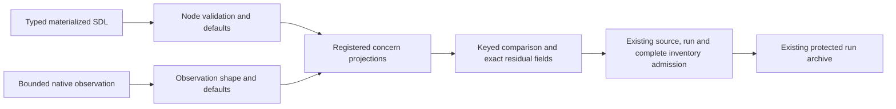

# Initial materialization admission (#1884)

The initial provisioning description must match either raw native readback or
the owning concern's value-free snapshot representation. Reporting after that
boundary is optional for a consumer that selects provisioning-only reporting.
The existing all-phase default remains unchanged.

## Ownership and flow

| Owner | Interface | Responsibility |
| --- | --- | --- |
| `raes_contracts.materialization` | `MaterializationSource.reporting_scope` | Bind `all-phases` (default) or `provisioning` into the operation identity. |
| `raes_processor.semantics.realization_node_defaults` | `materialization_node_projection` | Validate SDL separately from observation shape, restore node defaults, then project concerns through the registry. |
| `raes_processor.compiler.materialization_origins` | `materialization_node_payloads_match` | Compare projected nodes with native keyed identities and ordered sequences. |
| `raes_processor.planner` | `plan(materialization_reporting=...)` | Attach the full source and selected reporting scope to every phase. |
| `raes_runtime` | `RuntimeManager.plan(materialization_reporting=...)` | Carry the caller's selection to planning; retain it for fresh evaluation. |
| `raes_runtime.backend_materialization` | `finalize_materialization` | Require provisioning reports; require later reports by default or when prospective in-world augmentation needs them. Admit any report that is supplied. |

The dependency directions stay those of the existing executable import-boundary
model in `tools/policy/adr_policy.yaml`: contracts have no processor/runtime
dependency, compiler calls semantics, and runtime calls planner admission.
No new package boundary, service, storage destination or trust authority is added.

## Contract and security invariants

- Publish the optional `reporting_scope` property on each normative schema
  embedding `MaterializationSource`, with a change ledger entry and an identical
  reference schema. Omit the default from serialization to preserve old plan identities.
- Retain the full authenticated source in all phases; do not strip trusted fields.
- Initial provisioning still requires a valid report and protected archive.
- Later command results, evidence capture, preparation, exactness, scope and
  cleanup ownership checks remain in their existing owners. Later in-world
  augmentation still requires its report. Reporting scope grants no effects.
- Never place commitments in SDL or recover raw protected values from snapshots.
  The comparison is local and makes no independent backend-observation claim.
- Reject changed commitments, presence, identities, execution/source bindings,
  inventory additions/omissions, malformed observations and ordered-command changes.

## Verification

Use focused admission tests for environment, nested settings and local-control
bind sources, positive and negative cases, plus public runtime apply/evaluate
and cleanup checks. Check the standalone issue reproduction against workspace
packages. Run file-local policy checks before and after changes and mutation
checks against the new admission/reporting decisions. CI owns broad verification.

Verification completed: the standalone issue reproduction accepts both forms;
49 focused admission, public-runtime and positive conformance cases pass, as do
55 existing materialization/origin/inventory/source-bound cases. The three
published plan schemas match the generated reference and their change ledgers.
Five targeted mutations are rejected by tests: accepting unequal nodes, omitting
the initial report, dropping the all-phase default, skipping later augmentation
reports, and removing concern-owner projection. File-local policy and changed
Python lint pass.
