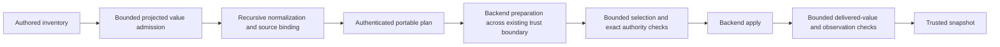

# Bounded cloud authority in Python plans

Issue #1885 supports large cloud inventories. It uses the existing public compiler and planner.
ADR-105 owns recursive authority, preparation, and completion admission.
ADR-070 still owns backend capability admission.
Neither decision changes.

## Ownership and interfaces

`raes_contracts.runtime_value_limits` owns a fixed `PLAN_AUTHORITY_LIMITS` profile.
It bounds work on recursive rules. Separate limits bound portable data.
The compiler, planner, and runtime share these limits.
They cover registered concerns and prepared node values.
Portable node membership keeps its own existing bounds.
Generic relations keep their small default limits.
`realization_constraint_binding` gains an optional keyword-only `limits` argument.
The argument controls admission, never the binding digest or permission.
No submitted plan or backend response can select a larger profile.
`validate_realization_constraint_document` exposes the existing bounded document admission.
The portable plan model uses it when plans are encoded or decoded.

The compiler checks each projected value. It then builds and binds the rule tree with the same limits.
It reports a spent budget as a limit error. A missing semantic rule remains a distinct error.
The planner checks source bindings and chosen values with these limits.
Prepared and delivered values face the same rule checks.
Existing limits on total portable data still apply. They bound each carrier before copy or encoding.
A plan keeps its rules and source binding when encoded. Its schema does not change.
The compiled requirement retains the limit error. This also applies when rule building is deferred.
It reuses the existing error member. Successful compiled models keep their existing shape and fingerprints.
It does not add fields to the portable authority contract.
The compiler's existing concern explicitness owner indexes ancestor paths once.
It selects leaves by path membership instead of comparing every pair of paths.
This keeps the same paths and exclusions. Work scales with the total path length.

## Finite work and security

The profile permits 65,536 recursive nodes, 1,048,576 operations, 65,536 members,
and 65,536 identity checks per relation.
It retains depth 32, 256 reference hops, 16 diagnostics, 1 MiB per scalar,
and 8 MiB total scalar bytes.
Each collection still permits at most 4,096 members.
The larger bounds cover the scope and identity data for 500 native secrets.
All allowances remain finite; exhaustion refuses admission.
Diagnostics name the exhausted limit and omit input values.

Exact leaves, subjects, roles, native IDs, content references, and canonical payload pointers remain binding.
Collection identity and closure rules do not change.
An integrity digest alone never grants permission.
Existing backend support and observation requirements still apply.
No provider call, external service, credential, new persistent store, or dependency is introduced.

The assets are author intent, source bindings, trusted state, and process resources.
Backend preparation and returned snapshots remain untrusted until admitted.
Carrier limits bound input data. Relation budgets bound rule building and checks.
Every failed gate preserves the trusted predecessor and refuses execution or delivery.

## Executable design and validation

The acceptance tests model this flow. They use synthetic cloud state and an in-memory backend.
They cover 500 secrets, serialized plans and preparation, unchanged delivery,
altered exact values at each boundary, and finite limit failures.
Additional binding tests check explicit limits and unchanged digest identity.
The import graph checks each package owner. Package policy checks import direction.
Focused mutations remove budget propagation or authority checks and must fail these tests.
The final diff must match this flow. It must also match the recursive and preparation specs.
