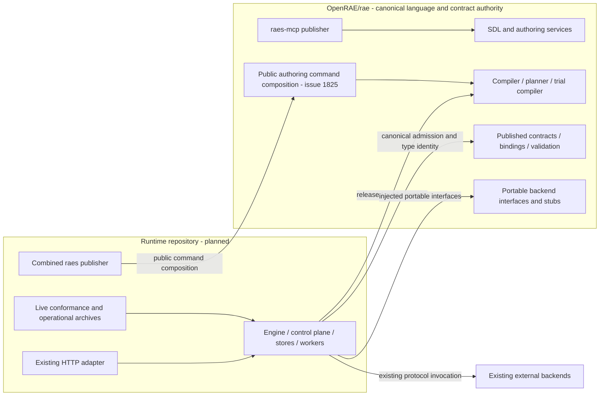

# Runtime repository boundary and extraction inventory

Issue [#1891](https://github.com/OpenRAE/rae/issues/1891) records the repository split for the Go hard cutover.
The common user-facing release gate is [#1804](https://github.com/OpenRAE/rae/issues/1804).
This plan records who owns each part.
It does not change product code.
It transfers no source, creates no repository and changes no installed behavior.

The working destination name is `OpenRAE/rae-runtime`.
It is not an approved destination or visibility choice.
Name the final repository first.
Record its access settings and approval before any move.
Only one owner edits each part during the move.

## Authority and dependency direction

| Continuing owner | Responsibility |
| --- | --- |
| `OpenRAE/rae` | SDL syntax, models, bounded loading, validation, authoring, inventory descriptions, instantiation, compiler, planner, trial compilation, analysis and language services |
| `OpenRAE/rae` | Normative specifications, published schemas and IDs, profiles, fixtures, bindings, contract validation, concept authority, portable backend interfaces, portable stubs and pure conformance checks. |
| Runtime repository | Execution engine, control plane, HTTP API, stores, Temporal workers, backend registry and invocation, participant execution/control, injects, experiment/run lifecycle, operational archives and execution-dependent conformance runners. |
| Existing external backends | Concrete realization, native resources and credentials; this split moves none of those implementations. |

Runtime imports released public SDL, processor, contract and backend APIs from `rae`.
`rae` product libraries, released modules and `raes-mcp` must not import runtime.
A build may check both repositories.
That does not grant a product import.
There is no third contracts repository, network compiler, plugin system or copied semantic implementation.

An arrow means that one part uses another.
It does not add a service call.
Authentication, authorization, store scope, leases, retry permission, uncertain-effect handling, evidence and secret boundaries stay as ADR-104, ADR-113 and ADR-115 define them.
P3 remains unavailable.
Splitting repositories grants no runtime capability.

## Mixed responsibilities and public seams

Paths below start at the source root.
They name roles.
A mixed file can have more than one role.
Do not copy the whole file on that basis.
Python stays the reference for behavior until the Go launch.
Continue the existing Go port once; do not extract Python or port it again.

| Existing area | Retained in `rae` | Runtime responsibility / necessary adjustment |
| --- | --- | --- |
| `implementations/python/packages/raes/`, including `runtime_*`, participant and experiment models | All language vocabulary, runtime inventory descriptions and semantic admission | None moves merely because its name contains runtime, participant or experiment |
| `raes_processor/compiler`, `planner`, `trial_compiler`, `trial_realization`, `models` | Compilation, planning, admitted trial identities, allocation, artifacts and analysis | Live experiment/trial execution consumes the admitted artifacts through public processor APIs. |
| `raes_processor/trial_scheduler.py` | `ScheduledEntry`, `BatchSchedule`, `plan_batch_schedule` and schedule meaning | `dispatch_batch_schedule` invokes effects; live dispatch and execution-receipt production belong with runtime. Preserve schedule identity and behavior. |
| `raes_contracts/` | All published DTOs, defaults, validation, normalized round trips, schema/vocabulary authority and shared type identity | Runtime consumes these released bindings, including snapshots and archive records; it does not redefine them. |
| `raes_backend_protocols/`, `raes_backend_stubs/` | Portable interfaces, manifest/profile admission and inert test doubles | Backend registry, invocation and runtime-specific adapters move; concrete backends stay external. |
| `raes_backend_stubs/stubs.py` | `StubProvisioner`, `StubOrchestrator`, `StubEvaluator`, `StubParticipantRuntime` and pure evaluation helpers | `create_stub_components` and `create_stub_target` assemble runtime targets. Move those factories with `RuntimeTarget`, `RuntimeTargetComponents`, `ReferenceTimeRuntime` and `backend_selection_observation_runtime` dependencies. Runtime imports the portable stubs; the stubs must not import runtime. |
| `raes_backend_stubs/manifest.py` and `raes_runtime/registry_scenario.py` | `create_stub_manifest` stays portable. The pure `scenario_component_options` selector belongs with processor compilation: it only compiles/reads a scenario model and returns existing feature flags | Expose that single selector through the public processor API in #1825. A retained authoring/app wrapper keeps scenario-aware manifest behavior: call the selector, then pass its flags to the pure stub manifest. The backend layer imports neither processor nor runtime. Runtime composition uses the same selector. Preserve all five flags, error checks and defaults. Keep `participant_temporal_probe_manager` in runtime; do not copy the selector or move the whole mixed file. |
| `raes_runtime/` | Canonical contracts it consumes stay with their existing authority | All live engine, operation, store, HTTP, worker, participant, inject and experiment/run behavior. |
| `raes_operations/run_artifacts.py` | `MaterializationArchiveRecord`, materialization submission types and semantic admission remain contract code | `RunMaterializationArchive` publication, protected filesystem readback and operational archive lifecycle. |
| `raes_conformance/conformance/` | `fixture_suite`, `processor`, pure validators, profiles, reports and diagnostics | Live target/probe/control runners move. The current dependency closure is too broad: pure checks reach `raes_runtime.result_contracts` through `snapshot_semantics`, and reports reach live probe types. Keep pure admission with its contract owner and separate live runner types. Split the facade; a current import is not a reason to move pure checks. |
| `conformance/modular_control_report.py` and `modular_control_types.py` | `validate_modular_report`, `ModularControlEvidence`, `ModularOwnerObservation` and the pure obligation/operation vocabulary | Keep pure report admission in `rae`. Move `ModularControlStep`, `ModularControlCase` and `ModularControlHarness` with the live runner. The report carrier must not retain control-plane or target imports. |
| `conformance/mixed_backend_types.py`, `participant_opacity_types.py`, `participant_policy_types.py` | Portable report bindings, coordinates, transcripts, observation carriers, pure serialization and validation | Separate runtime-bound case/configuration and harness types that need `RuntimeTarget` or control-plane callbacks. Live harnesses import shared carriers from `rae`. Pure report validation must not import a live harness to obtain its data types. |
| `raes_cli/processor.py`, `sdl.py`, `semantic.py` | Existing authoring, plan, reconciliation demonstration, normalization and inspection implementations | An admitted `RuntimeSnapshot` argument is data, not a live execution dependency. |
| `raes_cli/conformance.py` | Processor and pure fixture command implementations | Execution-dependent backend conformance composition; preserve both command groups. |
| `raes_cli/main.py`, `entrypoint.py`, `runtime.py` | Publicly composable authoring command implementations | Combined `raes` executable and public offline store-maintenance commands. |
| `raes_mcp/`, including `tools/operations.py` | Existing authoring, experiment-authoring, inspection and portable operation tools | No runtime import, renamed tool, forwarding service or second semantic implementation. |
| `implementations/go/internal/base/` | Every existing primitive keeps its authority | Expose only consumer-required types under #1825/#1892. Runtime-only helpers stay with runtime; do not copy shared primitives. |
| `implementations/python/tests/` and shared fixtures | Historical migration evidence; pure language/processor/contract/stub assertions continue in `rae` Go tests | Port existing effect, engine/store/HTTP/Temporal, participant, inject and archive assertions into runtime Go tests. Split mixed tests by assertions and fixture dependencies. |

Issue [#1825](https://github.com/OpenRAE/rae/issues/1825) owns exact public package/type/function names, command composition and compatibility commitments.
Issue [#1892](https://github.com/OpenRAE/rae/issues/1892) performs necessary moves of already ported primitives.
This plan fixes their owners and import direction.
It does not design a second API.

| Required external interface | Authority / reason it must cross the repository boundary |
| --- | --- |
| Bounded SDL loading, validation, authoring and diagnostics | `rae`; runtime and authoring consumers must reuse the existing semantic implementation |
| Compiler, planner and trial compiler inputs/results | `rae`; runtime needs admitted execution artifacts without importing processor internals. |
| Published contract bindings and admission | `rae`; preserve type identity, defaults, normalization, serialization, IDs and validation. |
| Backend protocols, manifests, profiles and portable stubs | `rae`; runtime invokes injected backends through the existing portable contracts. |
| Required clock/error/digest/domain/value types | Current `rae` primitive authority; expose only types reachable from required consumer interfaces. |
| Authoring command registration/composition | `rae`; runtime publishes the existing combined `raes` tree without a reverse dependency. |
| Engine/control-plane and store/lease/clock provider seams | Runtime; Coldlight embeds this shared runtime. Environment packs and LilRAE select the relevant released `rae` APIs and, only where needed, runtime APIs. |

Go still checks each `internal` import.
The model's `public` flag cannot grant that access.
A package needed by the other repository must be made public.
#1825 and #1892 own those moves.
Keep `github.com/OpenRAE/rae/implementations/go`.
Change a module path only when a named import requires it.
Do not move unrelated internals or expose every helper.
Approve the new repository before fixing its module path.
At the move, update imports and module files together.
Update the model, API pins and tests in that same change.
Release candidates must use exact released module versions.
A local workspace is not enough.

## Executable and installation ownership

The runtime repository is the sole publisher of the combined `raes` executable.
It imports authoring commands from released `rae` APIs.
It adds its own runtime commands to that tree.
Keep `sdl`, `processor`, `conformance`, `semantic` and `runtime`.
Keep their subcommands, flags, results and exit behavior.
The HTTP adapter keeps the same behavior under runtime.

`rae` retains authoring services and is the sole publisher of `raes-mcp`.
Preserve all existing MCP tool names, inputs, outputs and diagnostics.
Neither its binary nor its released library imports runtime.
No `rae` release artifact installs another `raes` binary after cutover.
Install both release candidates as a pair.
Check that each binary has one owner.
Check the whole command tree.
#1825 fixes the exact API and install artifact names.

## Complete source inventory

The [inventory](issue-1891-runtime-extraction-inventory.json) pins source commit `31cc63844f63027f4517307b0cd287eea55946dd`.
It covers all 53,364 tracked paths.
This includes tests, fixtures, examples, CI and release inputs.
It also covers docs, requirements and research/proof producers.
The source tree ID pins every path, mode and blob.
SHA-256 binds the full path manifest.
Each rule has a path count and digest for its records.
The old path and new prefix give the new path.
Git keeps each blob ID.
The manifest need not list those 53,364 paths a second time.

Use the longest matching `old_prefix`.
It must equal the full path or one of its parent directories.
Rules are not globs.
A partial file name does not match.
The most specific rule wins exactly once.
The owner takes the named role after cutover.
This does not grant a right to copy the Python reference.

| Disposition | Meaning |
| --- | --- |
| `retained` | Current artifact and its authority remain in `rae` |
| `moved` | The continuing operational artifact moves to runtime at the coordinated cutover; old public URLs keep a migration pointer. |
| `consumed-by-version` | The canonical artifact remains in `rae`; runtime consumes an immutable released bundle with identity and provenance. |
| `migration-only` | Port/reference material is used until #1804, then retired from active delivery; historical evidence remains in `rae`. It has no source-transfer destination. |

Go has base primitives and the parity harness at this source commit.
The other product layers are still planned.
The inventory's `planned_go_areas` records their eventual split without pretending that absent code has been extracted.
Keep this baseline immutable.
Freeze the completed Go source SHA before the move.
Create a new manifest for that SHA.
Check each new, changed or removed path against this map.
Review each mixed file with its tests and fixtures.
Do this before selecting it for the move.
The frozen manifest must name approved module paths and the #1825 public API map.
Do not move code while an entry is unresolved.
Do not treat this early baseline as the final completed-runtime transfer list.

## Governance, documentation, evidence and delivery artifacts

| Asset / current path | Continuing ownership and delivery rule |
| --- | --- |
| `specs/`, `contracts/`, `docs/requirements/`, `docs/governance/` | `rae` retains normative authority, requirement IDs, traceability records and canonical fixtures. Runtime records implementation/test links against exact released IDs and bundles; it does not fork the requirements or schemas |
| `docs/decisions/`, ADR pins and historical design/preflight records | Retain in `rae`; runtime references immutable revisions. New runtime implementation decisions live with runtime and cannot silently amend canonical language or contract decisions. |
| `docs/explain/`, `docs/public/`, `docs/migration/` | Keep language/contract/processor documentation in `rae`. The inventory names operational guides whose continuing owner moves to runtime. Mixed CLI/install and runtime-architecture pages retain canonical explanations in `rae` and link to the version-matched runtime operations guide. |
| `examples/` and contract fixtures | Canonical SDL examples and portable fixture bytes remain in `rae`; runtime consumes named versions for execution examples. Operational harness code and run outputs belong with runtime, while canonical input copies remain identified by digest. |
| `implementations/formal/`, `specs/formal/` | Canonical formal models and pure proof producers remain in `rae`; runtime supplies implementation-specific witnesses against exact model/source identities. |
| `docs/research/` | Published evidence, capture retention, source pins, protocol decisions and historical producer scripts remain immutable in `rae`. They are historical evidence, not runtime installation instructions. |
| `tools/` canonical checks | Specification/schema/requirement/proof-bundle admission stays `rae`-owned. Runtime consumes immutable results and owns new execution-dependent evidence producers. Preserve existing source-bound capture and numbered-publication rules. |
| Current runtime research producers | `docs/research/execution-architecture/experiments/`, runtime-control-plane, execution-recovery and participant-control research keep their old evidence/producers in `rae`. Future runtime Go producers get new source/path identities in the frozen transfer manifest; do not rewrite old captures or perform a Python extraction. |
| `.github/workflows/canonical-verification.yml` | `rae` keeps the current workflow. Keep canonical `proof-archive`, `model-check`, `checks`, `proof`, `go-architecture`, language/processor tests and documentation checks. Runtime adapts existing Go, integration, regression, security, traceability, mutation, coverage, Sonar and required-check controls to its own code. |
| `parity-inputs`, `parity-corpus` and `internal/parity` | Migration lanes until the common Go launch. Freeze golden evidence in `rae`; preserve digest/source provenance when runtime consumes relevant vectors. Do not create a second mutable corpus authority. |
| Remaining workflow files and tooling modules | Current files remain in `rae`; runtime adapts existing applicable title/body, bootstrap, policy, docs, release, security, scorecard and completion controls before its paired candidate is accepted. |
| Release Please configuration, version files, packaging inputs, wheel/sdist history | Existing Python release inputs are migration-only where they deliver Python. Retain historical releases and notices. `rae` publishes the SDL/processor/contract modules and `raes-mcp`; runtime publishes its library, combined `raes` and existing HTTP/worker artifacts. Each artifact has one publisher. |
| `LICENSE`, `THIRD_PARTY_NOTICES.md`, module digests, security/governance/contact files | Preserve source license/notices and imported dependency provenance. `rae` keeps its canonical files; the authorized destination must carry the applicable notices and operational/security ownership before source import. |

This plan approves no new host, service or access change.
It adds no publication site or supply-chain dependency.
Keep the existing design and code checks.
Keep the security, traceability, regression and mutation gates.
Do not weaken them for the split.
Full, integration, fuzz and mutation suites stay in CI; local verification stays targeted.

## Reproducible transfer and provenance

The baseline inventory records Git object IDs for `LICENSE`, `THIRD_PARTY_NOTICES.md`, `implementations/go/go.mod` and `go.sum`.
Preserve file license headers and the applicable dependency notices in the destination.
The final transfer receipt records both repository identities, approved access, source commit/tree, selected old/new paths, modes, blob IDs, required transformations and destination import commit.
Keep any import-path edits separate from the byte-preserving import so review can distinguish copied bytes from necessary wiring changes.

Rehearse entirely locally before an authorized transfer:

1. Read the pinned commit with `git ls-tree -r -z --full-tree` and verify the source tree and manifest digest.
2. Resolve every path through the inventory rules, checking effective counts/digests, destination containment and collisions.
3. At the completed-Go freeze, regenerate the concrete extraction selection and compare changes from the baseline. Include tests, fixtures, producer paths, licenses and build/release inputs; reject unresolved mixed ownership.
4. Materialize only selected regular blobs and intended contained links from the frozen commit. Preserve modes and verify every extracted blob against its source ID. Do not follow checkout symlinks or copy ignored files, credentials or local state.
5. After destination/access approval, import that selection into a new destination commit with the source manifest and license/notice provenance. Keep the source repository's history intact; never reset, filter or force-push it for extraction.
6. Apply only necessary module/import/build wiring. Record transformed path/blob pairs and prove unchanged behavior with existing regression, conformance and mutation gates in CI.

The inventory structural test performs steps 1 and 2 against the complete pinned Git tree without copying source.
A local rehearsal grants no right to upload or publish its output.

## Delivery sequence and release gate

1. Complete #1825's public consumer and command-composition commitments, then #1892's required primitive moves.
2. Continue the existing Go port on `go-cutover`, applying this ownership map to each existing slice. Keep one behavior implementation per responsibility.
3. Approve the destination and access settings. Freeze the completed-Go source inventory, prepare the destination and import its runtime with tests and existing CI/release controls. Reconcile later Go changes explicitly; only one repository actively edits each implementation.
4. Prepare the SDL-only build, paired cross-repository verification and documentation, exact module versions and paired release candidates. Record source SHAs, module digests, canonical bundle identities and artifact publishers for both candidates.
5. Rehearse, then execute #1804 as one coordinated breaking launch. Remove runtime implementation from `rae` in that cutover PR. No separate user-facing runtime release precedes this common gate.

After that launch, the repositories release independently against explicit compatible versions.
Before launch, a source import is not a runtime release.
A green build alone is not a release either.
Tie rollback and rehearsal evidence to the paired candidates.
Keep the same store and security behavior.

## Model and verification

`implementations/architecture.json` remains the sole Go architecture model.
Its layer descriptions declare the planned repository owners and mixed-layer split.
Its `sources` bind this decision, including the inventory commitment below, to the current system view.
The current graph still shows the modules, packages, imports and APIs in this checkout.
Do not invent destination modules for absent code or bypass Go `internal` visibility.
Later package moves update that same model through #1825 and existing Go design gates.

Targeted checks cover complete inventory ownership, source/provenance identities, collision/containment checks, product dependency direction, executable publishers and release-gate data.
The existing Go architecture-tool test lane owns these structural checks.
It already fetches full history without persisting checkout credentials.
The product Python test tree and frozen parity corpus stay unchanged.
Native `archcheck -design` and `archcheck` validate model, typed APIs and source-bound views.
ADR-059 checks amendment records and canonical pins.
Changed-document Vale checks apply the repository's writing rules.
These checks prove that the artifacts agree.
Reviewers must still check the role of each part.
They must check that behavior stays the same.

<!-- extraction-inventory a776133c989959e415c7816c3c412713a73ee794981e80fecf5fcdc5d258abf9 -->
