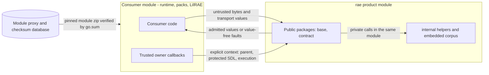

# Public Go packages for issue #1892

Issue [#1892](https://github.com/OpenRAE/rae/issues/1892) makes the required `rae` packages importable by the runtime repository and other consumers.
The [consumer API reference](issue-1825-public-go-api.md) names the packages and their interfaces.
The [repository boundary](issue-1891-runtime-repository-boundary.md) fixes their owners.
This change only moves packages, wires imports and adds the thin operations that #1825 assigns to #1892.
It changes no schema, identifier, fixture result or exported behavior.

## Scope and ownership

Go permits an import of an `internal` package only from the tree of its parent.
The runtime repository and the external consumers are outside that tree.
Thus each required package moves out of `internal`, to the path that the consumer plan names.

| Old path below `implementations/go` | Public path | Owning design |
| --- | --- | --- |
| `internal/base/fault` | `base/fault` | [shared primitives](issue-1779-shared-primitives-completion.md) |
| `internal/base/clock` | `base/clock` | [shared primitives](issue-1779-shared-primitives-completion.md) |
| `internal/base/ingress` | `base/ingress` | [architecture contract](issue-1859-go-architecture-contract-design.md) |
| `internal/base/canonjson` | `base/canonjson` | [architecture contract](issue-1859-go-architecture-contract-design.md) |
| `internal/base/digest` | `base/digest` | [architecture contract](issue-1859-go-architecture-contract-design.md) |
| `internal/base/address` | `base/address` | [architecture contract](issue-1859-go-architecture-contract-design.md) |
| `internal/contract/binding` | `contract/binding` | [contract validation](issue-1780-contract-validation-design.md) |
| `internal/contract/validation` | `contract/validation` | [contract validation](issue-1780-contract-validation-design.md) |
| `internal/contract/admission` | `contract/admission` | [contract validation](issue-1780-contract-validation-design.md) |

Each package keeps its owning design, layer, files and complete typed API.
Only the import path in the API snapshots changes.
The other base helpers stay below `internal`, because no consumer signature needs their identity.
`contract/corpus` also stays below `internal`.
It keeps the single embedded schema and vocabulary authority.
The product module path stays `github.com/OpenRAE/rae/implementations/go`.
No new module, repository or contracts package is necessary.

## Necessary adjustments

| Adjustment | Dependency that makes it necessary | Unchanged behavior |
| --- | --- | --- |
| Move the nine packages and rewrite their imports | Go refuses `internal` imports from another module | The moved package tests and the parity tests pass without a change |
| Generate bindings in `contract/binding` and keep corpus pieces in `internal/contract/corpus/data` | The generator wrote both below `internal/contract` | `contractgen -check` finds identical bytes and no extra files |
| ARCH-003 accepts a package at the public path of a planned consumer package of its layer | Each layer directory is below `internal` or `cmd` | Other placements still fail |
| ARCH-015 requires `existing` to name the public path | The relocation is complete | The API digest and issue 1892 checks remain |
| ARCH-015 compares the implemented extensions of an existing package with their declarations, in each build configuration | `contract/admission` now exists at its public path, and #1781 and #1788 add its other declarations later | An implemented declaration must match exactly; a planned one stays planned |
| ARCH-015 checks the imports of implemented packages, command entrypoints and their test files | The issue requires checks that reject reverse and private imports | No current package has such an import |
| ARCH-001 refuses a `replace` directive | Released module metadata must not carry a development override | No current `go.mod` has one |
| Add the archive and associated-artifact operations | #1825 assigns these thin compositions of existing owners to #1892 | They reuse the existing schema, default and invariant owners |

The predicate crosswalk in `specs/conformance/contract-predicate-sources.json` changes only its path prefixes.
An import rewrite changes no line number, so each recorded line still names the same code.
The CI steps, lint exception, policy references and Python policy test change only their paths.

## Contract admission operations

The operations are in `contract/admission`.
Their signatures are the [planned declarations](../../implementations/architecture-api/planned/rae/contract/admission.go.txt).
ARCH-015 compares each implemented signature with its declaration.

| Operation | Behavior |
| --- | --- |
| `DefaultAssociatedArtifactLimits` | Returns 1,024 artifacts, 4 GiB in total and 1 GiB for each artifact, as the reference does |
| `LoadAssociatedManifest` | Checks the manifest against its schema within the caller's byte and depth limits, and applies the published defaults; it makes no admission claim |
| `AssociatedArtifactSetDigest` | Derives the published set identity with the same projection that the existing invariant uses |
| `ValidateAssociatedManifest` | Refuses invalid limits and declared sizes above the caller's limits, then runs full admission with the admitted parent and the caller's readers |
| `MaterializationArchive` | Admits the typed inventory under the execution context, inserts it, applies the published defaults and admits the serialized record |
| `RestoreMaterializationArchive` | Checks the bounds and schema of the archive bytes before the owner reads them, admits them, then returns the record, its schema-checked inventory and the admitted value |

`MaterializationArchive` refuses a record that already supplies its inventory.
Thus a consumer does not construct or decode the nested raw JSON.
The archive invariant joins the inserted inventory to the attested SDL provenance.
`RestoreMaterializationArchive` does not admit the inventory again under a later execution context.
The archive invariant already binds the inventory to its protected SDL bytes.
The reference archive record in the existing inventory fixture is the expected serialization.

## External consumer fixture

The fixture module `example.com/raeconsumer` is in `implementations/go/testdata/consumer`.
The product module and the architecture check ignore `testdata`.
The fixture requires a pinned pseudo-version of a pushed `rae` commit.
Its `go.sum` pins the module and its dependencies.
It has no `replace` directive and needs no sibling checkout or workspace.
The `go` CI job checks it with `GOWORK=off` and read-only module resolution.
That step also runs `golangci-lint`, `raesvet` and the tests. It fails when verification changes `go.mod` or `go.sum`.

The tests use only public packages; the compiler refuses an `internal` import from this module.
They use the base primitives, schema and full admission, and the associated-artifact operations.
They also do the archive round trip with an omitted default.
They refuse stale context, a wrong parent binding, a missing execution, corrupted inventory bytes and invalid input.
The fixture data is a copy of one recorded execution and its retained archive record.

## Security and data flows

Assets: the published schemas and corpus, the admission decisions, the protected SDL archive bytes and the integrity of the dependency graph.
Trust boundaries: the module boundary between `rae` and its consumers, and the owner callbacks that supply trusted context.

| Threat | Control | Verification |
| --- | --- | --- |
| A consumer reaches private helpers | Go refuses `internal` imports from another module | The fixture compiles against public packages only |
| Runtime code reaches `rae` internals before extraction | ARCH-015 permits only implemented public `rae` packages, also for the runtime entrypoint and test files | `TestConsumerImportsStayOnTheRepositoryBoundary` and `TestConsumerTestImportsStayOnTheRepositoryBoundary` |
| `rae` code depends on runtime | ARCH-015 refuses a path from a `rae` consumer package or `raes-mcp` to runtime code, also from test files | `TestConsumerImportsStayOnTheRepositoryBoundary` and `TestConsumerTestImportsStayOnTheRepositoryBoundary` |
| A development override reaches released metadata | ARCH-001 refuses `replace`; the fixture step refuses `replace`, runs with `GOWORK=off` and fails when it changes `go.mod` or `go.sum` | `TestFindModulesListsEachReplacingModule` and the CI step |
| A substituted dependency | `go.sum` and the checksum database verify the pinned module | `go mod verify` in the CI step |
| A move changes generated authority | The generator compares the complete output at both destinations | `TestGeneratedDestinationsKeepTheCorpusInternal` and `contractgen -check` |
| An implemented operation drifts from its declaration | ARCH-015 compares the typed surface in each build configuration | `TestConsumerTypesCompareImplementedExtensions` |
| A caller inserts unadmitted inventory JSON | The archive operation owns insertion and refuses a supplied inventory | `TestMaterializationArchiveRefusesUnboundInput` |
| A stale context or foreign inventory | The existing archive and inventory invariants refuse the joins; the inventory is admitted under its own execution | `TestMaterializationArchiveAdmitsTheInventoryUnderItsExecution` and the fixture refusal tests |
| Unbounded archive bytes reach the trusted owner | Restoration checks the bounds and schema before the owner reads the record | `TestMaterializationArchiveBoundsRecordsBeforeTheOwner` |
| Payload exhaustion | Caller limits apply before payload reads; readers stop at the declared size plus one | `TestAssociatedManifestOperations` |
| Private values in errors | The operations return the existing value-free fault codes | The fixture checks the fault category |

The change adds no service, network call, credential, secret or log record.
The module proxy is the standard Go resolution path for a released module.

## Verification

Local checks are targeted: the moved packages, the parity package, the architecture and generator packages and the fixture.
CI runs the full Go suites, the mutation tests and the fuzz targets.

## References

- [Go module layout](https://go.dev/doc/modules/layout)
- [Go module release workflow](https://go.dev/doc/modules/release-workflow)
- [ADR-122](adrs/adr-122-go-architecture-model.md)
