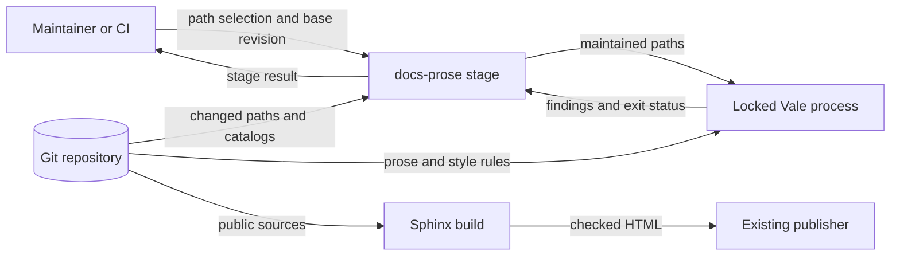

# Documentation entry paths preflight

Issue: #1932. Requirement: none. Date: 2026-11-07.
Source revision: `20dd892b97fb4e20af8a73c61dd04ef645dae307`.

This note explains the boundaries for the four entry pages. The supplied issue
is the delivery contract. This preflight does not rewrite those pages.

## Decisions and existing authority

Use the existing Sphinx/MyST build, Furo theme, and published URLs.
ADRs 009 and 019 and `specs/authority/authority-boundary.yaml` retain authority
over specifications and contracts. ADR-014 retains the verification graph.
ADR-021 retains evidence limits. ADR-115 retains external backend ownership.
No new ADR, schema, application abstraction, or documentation tool is needed.

The four pages have different entry contexts, with one purpose: route readers.
`README.md` serves GitHub and the PyPI description.
`docs/public/index.md` serves the hosted guide.
`docs/index.md` preserves an older repository entry.
`docs/README.md` routes readers to repository records and contributor guidance.
The latter two pages remain outside the hosted build.
They must still provide useful routes without requiring repository knowledge.

Offer Tutorials (learn), How-to guides (do a task), Reference (look up facts),
and Explanation (understand) as reader choices.
Retain audience routes without making four copies of the content tree.
Classify destinations by their actual purpose, not their directory name.
The [Diataxis compass](https://diataxis.fr/compass/) supplies that distinction.
Its [application guidance](https://diataxis.fr/how-to-use-diataxis/) rejects
empty structures and wholesale restructuring to fill four categories.

These existing destinations already support the routes:

| Reader need | Existing destination and boundary |
| --- | --- |
| First exercise | `docs/public/quickstart.md`: install the package and validate a local scenario; no infrastructure is created. |
| Continue learning | `docs/public/tutorials/first-scenario.md`: inspect and format; currently requires a checkout. |
| Author scenarios | `docs/public/sdl/index.md` and `sdl/validate-compile-plan.md`: author, validate, compile, and inspect. |
| Use APIs and commands | `docs/public/guides/python.md`, `guides/cli.md`, and `api/index.rst`; use the API reference for exact interface facts. |
| Look up language and contract rules | The canonical `specs/sdl/` and `contracts/` records, linked explicitly as repository sources. |
| Understand research | `docs/public/research.md`, `concepts.md`, `limitations.md`, and `citation.md`; research working records remain repository links. |
| Build a backend | `docs/public/backends.md`: portable contracts and conformance, with native lifecycle owned by the backend distribution. |
| Contribute | `CONTRIBUTING.md` and `docs/README.md`: checkout, checks, workflow, and decisions after the reader selects this route. |

The hosted entry and README must link directly to the same first exercise and
research explanation. Keep citation guidance near those choices.
Do not make concepts, contributor setup, or an external backend install a
prerequisite for the first validation result.
The current LilRAE lead link describes a different task: running a scenario.
Keep validation, planning, fixture conformance, and native execution distinct.

## Reuse and differences from earlier work

Reuse `docs/research/landing-page-precedents-2026-10-09.md` from #938.
Preserve its dated source comparisons as evidence.
Its inline exercise and shared page order describe the earlier design.
Issue #1932 replaces that layout with short routing pages.
The style guide now distinguishes routing pages from task pages.
Retain the earlier ownership, limits, citation, and accessible-diagram work.

The existing checks contain layout assumptions that implementation must reconcile:

- `test_issue_938_landing_page.py` requires repeated commands, matching prose,
  matching links, and a diagram on both primary entry pages.
- `test_public_docs_policy.py::test_readme_quickstart_matches_checked_in_scenario`
  requires an inline README scenario.
- `tools/nox_support/config.py::PUBLIC_DOCS_EXAMPLE_TESTS` selects those tests.

Change obsolete layout assertions to protect useful destinations and consistent
route targets. Keep execution checks on the canonical exercise and preserve
accessibility checks for diagrams wherever they remain.
Do not keep duplicate exercises merely to satisfy old assertions or delete
behavioral coverage to make routing changes pass.

`tools/check_project_positioning.py` independently requires the full RAES name,
agentic-environment framing, and the README's non-exhaustive application areas.
Shortening prose must retain these facts and the bounded reproduction claim.
`implementations/python/hatch_build.py::ReadmeMetadataHook` makes the root
README the PyPI description. Use links and markup that work there as well as
on GitHub; MyST directives belong only in Sphinx sources.

Check current code before reusing historical command claims.
For example, `raes_cli/main.py` now registers `raes semantic`, including
validation. The older #928 preflight is not the current command inventory.
`raes/parser.py::parse_sdl_file` and existing executable documentation tests
remain the first exercise's behavioral authority.

## Cross-cutting layers

The artifact flow is maintained source to checked HTML to the existing publisher.
The root README also flows through the existing packaging metadata hook.
Links to repository records do not authorize copying them into the hosted site.

| Layer | Canonical incumbent and required treatment |
| --- | --- |
| Publication containment | `tools/check_public_docs.py`, `tools/public_docs_markup.py`, and `tools/public_docs_guard.py` enforce `docs/public/`. Keep includes, images, downloads, and recorded dependencies inside that root. No symlinks or relative links that escape it. Use absolute repository URLs for external records. |
| Shape and parser gates | Sphinx owns MyST, reStructuredText, toctrees, and references. `docs/public/conf.py` loads the string-to-string redirect map. Preserve `redirects.json` and the checker's established redirect contract; no page moves are needed for this issue. |
| Build configuration | `tools/nox_support/config.py` owns `PUBLIC_DOCS_ROOT`, `DOCS_BUILD_ROOT`, and test selectors. `_run_docs` in `test_lanes.py` owns source checks, Vale, executable examples, warning-strict HTML, and output checks. `noxfile.py` registers the sessions. Reuse them. |
| Delivery and selection | `AGENTS.md`, `.ground-control.yaml`, `.gc/plan-rules.md`, `tools/verification_plan.py`, and `.github/workflows/ci.yml` retain workflow and check selection. Use the existing requirement-free route and a PR against `dev`. |
| Host and release | `.github/workflows/docs.yml` and `.readthedocs.yaml` use the current source root and frozen Python dependencies. `docs/Makefile` uses the same root. Keep the installed-distribution version source and honest fallback in `conf.py`. Local release metadata says 11.0.1; that does not verify the deployed site. |
| Authorization and secrets | Keep the existing workflow token permissions and main-only Pages deployment. Retain `.pre-commit-config.yaml` hygiene, private-key checks, and Gitleaks. No new account, token, external processing, upload, or preview service. No credentials or host environment values in prose or generated output. |
| Environment and OS exposure | No new environment binding, command interpolation, runtime config, or secret-bearing argv. Reuse fixed nox/Sphinx/Vale arguments and repository-contained output. `tools/vale_tool.py` owns admitted, verified Vale acquisition. |
| Errors and observability | Policy checks reuse `tools.policy.common.PolicyFailure`, safe paths, and bounded rendering. Tools retain `raes_contracts.errors` and `operational_logging.run_application`; nox retains `SessionReporter`. Sphinx retains native warnings. No new exception hierarchy, error envelope, logger, or audit stream. |
| Claims and prose | Reuse the positioning checker, `.vale.ini`, `styles/RAES/`, and the documentation skill. Manual STE review preserves technical meaning, obligations, units, and identifiers. Vale alone cannot prove conformance. |
| Persistence and authority | Maintained Markdown, existing package metadata, and disposable `docs/_build/` output are sufficient. No database, DTO, controller, service, repository class, parallel schema, or generated navigation registry. Normative sources remain linked authorities. |

Repository-only decisions and research must remain outside hosted HTML, search,
sitemap, downloads, and images. Hidden navigation is not a publication barrier.
The output checker derives allowed routes and assets from the public sources.
Do not weaken this boundary to share prose between entry pages.

## Extensibility and verification boundaries

Existing page paths and the public toctree are the navigation seam.
Keep destination URLs stable. Later improvements to an exercise or explanation
can change its content without edits to the four entry pages or build code.
`PUBLIC_DOCS_ROOT` remains the publication parameter; a real future URL move
uses the existing redirect mechanism. No new route manifest is warranted.

Implementation evidence must record the source revision, source paths, commands,
results, corrected differences, and exclusions in the PR.
Follow first-use, exact-reference, research, and contributor paths from each
applicable entry. A successful link check alone does not prove a useful route.
The Sphinx link checker ignores this repository's GitHub URLs; verify those
paths and useful fragment targets explicitly at the named revision.
Preserve useful heading anchors as prose moves; page redirects do not restore
removed fragments.

Reuse `docs-local` for the existing documentation gate and `docs-links` for
external links. Use targeted local tests; full suites remain in CI/CD.
The `docs-prose` session selects changed Markdown and reStructuredText across the
repository, including `docs/index.md` and `docs/README.md`.
Do not add a tool, broaden the corpus, or introduce a waiver to skip them.

Inspect the rendered hosted pages, README/PyPI-compatible content, and changed
repository-only prose. Check heading order, descriptive links, keyboard focus
and activation, and diagram text alternatives. Meaning must not depend on color.
Furo's `navigation_with_keys` setting does not prove keyboard accessibility.
Use the W3C guidance on [heading order](https://www.w3.org/WAI/tutorials/page-structure/headings/)
and [diagram descriptions](https://www.w3.org/WAI/tutorials/images/complex/).
Record any unverified render or interaction separately from passing checks.

## Non-goals and anti-patterns

No build or theme migration, Go instructions, new hosting, or publication action.
Issue #1803 owns Go instruction migration; #1804 owns the combined cutover.
Recheck the actual implementation revision if those boundaries change.
No release metadata, changelog, or dependency lock changes.
One implementation PR delivers #1932; no invented requirement UID or parallel
workflow is needed for this requirement-free issue.

No broad rewrite of linked destinations or four duplicate documentation trees.
Destinations must be useful now, without placeholders or dependencies on later
issues. Correct a blocking discrepancy against current code and report any
normative conflict; do not redefine a contract through explanatory prose.
Preserve legal text, quotations, generated artifacts, and pinned evidence.
Do not silently exclude maintained sections from the review.

RAES owns language, portable processing, contracts, and conformance.
LilRAE, Shifter, and other backend distributions own their native realization.
env-packs owns pack structure and authoring workflows.
Adapters remain separate projects; do not imply a release or compatibility that
has not been checked. Fixture success does not certify a live backend.
No runtime, API, auth, validation, logging, persistence, or schema behavior changes.

## Scope expansion for issue 1931

The user expanded this scope on 2026-11-07.
PR #1953 delivered issue #1931 to `go-cutover`, so `dev` does not have that work.
This delivery adds the documentation part of #1953 to `dev`.
The source commit is `04055a9ce1`.

| PR #1953 part | Treatment on `dev` | Reason |
| --- | --- | --- |
| Style guide and `AGENTS.md` route | Include | Issue #1932 needs this guidance. |
| `docs-prose` session and `_run_docs_prose` | Include | The same files apply to `dev`. |
| Base revision in the CI docs step | Include | CI selects changed prose with this revision. |
| Tests for prose selection | Include | These tests protect the included behavior. |
| Verification record | Include without parity sections | The record supplies the evidence for the included part. |
| `tools/parity_corpus.py`, `tools/parity_regressions.py`, and their tests | Exclude | These files do not exist on `dev`. |
| `refresh-parity-inputs` CI input and workflow text | Exclude | No `dev` job reads this input. |
| `architecture.modules` in `.ground-control.yaml` | Exclude | The Ground Control server refuses this block. |
| Digest in `historical_identity_records.json` | Exclude | `dev` has no digest field. |

## Architecture

The change has two parts: prose checks and entry pages.

`tools/nox_support/test_lanes.py` owns `_run_docs_prose`.
The public interface is the `docs-prose` nox session.
`docs-local` and `docs` call the same stage.
The stage reuses the selector grammar, Git collection, catalog validators, and path guards.
An unsafe path or a malformed catalog stops the stage with `InvalidInputError`.

The four entry pages hold routes, not task steps.
`docs/public/quickstart.md` owns the first exercise.
Each entry page keeps its current headings, so existing heading links remain valid.
Page URLs do not change, so `redirects.json` does not change.

## Systems security

| Asset | Threat | Control | Verification |
| --- | --- | --- | --- |
| Repository files outside the checkout | A selected path escapes the repository | `safe_repo_path` refuses the path | `test_issue_1931_documentation_tools.py` |
| CI command line | A path starts with a hyphen | The Vale command uses `--` before paths | `test_issue_1931_documentation_tools.py` |
| Protected records | The check treats pinned evidence as maintained prose | Catalog readers report exact protected paths | `test_issue_1931_documentation_tools.py` |
| Hosted site boundary | An entry page publishes repository records | Entry pages use absolute URLs for those records | `check_public_docs.py` and the `docs-local` session |
| Files on the runner | A selected reStructuredText file reads a file with a directive | The pinned Vale runs `rst2html` with `--no-file-insertion` | `test_issue_1931_documentation_tools.py` |
| Frozen ADRs | The check treats a superseded ADR as maintained prose | `_frozen_adr_paths` reports the ADR by its status | `test_issue_1931_documentation_tools.py` |
| Vale binary | CI runs an unverified binary | `ensure_vale` verifies the locked archive | `test_vale_tool.py` |
| CI base revision | A workflow expression changes the shell command | The step passes `BASE_REV` through `env` | `test_issue_1931_documentation_tools.py` |

The change adds no credential, service, upload, or dependency.
Residual risk: Vale does not prove STE conformance or technical accuracy.
Manual review covers these two subjects.

## Data flows

The maintainer or CI supplies the selection. The stage reads Git data and catalogs.
Vale reads prose and style rules, then returns findings to the stage.
The stage returns the result to the maintainer or CI.
Sphinx reads only public sources and sends checked HTML to the existing publisher.
The trust boundary is the repository root. External URLs are links; no check sends prose to them.

No other diagram is necessary. This change adds no component, deployment, or state.
No ADR changes are necessary. ADR-014 covers the nox graph, ADR-059 covers ADR pins,
and ADR-096 covers the historical records.
No policy-as-code rule changes. The landing-page tests change with the page layout.
No architecture-as-code file changes, because schema version 1 has no architecture block.
