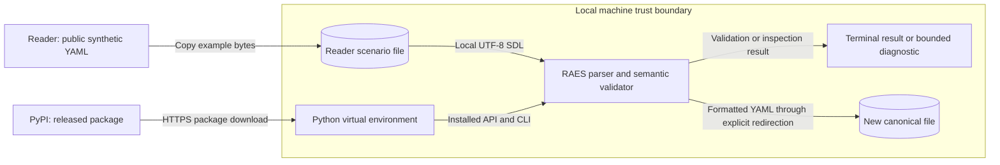

# First scenario learning path design

## Reader result

The quickstart and continuation are one tutorial for the released Python package.
The reader checks the existing two-node file before reading repository examples.
The next lesson changes host RAM.
It rejects a missing network reference, restores it, and checks the canonical format.
Both pages use the same directory, environment, and local file.

The examples index is a catalogue.
Each entry gives its purpose, required support, and a reference link.
Detailed catalogue and experiment API facts belong in the example-library reference.
Specialist notes describe the authored input and its support limits.
Existing page addresses and useful heading anchors remain available.

## Components and interfaces

The public interfaces are `parse_sdl_file`, `raes semantic validate`, `raes semantic inspect`, and `raes sdl format`.
RAES 11.0.2 supplies these interfaces through the PyPI `raes` distribution.
Its source is tag `v11.0.2`, commit `036c832d5693c5f6f9351d3a8e1264e5fcfc43e3`.
The first exercise needs standard CPython 3.14, pip, venv, and Bash.
Internet access is needed for installation. The exercise then operates on local files.

The existing parser, typed models, validator, CLI, and error handlers keep their roles.
The documentation introduces no new executable interface or dependency.
The original scenario and template bodies stay intact.
Catalogue IDs and historical evidence also stay intact.
Library prose and YAML comments get the same language review as Markdown.

`OpenRAE/rae` owns the language, processor, portable runtime interfaces, and fixtures.
Concrete backends own native deployment and execution under ADR-115.
The catalogue links to their guides.
It claims no compatible version or native result.
Future releases can repeat the lesson through the same public interfaces.

## Data flows and security

The diagram shows the package download and local file checks.
The file stays local during validation, inspection, and formatting.
No backend, runtime store, remote import, private content, or credential is needed.
Strict source checks and semantic validation protect the parser boundary.
The planned error uses a synthetic missing reference.
The CLI keeps its sanitized diagnostic.
A clean install check verifies the released package.
It uses no checkout imports or cached packages.
Formatting writes a separate file.
This prevents shell redirection from emptying the source.
Package trust remains the existing PyPI installation trust boundary.
This documentation change introduces no additional service or transfer destination.

## Architecture and policy artifacts

The data flow diagram also shows the components for this local exercise.
The exercise creates no deployment or runtime state.
Those diagrams need no changes.
Existing source guards, Sphinx, Vale styles, and the catalogue checker remain the controls.
Focused example tests check the lesson.
No policy-as-code or architecture-as-code change is needed.
Component roles and executable behavior stay the same.
No ADR changes are needed. ADR-115 already assigns native backend ownership.
The preflight note records the remaining binding architecture constraints.

## References and document review

- [Diataxis tutorials](https://diataxis.fr/tutorials/): visible results, concrete steps, and limited explanation; current guidance inspected 2026-11-07.
- [Python 3.14 venv reference](https://docs.python.org/3.14/library/venv.html): environment isolation and shell activation.
- [ASD-STE100 Issue 9](https://doi.org/10.5281/zenodo.23666005): sections 1, 5, and 6 for terminology, procedures, and descriptions.
- [Documentation style guide](../explain/reference/documentation-style-guide.md): page purpose, changed-path checks, and preserved evidence.
- [Architecture preflight](issue-1933-first-scenario-learning-path-preflight.md): source boundaries and existing helpers.

This document describes the design. Implementation tasks and verification results belong in the issue and PR.
The review checks technical nouns and short sentences.
Instructions use the imperative.
Each paragraph has one topic.
Code, identifiers, quantities, obligations, and preserved evidence retain their technical meaning.
