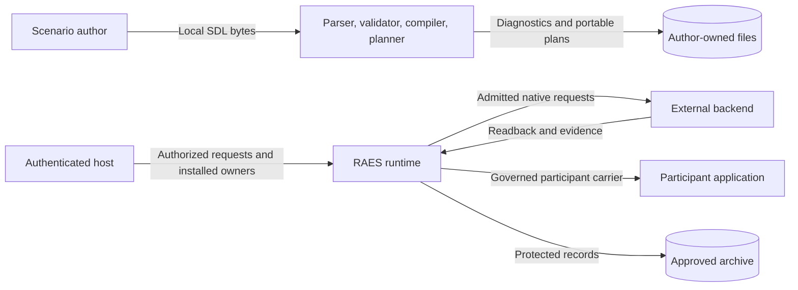

# Task guide boundaries

This design applies the issue 1909 documentation design to task guides.
The source baseline is `a89dd71a6edce5351a3f0d72bdc8beed1ab0867e`.
Published usage stays on Python until the coordinated Go cutover.

## Reader interfaces

Keep existing page paths and useful heading targets.
Each task states its inputs, permissions, effects, result, failure, and recovery.
Put these conditions beside the affected step.
Use entry pages to select tasks.
Move theory and catalogues to linked explanation or reference pages.
Participant-control theory stays in the public source boundary.
Command results use a public reference page.
Migration compatibility tables and the dated identity inventory use `docs/explain/reference/`.
Keep operating steps and old heading routes at the original migration URLs.
Keep pinned JSON claims unchanged.
Preserve historical inventory facts and source pins.
Historical migration records retain their original version and evidence boundaries.
Give those records a route to current instructions.

SDL tasks use `raes`, `raes_processor`, and `raes_cli` public interfaces.
Runtime tasks use the `raes_runtime.RuntimeControlPlane` public interface.
Backend protocols and conformance belong to `raes_backend_protocols` and `raes_conformance`.
RAES owns portable artifacts and runtime admission.
Backend distributions own native resources, credentials, effects, and cleanup.
OpenRAE/env-packs owns pack distribution.
No new executable module or public API is needed.

## Information and trust boundaries

Local semantic checks stop before the external backend boundary.
Runtime tasks cross that boundary only through explicitly installed owners.
Do not give participant applications administrative credentials or raw archives.
Archive writes need a deployment-approved destination.
Keep read-only inspection separate from requests that change runtime or infrastructure state.
An accepted receipt does not establish cessation, delivery, observation, or cleanup.
Unknown effects retain their original reservations and recovery obligations.

Documentation checks use local examples and existing test doubles.
They must not deploy infrastructure or certify an external backend.
For unavailable service checks, name the missing version and installation.
Name the missing authority and native evidence too.
Portable test success cannot establish production behavior.
That risk remains.
Exact backend release gates remain necessary.

## Existing controls and design decisions

Reuse the documentation style guide, Sphinx/MyST, Vale, and existing sample tests.
Use Diataxis how-to guidance for tasks.
Use its compass for page purpose.
Use Stripe's contextual prerequisites and visible results as an editorial pattern.
Review STE meaning and technical terms.
Check sentence length separately from lint.
The official STE website returned HTTP 403 during source retrieval.
Do not claim a complete dictionary audit from automated style results.

No policy or architecture code changes are required.
The interfaces and dependencies stay unchanged.
No new ADR is required.
Existing decisions cover documentation and backend ownership.
The data-flow diagram above covers the documentation's security boundaries.
No deployment or state diagram changes are needed because runtime behavior stays unchanged.
Preserve ADR-009 publication authority, ADR-061 compatibility, and ADR-115 backend ownership.
Keep schemas, generated output, legal text, source captures, and release versions unchanged.
Apply the ADR-009/061 amendments from issue 1929 to publication references.
Publication records hold identity, schema path, and stability.
They hold no hash or change summary; Git holds schema history.
Runtime content pins still use exact artifacts and the owning protocol's digest rule.
Correct stale references in adjacent contract guides and evolution records too.
These corrections align descriptions with the amended policy; they add no new policy.
