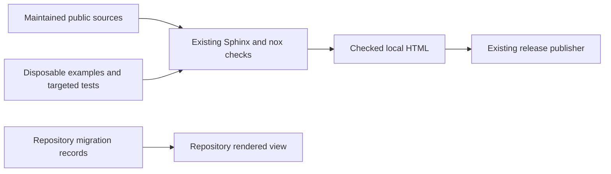

# Task guides and migrations preflight

Issue: #1934. Requirement: none. Date: 2026-11-07.
Source revision: `a89dd71a6edce5351a3f0d72bdc8beed1ab0867e`.

This note gives architecture guardrails for the supplied issue contract.
It does not rewrite the guides or prescribe an implementation sequence.
No new ADR, component, schema, or documentation tool is needed.
The [documentation style guide](../explain/reference/documentation-style-guide.md)
and [entry-path preflight](issue-1932-documentation-entry-paths-preflight.md)
already define the editorial and publication rules.

## Reader tasks and authority

Give each guide a named result and one reader purpose.
A tutorial can build one example through several steps.
A how-to guide must let a reader complete a known task without that tutorial.
Keep API lists in reference pages. Keep theory in explanation pages.
Do not create four duplicate content trees to classify pages.

Put prerequisites, inputs, permissions, effects, outputs, failure, recovery, and cleanup beside the affected action.
Identify installed-release tasks separately from checkout-only tasks and host-composition fragments.
Link each outcome to its exact reference and explanation.
Keep useful heading anchors when splitting a page; a page redirect does not preserve removed fragments.

Code establishes observed usage at the named revision.
`specs/authority/authority-boundary.yaml`, ADR-009, and ADR-019 retain normative authority.
Report a code/contract conflict for resolution; prose cannot change a normative obligation.
`specs/evolution/versioning-deprecation-and-migration.md` distinguishes compatibility dimensions.
Use that distinction rather than introducing a universal migration version.

The checkout records release 11.0.2 in `.release-please-manifest.json`.
That record does not establish the installed package or deployed documentation version.
`docs/public/conf.py` derives its version from installed distribution metadata.
Recheck the actual source and supported release before editing instructions.
Issue #1803 owns the Go build and instruction migration; #1804 owns publication at cutover.
Keep the current Python/Sphinx/MyST route until that boundary changes.

## Scope and existing verification

The baseline contains 35 Markdown pages and three JSON artifacts:

```shell
rg --files docs/public/guides docs/public/sdl docs/migration
```

The count also includes `docs/public/backends.md` and `docs/public/participant-control.md`.
The implementation PR must account for every page. This includes migration prose that stays in the repository.
Record splits, retained history, current routes, redirects, and exclusions with their reasons.
The JSON artifacts under `docs/migration/classification-examples/` are also part of the review boundary.
Their README distinguishes illustrative bindings from the pinned historical inventory.
Do not rewrite historical evidence or present its authored labels as an authoritative external catalogue.

Reuse these existing behavioral checks; layout assertions must follow any supported page split:

- `test_public_guide_examples.py` executes Python and semantic CLI samples and tests refusal mutations.
  It currently assumes five Python blocks and a fixed CLI operation sequence.
  Other guide fragments can carry `example-skip` reasons; those reasons do not establish execution evidence.
- `test_issue_613_scenario_plan_guide.py` executes every intermediate SDL step, outputs, diagnostics, and plan inspection.
  Preserve its `scenario-plan` markers or adapt the existing extractor to the new destinations.
  Its default dry-run plan intentionally exits 1 for `capture.offer-missing` while still emitting a plan.
- `test_semantic_cli.py`, `test_plan_inspection_cli.py`, and `test_backend_conformance_cli.py` cover the distinct command surfaces.
- `test_runtime_control_plane_api.py` covers identity, request bounds, redaction, idempotency, and single-worker refusal.
  `test_issue_1187_control_plane_security_conformance.py` covers provider leakage.
- Existing migration tests include `test_classification_migration.py`, `test_issue_1210_semantic_migration.py`,
  `test_issue_1338_identity_migration.py`, and `test_issue_1363_mixed_control_migration.py`.
  Select the owning tests for each rewritten procedure; this list is not a complete verification claim.
- Experiment evidence belongs with `test_issue_1630_record_*.py` and the relevant `test_issue_1629_*` cases.
  External backend isolation is covered by `test_issue_967_portable_backend_boundaries.py`.

Reuse #613 evidence through its executable guide and corpus scenario.
No #1554-labelled evidence was located in this checkout.
The existing guide execution tests came from commit `027dd8f3a3` (PR #1492).
Do not relabel that evidence as #1554 or claim that the requested evidence reuse is complete.

Use the existing writing checks on explicit changed paths and targeted behavioral tests locally.
Full suites remain in CI/CD. Mutation checks belong with executable examples where useful.
This preflight adds no executable behavior that needs a new mutation suite.
The PR evidence must name each section's purpose, source paths, revision, commands, versions, results, and corrections.
For unavailable external systems, state the unverified boundary and exact missing evidence:
owner, backend release and RAES pairing, installed capabilities, command, readback, and cleanup result.
An importable fragment, skipped example, or fixture report cannot replace that evidence.

## Task interfaces to reuse

All package paths below are under `implementations/python/packages/`.

| Task boundary | Canonical incumbent and guardrail |
| --- | --- |
| Authoring and parsing | `raes/parser.py`, `_yaml_loader.py`, `_source_profile.py`, and `validator/` own bounded input, duplicate-key rejection, typed structure, and semantic checks. Use public `parse_sdl` and `parse_sdl_file`; do not copy validators into examples. Text parsing and semantic CLI input do not compose file imports. File parsing has its own import-resolution boundary. |
| Semantic operations | `raes_cli/semantic.py`, `_semantic_sdl.py`, `_semantic_portable.py`, and `_semantic_result.py` own operation support, typed results, diagnostics, and exit statuses. Structural parsing is weaker than semantic validation. Unsupported operation/contract pairs are refusals, not empty successes. |
| Compilation and planning | `raes_processor`, `raes_cli/processor.py::load_backend_manifest`, and `planner/manifest_validation.py` own compiler and capability admission. A supplied manifest passes bounded JSON, published v2 model, and capability checks. The CLI refuses unresolved realization envelopes. The default stub is a dry-run target, not an executing backend. |
| Portable records | `contracts/schemas/`, `contracts/fixtures/`, `contracts/profiles/`, `contracts/schema-publication/`, and `raes_contracts` own published shapes and readers. Reuse `json_ingress.parse_bounded_json` and the owning contract model. No duplicate DTO, relaxed unknown-field reader, schema, or guide-specific validation. |
| Runtime lifecycle | `RuntimeControlPlane`, `control_plane_configuration.py`, `operation_supervision_configuration.py`, and the existing operation ledger own admission, effects, time budgets, retry, and recovery. A receipt proves acceptance only. Cancellation does not prove cessation; close does not imply native teardown. |
| Participant control | The existing crossing, information-flow, mixed-control, inject-delivery, and tool-action owners retain their separate authorities. World truth, governed views, participant-visible history, and archival evidence remain separate. A permitted crossing, released carrier, delivery, and observation are separate facts. |
| Experiment records | `runtime_experiment_records.py`, `experiment_records.py`, and the owning contract validators preserve started runs, missing measurements, scientific outcomes, evidence, and cleanup independently. Evidence readers have ownership and closure rules. Record building is not authorization to fetch arbitrary artifact URIs or write an archive. |
| Persistence | Existing `ControlPlaneStore` providers, store leases, path guards, record migrations, and `raes_cli/runtime.py` own durable state and offline maintenance. `raes_operations.run_artifacts.RunMaterializationArchive` owns portable materialization records. No new repository layer, database, direct SQL procedure, or archive converter. |
| External handoff | ADR-115 retains `RuntimeTarget`, manifests, capability profiles, and `raes_conformance.conformance` as the seams. RAES owns portable contracts and enforcement. `OpenRAE/lilrae` owns LilRAE realization and native lifecycle. Name the actual owner and artifact version for each other backend or integration; Shifter and env-packs have their own boundaries. |

Fixture conformance through `run_fixture_suite` or `raes conformance backend` checks published fixtures.
`run_target_conformance(target)` exercises an explicitly supplied target and can invoke its effects.
Treat the latter as an integration boundary until the target's behavior and permissions are established.
RAES ships no executing inject provider. Do not turn stubs or manifest declarations into native support claims.

## Security and host layers

Examples pass through the same gates as application code.
Simplifying prose must not remove a gate or move a trusted decision to an untrusted caller.

| Layer | Required treatment and existing owner |
| --- | --- |
| Configuration shapes | `ControlPlaneConfiguration` validates installed bindings and their compiled context. `ControlPlaneSecurityConfig` requires real booleans and integers, immutable role sets and binding tuples, bounded identities, and exact target bindings. Parse environment strings explicitly; never use `bool("false")` or substitute dictionaries for typed owners. |
| Authentication and authorization | `control_plane_api/_auth.py` checks exactly one route authority and seals app composition. P2 is a private administration/service API over P1. The host authenticates end users and authorizes each release. Transport roles do not confer participant disclosure or controller authority. Strict defaults trust no token or proxy header. |
| HTTP and portable input | `control_plane_api_guards.py`, route ingress, `raes_contracts/json_ingress.py`, and owning models retain their distinct bounds. The global body guard runs before authentication; route-specific decoding follows admission. Preserve duplicate-member, nonfinite-number, depth, size, and unknown-field refusals where enforced. Do not describe one route's bounds as universal. |
| Imported sources | `raes/module_registry/` retains lockfile, digest, signature, trust-policy, and extraction checks. File composition must use the documented resolver and pinned sources. Keep verification examples local. Offline semantic commands do not imply that file-based import resolution is offline. Pack distribution remains owned by env-packs. |
| Secrets and OS exposure | Use the host's existing secret channel and authorized backend sinks. Keep tokens, credentials, protected prompts, and private command keys out of argv, URLs, shell tracing, process dumps, copied output, fixtures, and archives. A secret reference is not permission to export its value. No documentation check reads real credentials or contacts a native daemon. |
| Host and transport | `control_plane_store_lease.py` enforces one owner and checks `WEB_CONCURRENCY` and `UVICORN_WORKERS`. Keep reload disabled. TLS, proxy header stripping, server connection/time limits, and network isolation remain host responsibilities. Do not mutate the sealed app after construction. PostgreSQL and Temporal need separately approved infrastructure and typed configurations, not automatic example setup. |
| Errors and logging | ADR-116, `raes_contracts.errors`, `operational_logging`, `diagnostics`, and `control_plane_api/_responses.py` own categories, safe responses, and value-free logs. Keep CLI stdout results separate from stderr logs. Do not print raw exception text, Pydantic inputs, provider output, or participant-facing administrative errors. Embedding and ASGI hosts must preserve safe logging too. Operational logs, scientific evidence, and authorization audit records serve different purposes. |
| Durable recovery | Store path guards, exclusive leases, target/run scopes, checksums, revision checks, and request commitments remain binding. Offline check/backup/restore requires the stopped owner's store and exact scope. Startup can migrate a supported older store; maintenance check instead requires the current schema. Restore and replacement are explicit writes. Neither restore nor restart grants redispatch of uncertain effects. |
| Publication and tooling | `check_public_docs.py`, `public_docs_markup.py`, and `public_docs_guard.py` contain sources, dependencies, images, and downloads within `docs/public/`. Link repository migration and design records with repository URLs; do not include them in hosted HTML. Existing `safe_repo_path`, `PolicyFailure`, and bounded diagnostics remain sufficient. |

Keep read-only semantic checks separate from file writes, archive writes, runtime mutations, and infrastructure effects.
Offline store inspection still acquires a lease and can use SQLite sidecar files.
It is not an unlocked filesystem read.
Execute safe procedures only in disposable local fixtures at their stated revision.
Do not execute historical teardown, external deployment, or live target conformance as a documentation check.

## Migration and extension boundaries

Name the source and target before giving conversion steps:
package release/commit, semantic revision, wire discriminator/schema content, profile, and store provider/schema.
Do not equate API-409 v2, a rev1 control policy, a package major version, and a SQLite schema number.
Use `docs/migration/revised-control.md` and its support reference for the existing cross-surface route.
Classify each migration by supported source and reader behavior, not by filename age.
Historical v2/v3 notes can describe independent opt-ins rather than obsolete package releases.

Retain original sources, sidecars, reports, digests, and reader identities.
Existing semantic, identity, classification, and mixed-control helpers own conversion and explicit loss decisions.
Do not add a universal converter, assume a lossless migration, relabel old digests, or rewrite retained outcomes.
Keep historical procedures as versioned records with a current route.
Rollback needs a compatible retained reader and store; it is not merely a package downgrade.

There is version drift to resolve in the implementation:
`guides/external-injects.md` names local schema 10 and PostgreSQL schema 3.
The inspected constants are local 12 in `control_plane_store_record_migration.py`
and PostgreSQL 5 in `control_plane_store_postgresql_schema.py`.
`guides/supervised-execution.md` also names the earlier SQLite schema 7.
These are code/prose discrepancies at the source revision, not proposed contract changes.
Check their release history before replacing historical statements with current instructions.

The extension parameters already exist: contract/profile identifiers, explicit manifests,
injected targets, runtime bindings, evidence resolvers, and typed host configurations.
Keep backend installation recipes with their distribution owner.
A later supported profile should use these seams and its own evidence without editing a central backend switch.
Stable page destinations and the existing toctree are the navigation seam.
For a published move, extend and test both `redirects.json` and the checker's exact redirect contract.
Do not weaken that contract to accept arbitrary routes.

## Artifact flow and delivery boundary

Maintained public sources and disposable example results enter the existing checks.
Checked HTML goes to the existing release publisher.
Repository migration records stay in the repository's rendered view.



This issue changes maintained prose and its existing execution checks where needed.
It creates no new component or runtime data flow.
`tools/nox_support/config.py` and `test_lanes.py` own source roots and check selection.
`docs-prose`, `.vale.ini`, `styles/RAES/`, and the locked `tools/vale_tool.py` own writing checks.
`docs-local` owns warning-strict HTML and output containment; `docs-links` owns external link checks.
The link checker ignores this repository's GitHub URLs; verify their paths and fragments explicitly.
Render repository-only prose too. Check heading order, descriptive links, and diagram text alternatives.
Check keyboard access when navigation changes. Vale and link success do not establish meaning or accessibility.

`AGENTS.md`, `.ground-control.yaml`, `.gc/plan-rules.md`, and `tools/verification_plan.py` retain workflow ownership.
Use the existing requirement-free route in `tools/nox_support/runner.py`; invent no requirement UID.
The issue calls for one implementation PR and its complete evidence inventory.
`.github/workflows/ci.yml`, `.github/workflows/docs.yml`, `.readthedocs.yaml`, and `docs/Makefile` retain build and release ownership.
This preflight performs no publication. No new hosting, upload, external processor, dependency, skill, or checker is authorized.
Preserve legal text, quotations, generated outputs, pinned evidence, and ADR freezes under their existing policies.
No runtime, API, schema, auth, logging, persistence, release metadata, or build migration is in scope.
