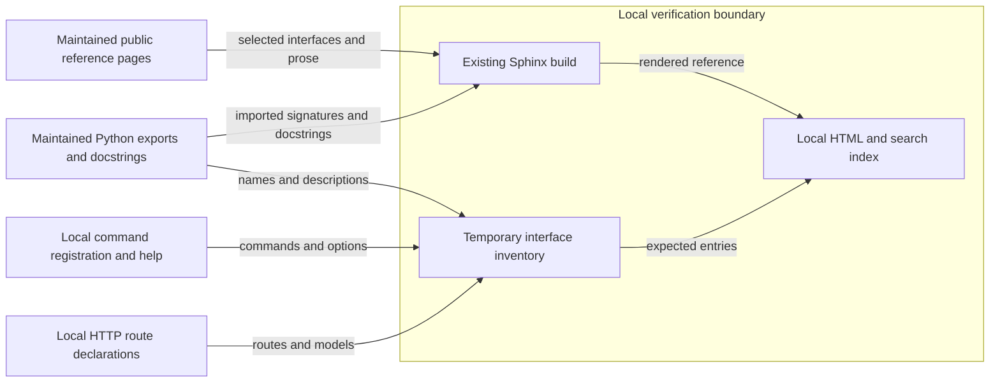

# API and command reference

## Purpose and boundary

The reference describes the Python APIs in the checked-out `raes` source.
The installed distribution reports version `10.2.0` at the initial assessment.
The delivery PR records the source commit and check results.
This document supplies the design for issue #1935 and applies the adoption design in issue #1909.

The build remains Sphinx 9.1.0, MyST, Napoleon and Furo.
Only `docs/public/` enters the public build.
Generated HTML stays outside version control.
Issue #1803 owns the Go documentation migration.
Issue #1804 owns publication.
This change grants no support claim to an internal package, draft contract or planned Go interface.

## Components and interfaces

The maintained reference pages select public APIs.
Autodoc reads names, types, defaults and docstrings from the installed Python packages.
Explicit export lists define each facade.
Existing documented modules retain their public definitions.
Imported facade members must remain visible, including members without docstrings.
Private implementation names and dependency imports are not new public interfaces.

The SDL facade, processor facades, runtime facade and contract facade keep their current imports.
The reference describes their existing responsibilities under ADR-015 and ADR-036.
Neutral contracts describe data and admission rules.
Their presence does not prove backend capability or grant execution authority.
The runtime owns execution and protected readback in the current Python distribution.
External backend implementations remain outside this repository.

The command reference follows the Typer command tree.
It gives inputs, defaults, output, errors and effects beside each command family.
The runtime store commands and `raes-mcp` entry point receive explicit entries.
The HTTP reference follows the routes registered by `create_control_plane_app`.
It states authentication, scope, request and response models, status codes and limits.
Task instructions remain in the existing guides.

## Data flows and protection

The protected assets are source, credentials, interface meaning and the public source boundary.
Autodoc imports Python code locally.
The existing source guard prevents documentation directives from publishing internal records or files outside the public source tree.
No new extension, documentation tool, remote processor, service or hosting destination is introduced.
Inventory and rendering use local files and existing dependencies.
HTTP inspection creates only a local reference application with a stub target.
It sends no request to an external backend.
Command inspection uses help and registration rather than executing commands with effects.

Missing entries are a coverage failure even when the build succeeds.
The source-derived inventory is compared with HTML anchors and Sphinx objects.
The PR records each corrected gap and each supported exclusion.
Existing parser, command and HTTP tests check the documented behavior.
The rendered review checks headings, signatures, links, search entries and keyboard navigation.
Style lint supplements manual checks of meaning and page purpose.
It does not prove technical accuracy or full STE conformance.

## Existing controls

`tools/check_public_docs.py` retains the source and output boundary checks.
The `docs-prose` lane checks explicit changed prose paths with the locked Vale binary.
The existing Sphinx build checks directive syntax and reference resolution.
Existing targeted tests cover parser errors, command results and HTTP admission.
Full tests and documentation verification remain in CI.

No Go code, package dependency, public signature or runtime rule changes.
The architecture model, system diagrams, normative contracts and accepted ADRs therefore retain their current content.
The diagram above describes the documentation data flow only.
The existing runtime diagrams continue to describe execution boundaries.
No new policy or authority ledger is needed.
The schema 1 configuration repair changes only comments relative to the integration branch.

## Reference sources

- [Sphinx autodoc](https://www.sphinx-doc.org/en/master/usage/extensions/autodoc.html): installed version 9.1.0; member selection, imports and docstrings.
- [Diataxis reference](https://diataxis.fr/reference/): information lookup, product structure and links to procedures.
- [Stripe API reference](https://docs.stripe.com/api/customers/create): keep parameters and returned results beside the operation.
- [Repository writing guide](../explain/reference/documentation-style-guide.md): STE meaning, sentence limits, protected text and rendered review.
- [ASD-STE100](https://www.asd-ste100.org/): official source; automated access returned HTTP 403 during assessment.

The writing review uses the repository's maintained guidance and preserves technical terms.
It checks sentence length, paragraph purpose and unchanged obligations separately from Vale.
No dictionary ruling is inferred from the unavailable official text.
