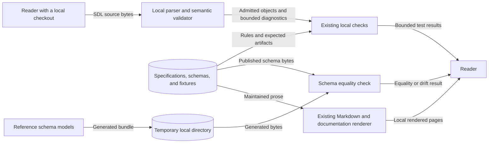

# Specification and contract reader boundaries

This design follows issue 1909.
It applies to issue 1936.
The source baseline is `c2fa955ee90d42950b075de3183dc2bef23ad9a4`.
Published usage stays on the supported Python release.
It changes at the coordinated Go cutover.

## Reader interfaces and authority

Keep exact language rules in `specs/` and contract artifacts in `contracts/`.
Use the existing directory indexes to help readers select a reference.
Keep each existing page address and useful heading target.
Reference pages describe required meaning, inputs, outputs, invariants, and limits.
Link reasons to existing explanations and decisions.
Put local check steps under `docs/develop/`.
Keep those steps in a separate how-to guide.
Keep code evidence separate from required behavior.

ADR-009 and ADR-019 own the authority boundary.
ADR-061 and its issue 1929 amendment own schema publication and compatibility.
Publication records contain identity, schema path, and stability.
Git records schema history.
ADR-079 owns proposition and assertion truth semantics.
ADR-109 owns objective ownership and participant assignment.
Use those decisions to correct old summaries.
Compare the summaries with current schemas and code.
Do not infer new semantics from implementation behavior.

The Python packages own their existing public interfaces:

- `raes`: source decoding, semantic validation, instantiation, and authored identity.
- `raes_schemas.schema_bundle()`: the reference schema bundle.
- `raes_contracts`: portable models, semantic validators, and contract seals.
- `raes_processor`: compilation, planning, and result admission.
- `raes_runtime`: operation admission, state, history, and runtime coordination.
- `raes_backend_protocols`: backend declarations and portable execution interfaces.
- `raes_conformance`: finite checks of declared contract support.

Add no module or public interface.
External backends still own native effects.
They also own cleanup.

## Data flows and security

Published rules, generated files, and local review output remain separate.
The equality checker writes generated schemas to a temporary directory.
It does not replace published schemas.
These steps need no native backend.
They deploy nothing.
They write no remote archive.
Local checks use checked-in synthetic fixtures.
No private instructions, credentials, runtime payloads, or hidden state enter documentation.

Protect required meaning and published identity.
Keep proof sources and evidence pins.
Keep private runtime data private.
Accidental schema regeneration can change published identity.
Use the existing equality checker and compare protected files with the source baseline.
Misreported evidence can suggest support that a backend does not have.
Keep each claim beside its evidence limit and owning implementation.
Unverified or absent behavior remains explicitly unverified or absent.
Finite checks do not prove general equivalence or deployed backend support.

## Documents and existing controls

The documentation style guide supplies page-purpose, STE, source, and rendering rules.
The Diataxis compass and reference guidance supply the reader-purpose pattern.
ASD-STE100 Issue 9 supplies the language rules and dictionary.
The local official PDF matches SHA-256
`d1f4ea9e7cd6e46b47aa9057209f99e78c0e9cfc4e27a5b07895b05c1a166431`.
The official website returned HTTP 403 during this review.
The standard and dictionary remain outside the repository.

Use existing Vale, Sphinx/MyST, policy checks, schema checks, and targeted conformance tests.
Do not add a documentation analyzer, service, dependency, or build migration.
Keep formal expressions, proof artifacts, fixture payloads, legal notices, and pinned evidence unchanged.
Review generated descriptions at their model or annotation source.
Do not rewrite a published description through direct output edits.
An annotation change that changes schema bytes needs the existing contract review boundary.

The existing `.vale.ini` supplies exact-file exceptions for the document reading metric.
Vale 3.15.2 does not apply inline rule controls to that metric.
Required schema terms, mathematical terms, and reference tables remain unchanged.
Other prose rules stay enabled on each listed file.
Unlisted pages retain the metric.
The existing documentation-tools test module checks these settings.
Its `prose_check.run` interface exercises the real pinned Vale.
No analyzer, validator, or new module is added.
Other policy code stays the same.
Architecture code stays the same.
The authority manifest and assurance policy continue to describe those boundaries.
Existing decisions cover authority and documentation organization.
No new ADR is needed.
The data-flow diagram above covers local documentation and verification flows.
Runtime behavior stays the same.
Existing state, deployment, and protocol diagrams still apply.

Keep the same actor, condition, quantity, and unit.
Keep the same qualifier and obligation.
Keep mathematical notation and formal identifiers exact.
Use short sentences and consistent technical terms.
Review page purpose and meaning separately from Vale results.
