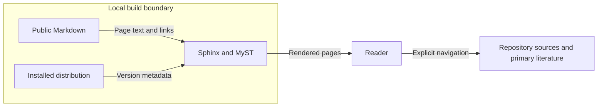

# Research discovery design

This explanation defines the documentation design for issue #1937.
The [preflight](issue-1937-research-discovery-preflight.md) supplies its boundaries.
The source baseline is `e71ddbc29e9e06658ddbe2b2c12edf8ed424f044`.
This commit identifies inspected Python behavior. It is not a release claim.

## Reader paths and interfaces

Keep four public addresses and the four existing concept headings.
Use explanation for concepts. Use an explanation entry for research.
Keep a citation how-to guide and a limitations reference.
Use ordinary links within the existing Sphinx/MyST build.
Keep specifications, decisions, and raw evidence outside its source root.

Three question routes connect meaning and realization, participant information,
and evidence for reproduction. Each route ends at a specific example or test.
Each gives code, specification, evidence, limits, and a next question.
The participant route links finite checks to the abstract opacity proof.
It distinguishes control permission, execution, delivery, and observation.

The first route starts with the existing first-scenario exercise.
The deeper routes use immutable repository links at the source baseline.
Research records keep their own declared revisions.
Their dates and revisions do not imply current backend support.
The citation guide retains the existing BibTeX facts.
It adds instructions for exact software, scenario, backend, and evidence identity.

## Components and data flows

| Source | Flow | Consumer | Boundary |
| --- | --- | --- | --- |
| Maintained public Markdown | Page text and ordinary links | Local Sphinx/MyST renderer | Only `docs/public/` supplies hosted page sources. |
| Installed Python distribution | Version metadata | Existing Sphinx configuration | A checkout version does not identify the reader's installation. |
| Repository code and specifications | Inspected behavior and required meaning | Documentation author | Public explanations cannot change normative requirements. |
| Reader | Explicit link navigation | Specific repository evidence or primary literature | Linked records are not included in the hosted search index. |
| Synthetic scenario and fixture files | Local parse or contract inputs | Existing Python public APIs | No deployment, credential, or external backend is needed. |

The diagram shows the existing static documentation flow.
Only public Markdown and installed version metadata enter the local renderer.
The reader follows ordinary links to sources outside the hosted build.
No runtime component, API, schema, dependency, or security boundary changes.
No deployment or state diagram needs a change.

## Security and assurance

Misstated evidence can cause readers to trust an unsupported configuration.
Place each limit beside its claim. Keep finite tests separate from proof.
Link the later correction to earlier opacity backend evidence.
Check that evidence references exist at the cited revision.

Raw records can contain restricted information.
Use checked-in synthetic examples and safe identifiers.
Keep sensitive material behind its existing access boundary.
Do not add uploads, remote includes, services, or new publication destinations.
Verify containment with the existing public documentation guard.

Use the existing frozen tools, Vale styles, source guard, and file-local policy.
No policy-as-code change is needed. No architecture model or control ledger changes.
No product code changes. No new enforcement or decision requires an ADR.
Future routes use the same question sections and ordinary links to fixed revisions.

## Writing and reference basis

The repository style guide owns the writing and meaning review.
Use short sentences, define specialist terms, and keep each page's reader purpose.
Retain literal identifiers, citation facts, normative obligations, and evidence.
Review prose manually as well as with Vale.
The official ASD-STE100 site identifies Issue 9, dated 15 January 2025.
Its complete dictionary requires an official-copy request.
This work uses existing maintained guidance and does not claim dictionary certification.

Diataxis explanation guidance supports connections, context, and bounded discussion.
Stripe's testing documentation supplies the established editorial pattern:
put a result's limits beside the result.
FMI 3.0.2 sections 1.2.2 and 4 separate simulation components and coordination.
W3C PROV-DM sections 2 and 5 describe provenance relationships.
Schoepe and Sabelfeld's 2015 opacity paper defines observer-relative secrecy.
These references explain questions. They do not certify RAES implementations.

The issue plan owns implementation tasks.
The delivery PR records commands and walkthrough results.
