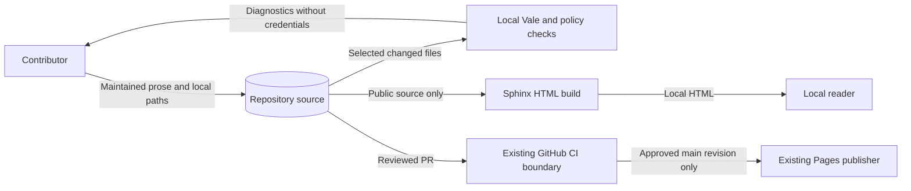

# Contributor and operator documentation preflight

Issue: #1938. Requirement: none. Date: 2026-11-09.
Source revision: `c8fc7245381742610f9ccf693ee47f81ba26b3d9`.

This note explains the design boundaries for the documentation rewrite.
The supplied issue is the delivery contract. This note is not an implementation plan.
No new ADR, tool, schema, or application abstraction is needed.

## Reader routes and authority

Keep setup, checks, debugging, release, architecture, and coding rules distinct.
Give each destination one reader purpose. Entry pages can route readers.
Select purpose from the content, not the directory name.
Do not create four copies of the documentation tree.

`CONTRIBUTING.md` owns the contribution entry route.
It must expose supported setup, a targeted check, and the pull request route.
`SECURITY.md` owns private vulnerability reporting.
`SUPPORT.md` owns ordinary support; public support and contribution pages link
to these root sources with absolute repository URLs.
Do not make governance history a prerequisite for these tasks.

Keep conduct reporting distinct from vulnerability reporting, even where contacts match.
Keep existing response limits; do not introduce a service commitment.

Use these existing destinations before creating another page:

| Concern | Existing owner |
| --- | --- |
| Delivery workflow | `docs/DEVELOPMENT_WORKFLOW.md`, `.github/PULL_REQUEST_TEMPLATE.md`, `.ground-control.yaml`, and `.gc/plan-rules.md` |
| Setup and tool admission | `implementations/tooling/README.md`, artifact lock and admission policy, frozen project locks, and `docs/explain/development-container.md` |
| Verification | `noxfile.py`, `tools/nox_support/`, `tools/verification_plan.py`, and `.github/workflows/canonical-verification.yml` |
| Exact coding rules | `docs/explain/reference/coding-standards.md` and `docs/develop/exceptions-and-logging.md` |
| Writing and review | `docs/explain/reference/documentation-style-guide.md`, `.vale.ini`, and `styles/RAES/` |
| Release | `docs/explain/releasing.md`, `.github/workflows/release-please.yml`, and release-please configuration |
| Architecture and authority | ADRs 009, 014, 019, 104, 115, 116, and 117; `specs/authority/authority-boundary.yaml`; `contracts/` |

Explain executable rules by linking to their owners. Do not reproduce validators
or workflow logic as a second policy. Agent prose must describe the same rules.
Review prose embedded in templates, workflows, skills, hooks, and style files.
Keep executable changes separate from prose corrections.
Report any required behavior change rather than hiding it inside this rewrite.

## Coverage and preservation

The delivery PR must account for every maintained prose file in the issue's roots.
Include nested implementation READMEs and prose in formats other than Markdown.
For each file, record purpose, rewrite or preservation action, and reason.
For rewritten sections, record source paths, revision, commands, results, and corrections.
Use the PR's existing evidence sections; no inventory schema or registry is needed.

Do not treat a directory name, checker exclusion, or old date as proof of preservation.
Separate maintained guidance from historical evidence within mixed pages.
Preserve `docs/development/authorship-anomaly-2026-07.md` as an incident record.
Use `tools/policy/historical_identity_records.json` and the ADR pin index for protected identities.
ADR-059 also freezes superseded and deprecated decisions.
Use its amendment process where applicable; do not change pins to admit prose edits.

Preserve adopted community rules, quotations, license terms, and third-party notices.
Improve their entry guidance without changing obligations or enforcement powers.
`CHANGELOG.md` is release-please output. Repository policy prohibits hand edits.
Meet its reader-route obligation through maintained entry pages, not generated entries.

Keep `LICENSE` text unchanged. Preserve legal text in `THIRD_PARTY_NOTICES.md`.
Edit generated prose at its maintained source when such a source exists.
Explain every exclusion in the PR; a lint exemption does not omit review.

## Cross-cutting layers

The data flow is maintained source, local checks and rendering, then the existing CI publisher.
This issue authorizes no publication action. Repository-only guidance stays outside hosted output.

| Layer | Required incumbent and guardrail |
| --- | --- |
| Publication and path validation | Reuse `tools/check_public_docs.py`, `tools/public_docs_markup.py`, and `tools/public_docs_guard.py`. Keep includes, images, downloads, and build dependencies inside `docs/public/`. Use repository links for outside records. Hidden navigation does not prevent publication through search or assets. |
| Markup and configuration shapes | Sphinx/MyST and `docs/public/conf.py` own parsing and navigation. `redirects.json` is a string-to-string map with an exact route contract enforced by `check_public_docs.py`. Preserve page URLs and useful heading anchors. A redirect does not restore a removed fragment. |
| Selection and protection validators | Reuse `_run_docs_prose` in `tools/nox_support/test_lanes.py`. It uses existing Git selectors, `safe_repo_path`, and protected-catalog validators. Explicit changed paths are its input seam. Do not bypass path containment or malformed-catalog failures. |
| Authentication and authorization | Preserve workflow permissions and main-only Pages deployment. Runtime explanations must follow `control_plane_security.py` and `control_plane_api/_auth.py`: P2 credentials are privileged, target-bound administrative identities. An audience binding does not make them participant credentials. Do not suggest trusting caller identity headers to fix an authentication failure. |
| Secrets and host exposure | Retain `.pre-commit-config.yaml` hygiene and secrets checks. No credentials, environment dumps, private stores, or raw diagnostic attachments in examples or reports. No tokens in argv, command substitution, shell history, or traced commands. No new service, upload, or external processing. Never access the user's secret file. |
| Environment and value shapes | Keep frozen environment setup and reviewed acquisition through `tools/vale_tool.py` and the tooling artifact lock. Runtime examples must satisfy `ControlPlaneSecurityConfig` and `ControlPlaneConfiguration`, including header, target, run-scope, and typed binding checks. Do not invent environment variables or use a locator as authority. |
| Errors and observability | Reuse `raes_contracts.errors`, `operational_logging`, API `_responses.py`, `tools.policy.common.PolicyFailure`, and nox `SessionReporter`. Keep CLI output, author diagnostics, API refusals, and operational logs distinct. Preserve bounded errors and value-free logging; do not ask users to expose raw exceptions or tokens for debugging. |
| Persistence and recovery | Link existing control-plane store and recovery guidance in `docs/explain/sdl/control-plane-operations.md`. Keep private OS ownership, target/run scope, admission drain, and backend uncertainty conditions. Backup or administrative resolution does not prove native cleanup. No new state store, evidence format, DTO, controller, service, or repository layer is needed. |

Code establishes observed behavior; normative contracts establish required meaning.
Report and resolve a conflict rather than changing either through explanatory prose.
Preserve the difference between parsing, semantic validation, admission, planning,
fixture conformance, and native execution. A passing fixture does not qualify a live backend.

## Release boundary and extensibility

This checkout has no Go module and retains the Python Sphinx/MyST build.
The release manifest records 11.0.2; it does not establish the deployed site's revision.
Verify instructions against their named release or commit before editing.
Issue #1803 owns Go build and instruction migration; #1804 owns publication.
Do not publish Go instructions early or introduce another build migration.

ADR-115 assigns portable contracts and runtime admission to OpenRAE/rae.
Concrete backend distributions own credentials, native execution, rollback, and teardown.
Name the actual repository, artifact producer, and revision for each backend task.
LilRAE, Shifter integrations, and env-packs are not interchangeable RAES artifacts.
Do not infer their current releases from historical ADR examples.

Stable destination links are the extension seam for later task improvements.
Keep versions and platform support in their existing lock and profile sources.
Use `PUBLIC_DOCS_ROOT` and the existing redirect map for publication boundaries.
Do not add a route registry, duplicate version constants, or another workflow engine.

## Delivery gotchas and non-goals

### Documentation data flows

The diagram shows source, diagnostics, and rendered HTML flows across local and GitHub boundaries.
This rewrite changes prose before the existing review boundary.
It does not invoke the publisher or change its permissions.
Local artifacts stay on this host.

Private credentials must never enter source, diagnostic attachments, or rendered output.
Existing secret checks and publication containment checks protect these boundaries.
No application component, executable policy, or architecture model changes.
The existing runtime diagrams remain authoritative for runtime explanations.

### Reference basis

The repository style guide supplies the writing and meaning review procedure.
The official ASD-STE100 Issue 9 overview explains controlled vocabulary and technical terms.
Diataxis supplies reader-purpose separation without a second classification system.
The uv synchronization reference explains frozen locks and environment selection.
Use these sources with the checked-out locks, not with assumed current package versions.

`CONTRIBUTING.md` currently offers the full `verify` gate locally before calling it CI-only.
Correct that contradiction using the current targeted sessions and test selectors.
Do not execute full tests, integration, fuzz, proof, release, or deployment as documentation tests.
Keep mandatory CI gates and narrowly scoped commit hooks intact.
Use `docs-prose` for explicit changed paths and existing documentation checks in CI.
Review STE meaning and page purpose separately from Vale results.

Use the existing requirement-free PR route against `dev`, with requirement UIDs marked none.
Do not fabricate a UID to satisfy the branch-name instruction.
Record any incompatible gate as a policy conflict.
Preserve PR title/body guards and maintainer approval boundaries for merges and releases.

Check repository-only rendered prose as well as hosted pages.
Inspect heading order, descriptive links, diagram alternatives, and changed keyboard navigation.
Do not rely on color alone. Test preserved URLs and fragments explicitly.
Sphinx link checking ignores this repository's GitHub URLs.
Record unverified rendering or interaction separately from passing source checks.

This preflight does not implement the issue.
The rewrite excludes API source comments, runtime repairs, schema changes, and new validation, exception, or logging systems.
It also excludes dependency changes, executable configuration changes, legal rewrites, historical edits, release metadata changes, publication, and custom documentation tooling.
One later implementation PR delivers #1938.

## Preflight checks

File-local repository policy passed before this note was added and after the edit.
`git diff --check` passed. Direct Vale checking used `tools.vale_tool.ensure_vale`
with `.vale.ini`; the corrected note passed.

The initial `docs-prose` session could not complete frozen environment setup.
It could not download pinned `rpds-py==2026.9.1` because DNS resolution failed.
No prose stage ran in that session.

Local MyST/docutils HTML inspection checked heading order and table structure.
The initial preflight added no diagrams, navigation controls, or links.
Browser visual and keyboard review were not performed.

No behavioral code changed; test suites and mutation testing do not apply.
No full suite, release, or publication ran.
