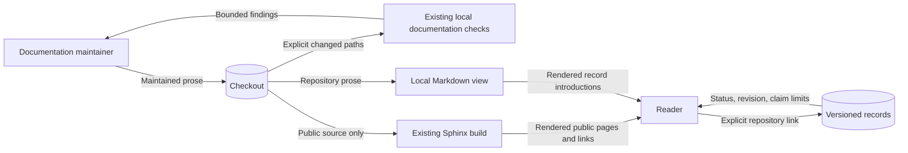

# Research record reader boundaries

This explanation defines the documentation change for issue #1939.
The source baseline is `e64ef3030f158e1cd5979df427e57423ead6ec2d`.
The [preflight](issue-1939-research-records-preflight.md) gives the preservation rules.

## Components and interfaces

The hosted research page links to repository records through explicit GitHub URLs.
The repository documentation index links to maintained research and record introductions.
These introductions separate explanation, exact reference, and current operating procedures.
Existing paths remain the reader interface.

No application module or public code interface changes.

Keep requirements, normative specifications, decisions, and observations distinct.
An accepted decision is a design choice.
It does not prove that code works or an experiment succeeded.
Use the ADR index for decision status and replacement links.

Use evidence manifests for observation identities and source revisions.
Use requirement files for statements, status, and traceability.
Keep historical commands separate from current check instructions.

Add short missing entry routes for research, requirements, and governance.
Revise maintained introductions in the seven record roots.
Preserve dated analyses and evidence at their existing paths.
The PR inventory assigns each tracked prose file to the ownership table in #1909.

It records exclusions by content and consumer.
It is delivery evidence, not a second repository registry.

## Data flows and protection

The hosted source boundary remains `docs/public/`.
Working records enter neither hosted includes nor search.
No new host, service, storage location, or processing destination is needed.
The existing GitHub repository holds the delivery PR and its evidence.

Protected assets are evidence identity, required meaning, and reader trust.
An unqualified historical claim can misrepresent current support.
Show its revision, status, and limits beside the reader route.
A prose rewrite can corrupt evidence or normative meaning.

Keep exact records unchanged and check the diff against the baseline.
Use ADR immutability and historical identity checks for their existing purposes.
Do not execute provisioning scripts to validate historical links.
An unavailable historical environment remains unverified.

No credentials or private runtime data belong in documentation or verification output.

## Existing controls and design decisions

Reuse Sphinx/MyST, Vale, shared STE checks, and existing link and source-boundary checks.
Reuse the repository's evidence and authority catalogs without new fields.
No policy-as-code change is needed because the publication and preservation boundaries remain the same.
No architecture-as-code change is needed because components and dependency directions remain the same.

No ADR amendment is needed because no governed decision changes.
The data flow above describes the documentation path; runtime diagrams remain valid.
Stable links permit later research topics without another registry or metadata schema.

The design follows the Diataxis compass and application guidance.
ASD-STE100 Issue 9 supplies the writing rules and dictionary.
The local official PDF has SHA-256 `d1f4ea9e7cd6e46b47aa9057209f99e78c0e9cfc4e27a5b07895b05c1a166431`.
The official website returned HTTP 403.

The PDF stays outside the repository.
Review sentences, terminology, obligations, brevity, and page purpose separately from lint results.
Keep each instruction within 20 words and each description within 25 words.

## Verification boundaries

Use targeted documentation checks and existing preservation checks locally.
Full builds, full link checks, integration suites, and formal replay remain in CI.
Review rendered introductions and descriptive links.
Repeat the released first-use exercise in a clean temporary environment.

Follow routes to accepted and superseded decisions, a formal result, a capture, and an open question.
Check exact-reference navigation from its entry page.
No product behavior changes, so mutation testing has no changed runtime target.
Preserve existing mutation tests for evidence checkers.

Record commands, results, source revisions, exclusions, and any uncertainty in the PR.

## Integration timeout follow-up

CI timed out the existing full-size cloud inventory delivery case after 120 seconds.
The case traverses 2,048 synthetic objects across transport, preparation, and delivery.
Other integration cases passed.
Use the existing 300-second timeout convention for this full-size case only.
Keep its fixture size, assertions, negative cases, and runtime resource limits unchanged.

The owning test module is `test_issue_1885_cloud_authority_budget.py`.
Its existing pytest marker supplies the test deadline.
The existing participant stress and formal replay cases use the same deadline.
No application interface, schema, dependency, trust boundary, or runtime behavior changes.
The data flow above remains valid.
Only a selected failing case runs locally; the full integration suite remains in CI.

[Pytest-timeout 2.4.0](https://pypi.org/project/pytest-timeout/2.4.0/) documents the per-item marker override.
The timer detects hangs; it does not measure precise performance.
