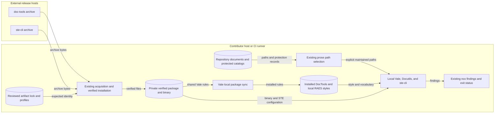

# Shared documentation package integration

This explanation describes the documentation tools for issue #1954.
The source revision is `c8fc7245381742610f9ccf693ee47f81ba26b3d9`.
The [preflight](issue-1954-shared-documentation-package-preflight.md) gives the existing boundaries.

## Components and interfaces

RAE consumes `OpenRAE/doc-tools` v0.1.0, source commit
`97866fad14d7fbb0d6752788ebdc5ae4f235573a`.
Its release archive SHA-256 is
`125104c0cc535698d1cc9bba3e57883bdf9d87db6da346ff583967c4ce42de6c`.
The archive contains the existing documentation skill, its notices, selected STE configuration, and four portable Vale rules.
The package remains the source of these assets.

`tools/documentation_tools.py` owns dependency integration.
Its public interfaces are `ensure_doc_tools()`, `ensure_ste()`, and `sync_doc_tools_styles()`.
They use the existing artifact selection, acquisition, and verified installation interfaces.
They add no analyzer, network client, skill, or package manager.
The existing artifact lock, host profiles, and selector bindings own the reviewed versions and digests.
Product dependencies and Python locks need no change.

`ensure_doc_tools()` returns a verified package directory.
The installation retains the skill, legal notices, configuration, wrappers, and Vale rules without changes.
`ensure_ste()` returns the verified ste-cli v0.10.1 executable for the supported host.
The generic installer checks archive bytes and installed files before use.
No package script downloads an unchecked cached binary.

`sync_doc_tools_styles()` uses Vale's existing local-directory package interface.
A temporary configuration gives Vale exact copies of the verified rules and the local `styles` destination.
Temporary copies use writable modes because Vale keeps source modes during installation.
`vale sync` installs the rules under ignored `styles/DocTools/`.
The next check restores those installed rules from the verified package.
The temporary configuration contains paths, not prose or credentials.

The existing `docs-prose` stage owns file selection and findings.
It keeps path containment, protected catalogs, batching, and selected Docutils environments.
It gives only selected maintained Markdown files to ste-cli.

The command uses the shared `.ste.yml`, `--no-baseline`, and `--fail-over 0`.
These are the shared wrapper's checking arguments.
RAE selects the binary separately to retain installed-file verification.
All checker failures remain nonzero.

Vale retains Markdown and reStructuredText checks.
The shared STE checker supports Markdown and plain text, not reStructuredText markup.
Manual review still checks STE meaning, page purpose, and source accuracy.

## Rule ownership

| Check | Owner and treatment |
| --- | --- |
| Plain words, promotional words, dismissive words, heading punctuation | `DocTools` owns these four rules. Remove the four duplicate `RAES` files after integration works. |
| Sentence length in Markdown | Shared STE-5.1 owns the check. Disable `RAES.SentenceLength` for Markdown only. |
| Sentence length in reStructuredText | Keep `RAES.SentenceLength` and manual STE review. |
| Contractions and paragraph length in Markdown | Shared STE-4.2 and STE-6.6 own these checks. |
| Heading case, reading score, RAE vocabulary, repetition, contracts | Keep existing local configuration and rules. |

The shared plain-word rule omits the substitution from `terminate` to `stop`.
These cloud API terms can have different meanings.
Source and normative checks remain local.
Existing rule-specific exceptions must use the shared rule names where applicable.

## Data flows and trust boundaries

Text alternative: release archives cross into the host through existing integrity checks.
Verified files supply Vale rules and the STE command.
Local documents enter existing path selection, then local checks.
Only findings enter the nox report.
Document text does not go to release hosts or another service.

## Security and failure behavior

| Asset and threat | Control and verification |
| --- | --- |
| Host executes changed archive or cached bytes | Existing reviewed archive and installed-file digests. Targeted tests reject corrupted downloads and installed files. |
| Unsafe archive or cache path reaches host files | Existing bounded extraction, private directories, no-follow checks, locks, and atomic installation. Keep existing installer tests. |
| Document text leaves the host | Shared configuration disables dictionary and analyzer features. The integration uses local processes and credential-free acquisition. |
| Checker reads external or protected files | Existing safe paths and protection catalogs run before acquisition or checking. Targeted selection tests retain these boundaries. |
| reStructuredText includes a local file | Keep pinned Vale and Docutils with `--no-file-insertion`. Retain its regression test. |
| Findings become a successful check | Existing nox process handling propagates failure. Negative samples and focused mutations exercise this boundary. |

Release signatures are not claimed.
Initial digest review trusts the named upstream releases, as ADR-106 permits.
A user who can change reviewed repository code can also change its checks.
PR review and existing CI remain the controls for that risk.

## Existing decisions and publication

ADR-106 covers acquisition and installation.
ADR-014 covers the existing nox graph.
ADR-059 covers protected decisions.
ADR-009 retains normative authority, and ADR-116 retains the error model.
No new ADR, policy schema, or enforcement framework is needed.
The existing lock, profiles, and Vale configuration provide executable architecture and policy records.

The Sphinx/MyST build, source boundary, output inventory, and publisher permissions remain in their existing owners.
Issues #1799, #1803, and #1804 retain the Go migration and publication work.
This integration gives no new publication route or future Go instructions.

## Sources and document review

The design uses the v0.1.0 package installation guide, reference, architecture, and release archive.
Vale v3.15.2 `cmd/vale/sync.go` confirms the local-directory package interface.
ste-cli v0.10.1 `README.md` gives formats, options, and exit behavior.
Diataxis application guidance supports the existing page-purpose review.

The existing local ASD-STE100 Issue 9 copy supplies the writing and meaning rules.
Its SHA-256 is `d1f4ea9e7cd6e46b47aa9057209f99e78c0e9cfc4e27a5b07895b05c1a166431`.
The official website returned HTTP 403. No standard text or dictionary enters this repository.

This document explains components and boundaries. The issue plan owns implementation tasks.
Review instructions for meaning, technical terms, sentence length, and one topic per paragraph.
Legal notices and literal code retain their exact contents.
Automated style checks provide separate evidence, not proof of full STE conformance.

## Verification evidence

The platform is Linux x86_64, Python 3.14.7, and uv 0.13.4.
An isolated frozen tooling environment and empty tool cache installed the selected release inputs.
No personal skill or project installation supplied the shared assets.
The installed skill SHA-256 is `145584635ea7287b1d8c9b28c3a2a0bd5794fa80f33944cfb45fdafa15e5234f`.
All 11 retained package files match the immutable source commit's Git blobs.
The archive and three ste-cli platform archives match their published release digests.

| Boundary | Observed check |
| --- | --- |
| Shared language rules | Negative Markdown reports STE-4.2, STE-5.1, and STE-6.6. Corrected text passes. |
| Integrity | Changed archive bytes fail before installation. Changed configuration and binary files fail before use. |
| Repeat setup | Two consecutive Vale syncs pass. A changed installed rule is replaced from the verified package. |
| Clean import | A regression test imports dependency integration in the isolated tooling interpreter without an installed product. |
| No-path invocation | The unchanged package wrapper exits 2 without a path, before any binary download. |
| Existing formats and boundaries | Targeted tests retain reStructuredText, Docutils file-insertion protection, safe paths, frozen records, and literal bytes. |
| Public sources | Explicit prose checks pass on `docs/public/index.md` and `docs/public/api/index.rst`. Public boundary regression tests pass. |
| Mutations | Tests fail if shared STE is omitted, its failure threshold is removed, shared Vale is omitted, or reStructuredText enters STE. |

Source review compared the guide with the new integration module, existing nox stage, artifact authorities, and selected upstream source.
The guide now identifies shared ownership and released skill provenance.
It no longer claims that this setup installs no STE analyzer.
The four deleted local rule files are the actual duplicates listed above.
No checker, skill, dictionary, or integrity implementation was copied into maintained source.

The shared check required paragraph divisions in maintained guidance and the preflight.
It also required one paragraph division in the public landing page.
That page's text, links, headings, and supported behavior are unchanged.
The historical #1931 record, accepted ADRs, generated output, and previous legal notices retain their exact text.

Existing traceability entries still describe the touched artifacts.
No deleted rule had a requirement link.
This requirement-free issue needs no status transition or new requirement link.
Both native blocking relations exist. The extraction issue and #1931 are closed.

Repository-only pages were rendered locally with the existing Markdown parser.
Heading order passed, and all previous headings remain in the maintained pages.
No page moved. No navigation control or redirect changed.

The diagram has a text alternative. No meaning depends on color.
The public Sphinx build and complete verification remain CI checks.
