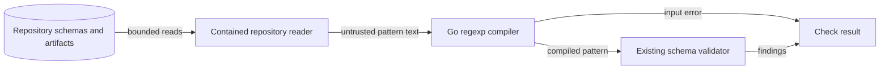

# Go governance pattern syntax

Issue #1983 removes Python regular-expression translation from governance.
The tooling module owns this change in `governance`.
Its public interface remains `Check(context.Context, Request) (Report, error)`.

## Components and failures

Schema patterns use `regexp.Compile` without source translation.
The schema compiler retains its existing callback and offline resource loader.
Compile errors use the existing policy input error.
Coverage and JSON artifact checks propagate that error through `Check`.
Requirement patterns already use Go syntax and retain their start-match rule.
Fixed manifest path restrictions keep their existing predicate and refusal rules.
Fixed documentation and assurance checks use literal Go patterns.
They do not generate character classes from Python Unicode tables.
Inert Python source parsing retains its named string escape resolver.
This separate path does not match or translate configurable policy patterns.
Number parsing keeps its shared Unicode helper.
This helper does not compile or translate patterns.

Go character classes, anchors, escapes and flags apply directly.
For example, `\d` matches ASCII digits and `\z` marks the absolute end.
Unsupported syntax fails compilation. No fallback matcher runs.
Published schemas and policy records remain unchanged.
A schema that requires unsupported syntax produces an input error.
This is an intentional change from the retained Python reference.

## Data flow and security

Repository bytes cross the existing reader boundary before pattern compilation.
Invalid patterns must stop evaluation rather than skip validation.
Go compiles patterns. No custom parser or fallback runs.
Existing read limits, offline references and error classification remain in force.
Tests cover malformed patterns, unsupported constructs and boundary propagation.
Fixed path tests retain the existing traversal restrictions.

## Architecture and authority

The existing architecture model declares the owning package and its API.
No package, public API, import direction or deployment boundary changes.
The architecture model therefore needs no new declaration.
No policy authority, ADR decision, control ledger or published schema changes.
The original governance design must describe the new pattern contract.
Tests for Python pattern parity become tests for the Go contract.
Recorded reference artifacts remain historical evidence.

## Sources and document review

- Go 1.27.3 `regexp` documentation: https://pkg.go.dev/regexp
  The Overview and Compile sections define syntax, matching and errors.
- Effective Go: https://go.dev/doc/effective_go
  The Errors section supports explicit error returns at the existing boundary.

This document explains components, trust boundaries and failure behavior.
Prose review checks sentence length, consistent terms and technical meaning.
The source checks are `schema_validation.go`, `artifact_pattern.go` and the public `Check` boundary.
