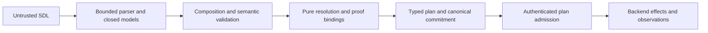

# Issue 1987: Authored safe-state declarations

The SDL declares a desired safe state and the proof needed to establish it.
The backend supplies the mechanism.
Resolve the declaration before plan admission.
Do not contact a backend or claim that the state already exists.

This note guides issue #1987.
It does not publish syntax or an implementation plan.
No requirement UID applies.
The inspection baseline is `e64ef3030f158e1cd5979df427e57423ead6ec2d`.
[ADR-113 section 4](adrs/adr-113-reusable-execution-machinery.md) settles the authority boundary.
No new ADR is needed.

## State and scope

Use one closed, optional value for safe hold, controlled stop, or a specified continuing mode.
Each value needs observable conditions.
A continuing mode also needs an identity.
Use governed properties and typed predicates.
Do not add commands, product settings, or arbitrary expressions.

State depends on the node or service's role in the scenario.
An IT/OT label, device class, or exception type must not choose it.
A hold need not stop a process.
A stop need not remove power or destroy a resource.
Continuation grants no retry permission.
Omission declares nothing and keeps legacy validation results.

Keep safe state separate from failure response, retries, cleanup, reset, compensation, cancellation, realization closure, initial service state, and observation demand.
A valid declaration proves neither physical safety nor cessation.
It does not prove backend support or operator authority.

Reuse the existing declaration index, reference eligibility policy, semantic addresses, and lexical scope rules.
Use stable collection identities, not positional indexes.
Do not split composed names to infer ownership.

Named transport bindings and logical runtime services have different meanings.
Unnamed ports have no service identity.
The eligibility policy must name supported targets.
Runtime children and observed backend objects gain no implicit eligibility.

Resolve complete values at the nearest defining scope.
Never combine a child's mode with a parent's proof.
Reject duplicates, dangling references, ambiguous targets, cycles, unsupported versions, and namespace escapes.
Import order must not choose precedence.

Imported defaults stay with their module.
Private and repeated imports keep separate identities.
Resolve again after substitutions make the scenario concrete.

## Proof

Reuse `Proposition` with `basis=observed_state` and typed predicates.
Reuse assertion postconditions and existing truth semantics.
Check exact subjects and evidence joins, as service materialization already does.
Do not copy that feature's content-only targets, visibility rule, or workflow.
Do not create another evaluator.

Each target needs its own complete proof.
One member's result cannot prove a whole scope safe.
Reject declared-state predicates, unrelated evidence, and incomplete target coverage.
Derive evidence through proposition requirements where possible.
Retain exact proof definitions in the plan.
No later source lookup should be needed.

Use `EvidenceRequirement` for source, scope, window, sensitivity, redaction, integrity, retention, and loss disclosure.
Keep existing capture-support admission when capture is requested.
Do not add mandatory experiment capture or export solely because a safe state is declared.
Operational proof and retained study evidence stay separate under ADR-066.
Missing, stale, redacted, or inconclusive observations cannot prove success.
A backend acknowledgement, log entry, manifest claim, or planned value is not proof.

## Owners and plan flow

`raes.scenario`, `raes.nodes`, and `SDLModel` own authored shapes.
Share one value across any attachment surfaces.
`raes_contracts` owns the portable resolved value below the language and runtime packages.
Keep ADR-117 and ADR-121 import boundaries.
Move shared proof types down if needed; do not import language models upward.

`SemanticValidator` owns semantic joins and incremental validation.
Parsing, imports, and instantiation must use the same rules.
`raes.composition` owns symbol rewriting and private bindings.
Reuse its existing scope and provenance helpers.

The compiler resolves meaning.
The planner carries it through admission.
Use typed native phase-plan fields, not arbitrary payload metadata.
Each affected node or service needs an entry, including unchanged resources and services without native operations.
No-op plans must retain these entries.
Keep target identity, defining scope, module provenance, and resolved proof.

Each independently submitted phase needs the declarations relevant to its effects.
Use one resolved value with deterministic projections.
Preserve it through preparation, inspection, HTTP conversion, serialization, and request commitments.
Source edits must change new plan commitments.
Recovery must retain the admitted value.
Deletion must not derive a state from new defaults for an absent resource.

The last edge names a future execution consumer.
It does not authorize a safe-state procedure in this issue.

## Trust boundaries

Keep parser byte, token, depth, alias, and duplicate-member limits.
Keep JSON ingress bounds and ambiguity checks.
Use bounded references, unique collections, strict mode values, and finite operands.
Revalidate nested caller-held values; an outer frozen object does not freeze its contents.

Published schemas remain authoritative under ADR-009.
Keep SDL phase schemas, plan schemas, adapters, fixtures, and `schema_bundle()` aligned.
Existing schema edits need no publication-record edit.
New schemas need entries; removals need tombstones.

Keep exact artifact authorization, route authorities, target/run identity, and core authorization.
Add no role, route, credential, or host configuration.
Installed support and current willingness remain separate facts.
A declaration grants no control, observation access, or cross-tenant access.

Keep secret-reference, generated-value, environment, sensitivity, and redaction rules.
No secret bytes, endpoint settings, or environment dictionaries belong in this declaration.
Resolution needs no ambient configuration, secret lookup, subprocess, shell, listener, filesystem probe, or device call.
Host termination does not prove remote cessation.

Reuse SDL findings, `Diagnostic`, shared errors, portable redaction, and HTTP response envelopes.
Do not expose raw validation input or backend exception text.
Add no logger configuration or audit store.
Keep authenticated inspection, participant projection, markings, final-sink checks, and retention controls.
Proof may reveal private scenario intent.

Use existing plan commitments and store codecs.
Keep revision, atomic state, audit, and recovery checks.
Add no parallel safety database, live-state cache, or source re-resolution on recovery.

Known authored contradictions must fail admission.
Syntax alone cannot prove physical compatibility across shared equipment.
Execution must later check shared resources, time, interlocks, and operator authority.
Do not substitute an apparently stricter stop; stopping can itself be unsafe.

## Extension and checks

The seam is a versioned portable declaration with canonical target and proof bindings.
Other continuing modes use different governed values and predicates.
Other services enter through the existing family and eligibility policy.
A future mechanism must consume the same committed value.
It must check exact capability, willingness, authority, and observed outcome.

Exclude procedure execution, safety certification, device drivers, emergency-stop APIs, new retries, and automatic failure response.
Add no scheduler, controller, service, database, or workflow engine.
Keep trial allocation, cleanup ownership, retention, and legacy validity unchanged.
Do not change another repository or claim its backend mechanism is delivered here.

Use existing execution-policy, proposition, scope, and plan-projection test patterns.
Check all modes, nearest scope, sibling isolation, imports, instantiation, services, and no-op plans.
Reject wrong subjects, incomplete proof, malformed modes, duplicates, unresolved targets, and namespace escapes.
Check omission, schema parity, round trips, deterministic commitments, tampering, and retained admitted values.

Use targeted mutations for dropped plan fields, proof joins, and scope precedence.
Check value-free errors and pure resolution.

Run changed-path policy, schema, and prose checks.
Keep the source-size and import rules.
Run only targeted tests locally.
Full, integration, fuzz, and completion suites belong in CI/CD.
This note establishes no passing implementation tests.
