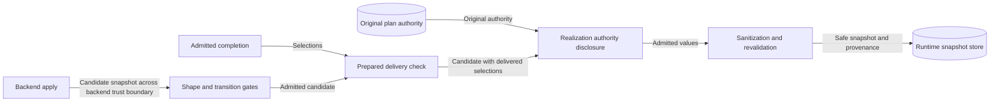

# Absent prepared values: delivery design

## Context and ownership

Issue [#1993](https://github.com/OpenRAE/rae/issues/1993) reports a false delivery failure.
An admitted completion can leave a concern field absent.
Apply can then deliver a value at that field.
The delivery check refuses that result, but the original realization authority accepts the value.

The [preflight](issue-1993-absent-prepared-values-preflight.md) identifies the owners and guardrails.
`raes_processor.planner.realization_preparation` owns the delivery check.
Its public interface is `prepared_delivery_violation`.
`raes_runtime.backend_apply_results` calls that interface before realization disclosure.

## Delivery rule

A selection is a value that the admitted completion contains.
Each selection is an exact delivery obligation.
An absent field in the completion is not a selection.
An absent field carries no delivery obligation.

`_delivery_violation` applies the rule for one authority pointer.
The existing `_value` helper returns the `_MISSING` sentinel for an absent field.
Null, false, zero, and empty collections are present values.
A present record or collection keeps its whole-value comparison.
Its absent descendants do not become wildcards.

| Completion value | Delivered value | Result |
| --- | --- | --- |
| Absent | Absent | No violation |
| Absent | Present | No violation |
| Present | Absent | Violation |
| Present | Equal | No violation |
| Present | Different | Violation |

`prepared_node_delivery_violation` keeps its closed projection for prepared additional nodes.
That projection is the only authority for a backend-added node.
The absence rule does not apply to it.

## Data flow and security

The protected assets are original authority, trusted runtime state, and provenance.
The candidate snapshot crosses the backend trust boundary.
The threat is a delivered value outside the original authority.
`realization_authority_disclosure` controls that threat for every non-closed authority.
It rejects closed-concern materialization, out-of-domain values, and malformed values.
A runtime test verifies that this gate still rejects an out-of-domain value at an absent selection.

A second threat is a backend that replaces a selection with another allowed value.
The exact comparison of present selections controls that threat.
Unit tests verify the changed-value and missing-value cases.
A rejected result keeps the trusted predecessor and discloses no candidate values.

The residual risk is unchanged: the runtime cannot prove backend honesty.

## Related artifacts

[ADR-105](adrs/adr-105-recursive-partial-description-semantics.md) requires delivery of the selected values.
An absent field is not a selection, so ADR-105 needs no change.
The [preparation specification](../../specs/sdl/backend-realization-preparation.md#delivery-and-publication) states the rule.
The [result admission contract](../../specs/formal/runtime-contracts/backend-result-admission.md#admission-and-publication) states the same rule.
No schema, policy rule, configuration, or import direction changes.
No other diagram changes.

## References and writing review

- [RFC 6901](https://www.rfc-editor.org/rfc/rfc6901), sections 4 and 7: a pointer to a nonexistent value is a distinct condition, and the application defines its effect.
- [Kubernetes server-side apply](https://kubernetes.io/docs/reference/using-api/server-side-apply/), field management: a manager owns only the fields that it sets.
- [ASD-STE100 Issue 9](https://www.asd-ste100.org/assets/files/ASD-STE100_ISSUE9.pdf), sections 1, 3, 5, 6, and 8: terminology, active voice, sentence length, and document purpose.

The writing review checked STE sentence length, active voice, and one fact for each sentence.
This document describes the system; the issue plan records implementation tasks.
