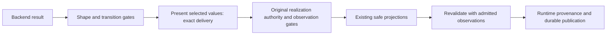

# Absent prepared values: architecture preflight

Issue: #1993. Requirement: none. Date: 2026-11-09.
Source revision: `e64ef3030f158e1cd5979df427e57423ead6ec2d`.

This note records guardrails, not an implementation plan.
The issue is the delivery contract.

## Decision and authority

An absent field in an admitted completion creates no delivery obligation at that field.
A present value stays an exact obligation through its concern projection.
The original realization authority and the runtime gates still check every delivered value.
Absence does not grant authority or prove support.

The owner is `raes_processor.planner.realization_preparation`.
Its public interface is `prepared_delivery_violation`.
Its `_delivery_violation` compares one authority pointer with the selected operation.
Reuse `_value` and its `_MISSING` sentinel to find an absent field.
Do not test absence with truthiness, null, an empty collection, or a model default.

A present record or collection keeps its whole-value comparison.
Its missing descendants do not become wildcards.

Present selections reuse `project_realization_concern`, `portable_realization_value`, and exact `structure_matches`.
Keep strict scalar types, ordered sequences, set identities, and bounded conversion.
A different allowed value still fails delivery.
A missing delivered value still fails when the completion contains the field.

[ADR-105](adrs/adr-105-recursive-partial-description-semantics.md) separates the selected completion from the original authority.
No new ADR or schema is needed.
The [preparation specification](../../specs/sdl/backend-realization-preparation.md#delivery-and-publication) must state the rule.

## Boundaries

Paths are relative to `implementations/python/packages/`.
These owners stay in scope even when their source needs no edit.

| Layer | Owners | Guardrail |
| --- | --- | --- |
| Authentication | Runtime API guards, plan authorization, backend authority | Keep request bounds, planner authorization, and the plan commitment. Absence grants no new authority. |
| Transport | Preparation contracts and runtime `backend_preparation` | Keep closed shapes, digests, unique addresses, and work bounds. No schema or default change. |
| Selection | Planner preparation and node admission, backend profiles | Keep selection admission, offers, profiles, membership, and `validate`. Keep the original plan apart from `completion_plan`. |
| Result integrity | Runtime result, transition, and snapshot gates | Keep shape, identity, change accounting, and transitions. An absent selection does not skip an entry or other authorities. |
| Realization | `realization_authority_disclosure` and concern evaluators | Keep closed-concern refusal, domains, constraints, and observation rules. A value can pass delivery and fail here. |
| Secrets | Runtime environment variables, concern projections, account credentials | Keep name rules, source rules, and sensitivity joins. Add no secret resolver. |
| Host exposure | Container configuration and published ports | Keep entrypoint order and port meanings. Add no subprocess, interpolation, or port binding. |
| Errors | Runtime diagnostics and operational logging | Keep value-free diagnostics and the current message. Log no payload values. |
| Persistence | Apply results, durability, snapshot store, sanitization | Gate raw results first, then revalidate safe values. A rejected claim keeps the trusted predecessor. |

The [portable comparison design](issue-1865-preparation-comparison-design.md) supplies the comparison model.
The delivery boundary keeps this order:

The protected assets are original authority, secrets, host exposure, runtime state, and provenance.
Backend output crosses the trust boundary before shape admission.
Delivery alone does not authorize publication or observation collection.
Rejection keeps runtime state; it does not roll back backend side effects.

## Extensibility and exclusions

`ResolvedRealizationAuthority.payload_pointer` selects the field.
The descriptor registry owns concern meaning.
Another concern needs no backend branch, field allowlist, flag, or new schema.
Do not change pointer traversal or equality to fix this defect.

`prepared_node_delivery_violation` stays binding for prepared additional nodes and networks.
The absence rule does not relax its closed projection.
Absence does not turn a closed field into an open field.

Out of scope: backend profiles, negotiation, offers, legacy envelope admission, and membership.
No configuration, service, exception class, logging flow, or schema version is added.
LilRAE is context only.
No release, version, changelog, or workflow change is needed.

## Verification

A read-only probe reproduced the defect at the source revision above.
An absent selection with a present delivered value failed.
Absent and absent passed, and equal present values passed.

Tests must separate absence from null, empty collections, false, and zero.
Present selections need equal, missing, changed, type, and order cases.
A runtime test must show that the realization gate still refuses a bad value at an absent selection.
Keep operating-system observation preference and prepared node exactness.

Related tests are `test_issue_1204_backend_preparation.py`, `test_issue_1204_preparation_os.py`, and `test_issue_1204_prepared_sequence.py`.
Also keep `test_issue_1204_resource_collections.py` and `test_issue_1886_scalar_scope_authority.py`.
Local runs stay targeted; CI runs the full suites.
