# SDL semantic fixture publication design

This explanation defines the fixture boundary for issue #2008.
The [preflight](issue-2008-sdl-semantic-fixtures-preflight.md) records the existing owners and constraints.

## Architecture and interfaces

`contracts/fixtures/sdl/semantic-vectors-v1/` owns the maintained semantic vectors.
The initial publication preserves all 824 cases, nine shards, the manifest, and the historical provenance bytes.
The manifest keeps the `raes-sdl-semantic-vectors/v1` format.
SDL specifications retain authority over semantic meaning.

The existing `internal/sdl/authoring` tests own the fixture reader and semantic comparisons.
A private test helper accepts `fs.FS` rooted at this family.
It returns checked vectors or an error before semantic evaluation.
The tests read both the published directory and the existing packaged corpus.
`Parser.Decode`, `Parser.Validate`, and document identity methods retain their current interfaces.
No product API, package, layer, or dependency edge changes.
The existing architecture model already declares these owners and imports.

The reader retains ordered shard names, raw-byte hashes, positive counts, unique case names, and inventory completeness.
Bounded reads and `base/ingress.Parse` precede typed JSON decoding.
Unknown fields, missing required fields, inconsistent results, and unsupported settings cause failure.
The reader rejects missing, extra, and unsafe shard names.
Manifest bytes and total shard work have finite bounds that permit family growth.

`contractgen` remains the sole Go packaging mechanism.
Its archive is a generated copy of the published contracts.
The retained Python readers use the published directory for their separate parity checks.
The Python semantic writer and its CI invocation are removed.
The selection, formatter, import, and temporary corpus checks keep their existing owners.
The legacy canonical recorder excludes this mixed semantic corpus from its payload discovery.
This keeps future semantic fixture changes independent of Python parity regeneration.
Existing canonical payload coverage remains unchanged.

## Security and data flows

```mermaid
flowchart LR
    Maintainer[Repository maintainer] -->|reviewed JSON changes| Published[(Published manifest and shards)]
    Published -->|bounded read-only bytes| Inventory[Inventory and record checks]
    Published -->|deterministic archive generation| Archive[(Packaged contracts)]
    Archive -->|read-only fixture bytes| Inventory
    subgraph SDL[Existing SDL admission boundary]
        Decode[Source and construction checks] -->|constructed document| Validate[Semantic admission]
    end
    Inventory -->|source text| Decode
    Inventory -->|expected results| Compare[Existing assertions]
    Validate -->|observed diagnostics and identity| Compare
    Compare -->|pass or failure| Result[Test report]
```

The assets are reviewed expected results, source examples, and historical provenance.
Fixture metadata cannot grant SDL admission, import authority, credentials, or execution permission.
The source owner applies its existing limits and strict source profile.
The reader does not resolve credentials, start processes, or retrieve network data.

| Threat | Control | Verification |
| --- | --- | --- |
| Missing cases or altered bytes | Complete inventory, unique names, counts, and raw-byte hashes | Corruption tests and unchanged initial file comparison |
| Ambiguous records or ignored settings | Strict ingress, typed fields, and result checks | Malformed record and duplicate JSON member tests |
| Path escape or excessive work | Fixed family root, exact shard names, bounded reads and inventory | Unsafe path, symlink, and size tests |
| Stale packaged fixtures | Existing deterministic generator and packaged reader | Generator check and source/package comparison without a checkout |
| Results copied from the tested implementation | Maintainers edit reviewed expected results directly | Semantic assertions and review of fixture changes |

Hashes detect byte changes; they do not prove semantic correctness.
The initial Python provenance describes the original recording only.
Later changes use repository history and must preserve that historical record.
Finite fixture success does not prove complete SDL conformance or runtime safety.

## Supporting artifacts

The family README defines the format and its asserted dimensions.
A separate how-to guide gives direct JSON maintenance and targeted Go commands.
The contracts index links to the family.
These documents keep reference, procedure, and design content separate.

Existing authority policy and ADR-009 already place fixtures under `contracts/`.
No new policy rule, schema, schema ledger, or ADR is needed.
The architecture model records this design as a checked source.
Its package and interface declarations remain valid.
The diagrams above supply both the component relationships and the data flow.
No deployment, estate, or persistent service changes occur.

The store-reopen test allows ten seconds for each observation call.
This covers disk writes on busy CI hosts.
It checks the first final state before the store reopens.
It keeps its checks for retained stages, reservations, and no repeated effects.
Runtime deadlines and the tests that check them stay the same.

## References and review

- [Go testing](https://pkg.go.dev/testing@go1.27.3), Go 1.27.3: subtests and test helpers support the existing runner.
- [Go io/fs](https://pkg.go.dev/io/fs@go1.27.3), Go 1.27.3: filesystem injection supports packaged and corruption checks.
- [Google Go style decisions](https://google.github.io/styleguide/go/decisions), accessed 2026-11-11: table tests and useful failures guide verification.
- [Documentation style guide](../explain/reference/documentation-style-guide.md): reader purpose, meaning preservation, and short sentences guide the prose.

The document review checks technical terms, sentence length, brevity, and purpose.
Automated prose checks supplement this review; they do not prove full STE conformance.
The official ASD-STE100 website returned HTTP 403 during source access.
