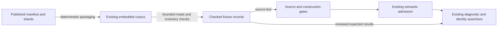

# SDL semantic fixture publication preflight — issue 2008

Publish the existing semantic vectors as maintained contract fixtures.
Issue #2008 supplies the contract; no formal requirement applies.
This note sets the design boundaries. It is not an implementation plan.
Inspection baseline: `0365fb9bdb6ca208276c0c535a9e9e3cd201208c`.

## Publication and ownership

Use `contracts/fixtures/sdl/semantic-vectors-v1/` as the single maintained family.
Keep `semantics.json`, its `raes-sdl-semantic-vectors/v1` discriminator, and the ordered shard format.
The current manifest names nine shards containing 824 unique cases.
All recorded counts and SHA-256 hashes agree at the inspection baseline.
Each shard satisfies the existing 450 KiB ceiling and the 500 KB hygiene limit.
Preserve the initial case names, source text, expected results, and shard bytes.

ADR-009, ADR-019, and `specs/authority/authority-boundary.yaml` already classify fixtures as normative contracts.
SDL specifications and published schemas retain their existing authority.
Publication must not silently turn a reference implementation defect into an SDL rule.
Resolve any specification conflict explicitly before changing its expected result.
No new authority class or ADR is needed.

Keep `semantics-provenance.json` as historical recording evidence, with its original commit, package hash, and dependency versions.
It does not require a current Python installation or package-hash refresh.
Later reviewed fixture changes must not claim that the original recorder produced them.
Repository history records those changes; no new provenance service is needed.

## Existing owners and boundaries

Paths in this table are repository-relative. Product packages are under `implementations/go/`.

| Concern | Canonical incumbent and required reuse |
| --- | --- |
| Fixture inventory and assertions | `internal/sdl/authoring/semantic_vectors_test.go` and `semantic_api_test.go` own manifest integrity and semantic comparisons. Retain those checks against the published family. |
| Distribution | Tooling `contractgen.Generate`, `contractgen.Check`, and `cmd/contractgen` package all of `contracts/`. Product `internal/contract/corpus.Open` reads the generated archive offline. Regenerate derived archive pieces; never hand-edit them. |
| JSON ingress | `base/ingress.Parse` supplies bounded parsing, duplicate-member rejection, exact numbers, and object/array root selection. Use it before decoding fixture records. |
| SDL construction | `internal/sdl/source` owns YAML syntax, ranges, source profiles, and composition budgets. `authoring.Parser.Decode` uses existing normalization and `validation.CheckSDLConstruction`. |
| Semantic admission | `authoring.Parser.Validate`, `contract/admission`, and `internal/contract/sdlrules` retain their existing rule ownership. Fixture loading must not duplicate their predicates. |
| Identity | `Document.CanonicalBytes`, `Document.CanonicalDigest`, `base/canonjson.JCS`, and `base/digest.SHA256` own semantic projection and hashing. |
| Diagnostics and errors | `contract/diagnostic`, `base/fault`, and ADR-116 own diagnostics and classified failures. Existing `internal/base/logrecord` remains the operational logging owner if an outer command needs records. |
| Repository gates | Native `governance.Check` and `cmd/policycheck` own governance reports and contained repository reads. Retained Python gates remain governed by the canonical verification workflow during cutover. |

`internal/contract/packaged.Read` already supplies bounded, strict object reads.
It cannot read the array-root shards unchanged. Do not wrap arrays in invented objects to fit it.
Use the existing ingress array mode and bounded-reader pattern without adding another parser or public fixture API.
Keep execution and assertions in the SDL owner; the tooling layer cannot import product `internal` packages.

## Cross-cutting gates

Treat proposed fixture bytes as untrusted until their inventory and shape pass.
An expected negative SDL result is different from a corrupt fixture or an operational failure.

| Layer crossed | Required control |
| --- | --- |
| Filesystem and packaging | Read through the corpus filesystem, with clean relative shard basenames. Reject traversal, absolute paths, symlinks, missing shards, and unlisted semantic shards. Keep packaging's existing symlink refusal and archive checks. |
| Manifest and resource bounds | Bound reads before allocation and decoding, including the manifest. Retain the 450 KiB shard ceiling, ordered names, positive counts, raw-byte hashes, unique case names, and complete inventory checks. Bound aggregate work too. |
| Record shapes | Check the exact version, required fields, types, supported optional fields, and result combinations. Reject unknown or contradictory records. Keep findings and locations aligned, including null locations. Plain `json.Unmarshal` silently ignores unknown fields and is insufficient alone. |
| Source and configuration | Use `source.DefaultLimits`, `Limits.Validate`, strict `sdl-yaml/v1`, and the existing reject-migration default. Keep the diagnostic source name `main.yaml`. No ambient environment binding selects fixture roots, parser modes, limits, or expected outcomes. |
| Authored security shapes | Source text still passes existing construction, admission, and semantic security checks. Reuse `contract/admission/sdl_environment.go`, `sdl_images.go`, `sdl_secrets.go`, and `sdl_commands.go` for their existing environment, secret, command, path, redaction, and permission checks. Fixture metadata cannot bypass them. |
| Host and authentication | Fixtures grant no authentication, authorization, credential resolution, filesystem access, or execution authority. Keep import input confined to supplied sources or an empty filesystem. No network access or process launch is needed to evaluate these vectors. |
| Secrets and OS exposure | Publish synthetic data only. Reuse hygiene, private-key detection, and Gitleaks with existing scope. Do not exempt the new family broadly. Keep source bodies and credentials out of command arguments and environment dumps. |
| Error envelopes and logs | Preserve existing fault categories, stable codes, ordered diagnostics, and source ranges. Do not log raw source, wrapped payloads, or tracebacks. Distinguish corrupt corpus failures from expected validation refusals; never count an arbitrary error as a passing negative case. |
| Persistence | Checked-in fixtures and their generated package copy are sufficient. No database, cache, mutable registry, controller, service, or repository abstraction is needed. |

The present 824 rows have no `limits` member, although the Python recorder supports one.
The Go `semanticVector` carrier does not decode it.
A future limit variation must use typed `source.Limits`, validate it, and apply it explicitly.
Never silently accept a setting that the runner ignores.
Likewise, `materialized` metadata cannot override the phase derived by the existing document owner.

## Comparison and maintenance guardrails

Maintain source inputs and reviewed expected results directly, without a Python recorder.
A metadata-only update may recalculate shard counts and raw-byte hashes.
It must never derive expected acceptance, findings, canonical bytes, or digests from the implementation under test.
Keep one authoritative copy; generated packaging is a checked derivative.

Preserve ordered findings, advisories, locations, explicitness records, canonical bytes, and semantic digests.
Preserve absent, null, and empty values where the recorded contract distinguishes them.
The present comparator does not directly assert every finding's `owner` and `pointer` field.
Document the asserted dimensions rather than claiming complete diagnostic equality.
Keep the specific transition-pointer refinement in `checkSemanticLocation` bounded to its existing meaning.
Do not replace exact comparisons with generic prefix matches or unordered sets.

`canonical-integer-range` records `canonical_error: SDLParseError`.
That label describes the original recorder's exception, not a required Go exception class.
The existing comparison asserts refusal of both canonical bytes and digest after semantic acceptance.
`materialized-portable-defaults-3853` instead requires the existing `sdl-materialized-portable-bounds` refusal before semantic findings.
Do not conflate those stages, suppress operational errors, or introduce a compatibility exception hierarchy.

Shard SHA-256 covers exact file bytes and uses unprefixed hex in the manifest.
SDL semantic digests cover the owner's canonical projection and retain their `sha256:` prefix and profile.
Manifest identity, source identity, semantic identity, and historical recorder provenance are distinct claims.
Do not reformat source strings, normalize line endings, or hash parsed JSON in place of shard bytes.

## Whole-repository integration and extension seam

The generic JSON routes in `tools/check_json_artifacts.py` and native `governance/json_routes.go` do not select this shard layout.
Placing it under `contracts/fixtures/` alone therefore supplies no generic validation coverage.
The existing native semantic tests must execute the published inventory and fail on an empty or damaged family.
Do not route mixed positive and negative SDL cases through a payload-only `valid/` schema route.
A fixture family needs no new SDL schema, DTO, schema-publication entry, or semantic invariant registry.

`contractgen` packages the whole contracts tree, including the new family and its historical provenance.
Its generated-output check must agree with that tree.
Retain the archive reader's piece limits and verify consumption without a source checkout.
The existing Python corpus packaging also includes `contracts/fixtures/` while that release route remains active.
Do not create a second distribution mechanism or a fallback to local test data.

The canonical Go CI job still calls `parity_authoring_vectors.py --semantic --check`.
Publication must replace that maintenance dependency with native integrity and behavior checks.
Other callers include `tools/parity_shared_rule_vectors.py` and `implementations/python/tests/test_issue_1783_semantic_recorder.py`.
They must not retain a competing authoritative corpus or become required to maintain this family.
The recorder's formatter, imports, selection, and temporary MCP oracle modes remain separate concerns.
Do not remove those checks wholesale; issue #1872 owns the wider tool removal.
Keep `RAES_SEMANTIC_ORACLE` separate from this published manifest.

Use a family-relative root and an injected `fs.FS` as the narrow loader seam.
That permits embedded consumption and isolated corruption tests through the same inventory checks.
The manifest supplies shard names and counts.
Consumers must not hard-code nine shards or cap the family at 824 cases.
Keep stable case names so additions need no runner branches or renumbering of existing cases.
A changed fixture format requires an explicit version decision, not heuristic shape detection.

`implementations/architecture.json`, ADR-122, and `docs/develop/go-architecture.md` govern package and import changes, including test imports.
The existing model already permits the SDL owner to consume the corpus.
This guidance introduces no package, import, or public API, so it requires no model change.
Any implementation that changes those boundaries must declare and check its design first.
Review source-bound design hashes and the generated view when changing an owning design document.
Reuse `.ground-control.yaml`, `.gc/plan-rules.md`, and the existing requirement-free workflow; do not invent a requirement UID.

## Verification boundary and non-goals

Evidence must show that all initial cases remain and pass native checks.
It must also show rejection of corrupt fixtures and packaged use without Python.
Corruption cases must cover altered bytes, counts, duplicates, unsafe names, malformed records, and missing or extra shards.
Keep local checks targeted. CI owns full corpus, race, coverage, mutation, fuzz, and completion runs.
This preflight changes guidance only; no executable lines need mutation testing.

This issue does not change SDL syntax, semantic rules, canonical profiles, diagnostics, or validation strength.
It does not publish formatter, version, import, solver-internal, or MCP parity corpora as part of these 824 vectors.
It does not implement a new conformance service, CLI, plugin, validator, framework, or storage system.
It does not complete the Python cutover or issue #1872.
Finite fixture success is evidence for this family, not proof of complete SDL conformance or runtime safety.
