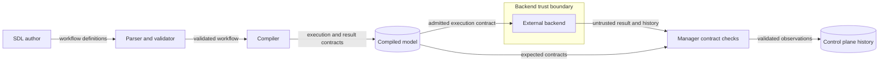

# Workflow transition design

This design completes the abstract workflow model for issue #2009.
The [preflight](issue-2009-workflow-transition-preflight.md) records the repository assessment and binding boundaries.
The [library assessment](issue-2009-workflow-library-assessment.md) gives the scope and reasons for the code changes.

## Control model

The specification owns the transition rules in `specs/formal/workflows/state-machine.md`.
The workflow README lists the same eight step kinds.
Control locations carry workflow invocation and branch identity.
Two branches can occupy the same step without becoming one branch.
Nested parallel steps retain separate barriers.

Observable steps execute once per workflow invocation.
The first arrival starts execution; arrivals during execution wait for that result.
Later arrivals reuse the completed result and take the matching continuation.
Each arrival retains its branch identity.
Retry arrivals share the same attempt budget; call arrivals share one callee invocation.
Shared parallel arrivals share one fanout activation and reuse its result.

The user approved shared execution during review of issue #2009.
This choice preserves the existing single result entry per step.
It requires no per-visit result carrier or new execution engine.
Control-only decisions and switches still evaluate on each visit.
Compensation registration occurs once for each successfully completed compensable step.

Observable state remains limited to `objective`, `retry`, `parallel`, and `call`.
Each rule gives its entry, continuation, and completion condition.
Switch cases use authored order and a required default.
A call suspends its caller location until the callee returns.
Callee step state stays in the callee invocation.

A parallel step activates every declared branch root.
Each abstract transition advances one enabled branch while preserving the others.
A branch waits when it reaches its owning join.
The join releases one continuation only after all branches arrive.
Handled step failure can still lead to successful convergence.
An unhandled branch failure uses the parallel failure route or terminates execution.

The model imposes no fairness, physical concurrency, or branch completion order.
It describes portable meaning, without claiming complete backend trace verification.
The existing compensation model retains reverse completion order across branches.

## Data flow and security

The following diagram shows the existing data path and the backend trust boundary.
The specification describes the contracts on that path.

Protected assets are authored control meaning, validated state, and ordered history.
Incorrect routing or early barrier release can misrepresent workflow completion.
Ordered cases, branch identity, join ownership, and guaranteed visibility address those threats.
Existing validator and compiler tests check the affected contract boundaries.

Manager checks retain responsibility for untrusted backend observations.
The change adds no route, permission, credential, storage field, or external transfer.
Existing checks do not establish all possible schedules or live backend behavior.

## Supporting artifacts

The existing Markdown model is the architecture artifact permitted by ADR-007.
Graph checks reuse the shared helpers from ADR-118.
Shared workflow rules check branch paths and known step state.
The validator checks prior state in graph order.
Long paths no longer need deep calls to these checks.
No policy or published schema change is required.

ADR-009 retains specification authority; ADR-115 retains external backend ownership.
Accepted ADRs, published schemas, and runtime interfaces need no change.
The library assessment names the new helper and its tests.

## Reference and writing review

[SCXML 1.0](https://www.w3.org/TR/2015/REC-scxml-20150901/), sections 3.1.3 and 6.4, supplies comparative state-machine patterns.
[AWS Parallel states](https://docs.aws.amazon.com/step-functions/latest/dg/state-parallel.html) supplies a branch completion reference pattern.
These sources do not define RAES behavior or add their scheduling and cancellation policies.
Repository contracts remain the source for RAES fields and invariants.

Both changed specifications are reference material.
Review preserves technical names, normative conditions, and literal field names.
Use short descriptive sentences and the repository's pinned local prose checks.
The official STE site blocks direct retrieval; its indexed issue 9 guidance and the pinned documentation skill inform this review.
No full STE compliance claim follows from a clean linter result.
