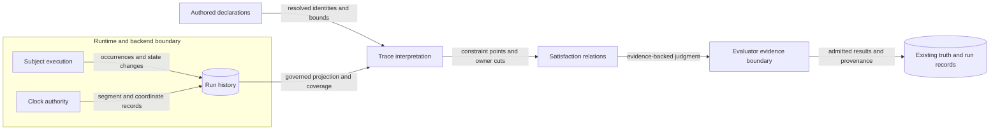

# Trace satisfaction design

This design supports issue #2010 at commit `1cb8f78946214fa20da0d185335bffed256debdf`.
The [preflight](issue-2010-trace-satisfaction-preflight.md) records the current limits.
The two formal specs own the rules.

## Semantic boundary

The shared time spec owns trace and constraint rules.
The assertion spec owns role and evidence rules.
Each trace has a run, owner, subjects, event points, clock, segment, and horizon.
Participant traces retain their current validity rules.
Other SDL subjects use records from their own events or lifecycle.

Precedence uses strict order over paired points.
Duration uses exact tick differences between start and end points.
Windows exclude their end; deadlines include their upper bound.
Cadence uses exact repeated points over a finite horizon.
Repeated subjects need clear rules to select and pair events.
Extra fields add no hidden rules.

Preconditions use the owner entry cut before effects.
Postconditions use the governed exit cut.
Invariants cover the owner's nonempty interval and all its microsteps.
Polarity applies to each state first.
Missing evidence leaves an unknown outcome unless a witness decides the claim.
Missing capability does not make a claim false.

## Data flow and protection

The diagram shows which facts each judgment needs.
It adds no service or store.
Clock records alone do not prove subject events or state coverage.

The protected assets are claim identity, hidden state, clock authority, and evidence integrity.
False order and stale segments threaten claims at the apparatus boundary.
Event pairing, clock binding, and separate segments control those threats.
Examples check ties, deadline equality, missing events, and resets.

Gaps in evidence threaten invariant claims.
Coverage rules prevent one sample from proving an interval.
Current marking and view rules still protect hidden state.
The residual risk is clear: prose cannot prove that evidence is true or that runtime checks enforce these rules.

## Existing architecture and policy

ADR-079 and ADR-090 already govern these choices.
No ADR amendment or new authority root is needed.
There is no new executable module, public API, schema, policy check, or architecture model.
The equations give a common meaning to trace claims.
Current conformance and truth-result checks retain their stated limits.
The v1 `scenario_time` string supplies no shared clock or coverage proof.

## References and document review

[OWL-Time, 2017 Recommendation](https://www.w3.org/TR/2017/REC-owl-time-20171019/)
sections 3.1 through 3.4 separate order, reference systems, position, and duration.
[ROS 2 Clock and Time](https://design.ros2.org/articles/clock_and_time.html)
gives the clock-source and jump design pattern already used here.
These sources inform the design; they do not define RAES rules.

The changed pages are references, with synthetic examples.
Review preserves quantities, meaning, and heading links.
The local style guide and pinned skill govern prose review.
The official STE website denied access.
This review does not claim full dictionary conformance.
Checks cover policy, prose, links, and rendered Markdown.
