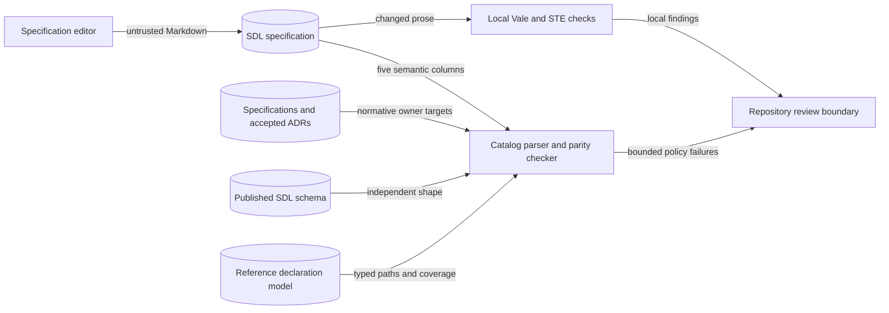

# Language-neutral SDL citation preflight

Issue: #2011. Requirement: none. Date: 2026-11-11.
Source revision: `136d8bbcd2b94b8440d741824b740feead11654e`.

Remove code names and file links without changing SDL meaning.
The supplied issue is the delivery contract. This note records design boundaries.
It does not perform the cleanup or give an implementation plan.

## Authority and catalog contract

[ADR-009](adrs/adr-009-normative-artifact-authority-and-repository-structure.md),
[ADR-019](adrs/adr-019-normative-authority-boundary-manifest.md), and the
[authority manifest](../../specs/authority/authority-boundary.yaml) already establish the required boundary.
Normative prose and published contracts define meaning. Code consumes them.
No new ADR, authority family, schema, registry, or runtime layer is needed.

Keep the reference index's source path, candidate domain, resolution phase,
failure semantics, and normative owner. Remove its implementation-evidence column.
Preserve every reference edge. Keep declared, eligible, derived, runtime,
vocabulary, registry, contract, and opaque reference domains distinct.
An owner remains a local specification or accepted ADR.
Code and explanatory pages cannot own normative meaning.

This changes a private tooling table contract, not a published wire contract.
The incumbent [parser](../../tools/sdl_catalog_parity/_rows.py) requires six columns.
The [checker](../../tools/sdl_catalog_parity/_checks.py) compares evidence links exactly through the
[expectation registry](../../tools/sdl_catalog_parity/_registry.py) and its three existing parts.
Their change to five columns belongs within the cleanup's scope.

Keep independent expectations for source paths, domains, phases, and failures.
Keep typed-model traversal, owner checks, completion-domain checks, coverage checks,
duplicate rejection, bounded parsing, and internal-link checks.
Do not derive expectations from the edited table or bypass a failed comparison.

At the source revision, the index has 238 rows and 238 Python file links.
The issue's count of 236 is historical context, not a permitted coverage reduction.
There are five additional Python file links in `external-injects.md` and `profile-selections.md`.

## Meaning that must survive

The three names in the issue are examples, not an exhaustive acceptance list.
Review all files under `specs/sdl/`, including non-normative evidence blocks.
The README's permission to name implementation symbols conflicts with the new acceptance boundary.
Review test filenames, exception classes, package names, model members, and constants too.

| Concern | Required boundary |
| --- | --- |
| Recursive realization and preparation | Preserve every numeric limit, unit, shared budget, scope, and exhaustion outcome. Keep recursive authority, aggregate plans, and snapshot/preparation carriers distinct. `recursive-realization-constraints.md`, `backend-realization-preparation.md`, and `safe-state.md` share these concerns. Check values against `runtime_value_limits.py` and its inherited defaults. Name the bounded operation or carrier, rather than its constant. |
| Scenario-family selection | Preserve complete recorded selections. Composition precedes selection; unresolved families fail closed. Keep authored field presence. Defaults and first members cannot select a family. Keep selection separate from experiment sampling and instantiation. |
| Protected mailbox materialization | Name the configured protected sink by its role. Keep separate authorization of the exact account/mailbox pair. Check before mutation. Keep one materialization owner, private authentication state, state replacement, and deletion cleanup. Keep the reference demonstration limit; do not claim live mail-server support. |
| Diagnostics | Preserve stage, severity, stable code, JSON Pointer, source ranges, bounded messages, collect-all behavior, and error/advisory distinctions. Remove exception-class citations without removing their failure-channel meaning or disclosure restrictions. |
| Identity and relationships | Preserve PI clause IDs and rejected legacy authored fields. Keep role selection, assignment versus attribution, namespace rewriting, and declarative-only support limits. Name rejected fields through authored paths. Keep conformance cases and their limits without Python test names. |
| Other model names | Check sections, software requirements, cloud access, domain topology, materialization, participant control context, and both profile documents. Replace implementation names with authored field paths or published contract locations. Preserve real field names, enum values, contract IDs, and JSON Pointers. |

Use [published schemas](../../contracts/schemas/README.md), formal specifications,
and owning ADRs to resolve portable terms. A schema name can resemble a class.
Find its published contract and pointer before treating it as a portable term.
A capitalized-word ban would also reject legitimate standards and technical terms.

Do not replace Python names with Go names or undocumented successor APIs.
Do not turn reference behavior into a stronger universal rule.
Report any conflict between code and specification. Do not silently change meaning to resolve it.

## Cross-cutting layers

The artifact flow stays: source, local policy and prose checks, repository review.
Runtime inputs, execution boundaries, and stored data do not change.

| Layer | Incumbent and constraint |
| --- | --- |
| Authority and policy | Reuse `specs/authority/authority-boundary.yaml`, `tools/check_authority_boundary.py`, and `tools/check_repo_policy.py`. Keep normative facts in `specs/` and contracts in `contracts/`; this note is explanatory. |
| Catalog shape and validation | Reuse `tools/check_sdl_catalog_parity.py` and `tools/sdl_catalog_parity/`. Retain the exact index heading, semantic rows, root-contained links, byte/row bounds, and owner validation. Its link check proves file existence, not fragment correctness. |
| Source and phase admission | Preserve `document-model.md`, `variables-and-instantiation.md`, and `diagnostics.md`: bounded YAML decoding, closed structural shape, semantic resolution, substitution/revalidation, and direct-artifact admission remain separate gates. No SDL parser or runtime DTO changes are required. |
| Published schemas and profiles | Reuse checked-in schemas, fixtures, publication records, and profile contracts. Schema validity proves shape. It does not prove semantic support or grant execution authority. Keep pinned definitions, local-only references, offline admission, and authenticated plan authority from `plan-realization-profiles.md`. No generation or publication change is required. |
| Authentication and authorization | Documentation grants no execution authority. Retain independent target/sink configuration, exact owner checks, plan authentication, context binding, and checks before mutation. A selected profile or matching digest is insufficient authorization. |
| Secrets, environment, and configuration | Preserve `account-credential-bindings.md` and the profile credential projection boundary. Public bindings stay separate from private credentials. Environment bindings and config shapes do not change. There is no new secret lookup or service. Examples must remain synthetic. |
| Errors, logging, and observability | Tooling reuses `PolicyFailure`, `CatalogParseError`, existing failure IDs, and the `run_application` boundary. Preserve value-free diagnostics and existing operational logging. Credentials, parameter maps, raw framework input, and tracebacks cannot enter public errors or logs. No duplicate exception hierarchy or logging channel is needed. |
| Persistence and evidence | Preserve native plans, snapshots, lifecycle cleanup, provenance, and historical evidence. Authored declarations and test coverage do not prove observed effects. No store migration, repository/service layer, or new evidence ledger is required. |
| Host and acquisition | Reuse frozen tooling and the artifact lock through `tools/documentation_tools.py` and `tools/vale_tool.py`. Checks run locally. No upload, remote analyzer, token in process arguments, or environment dump is needed. |
| Documentation and workflow | Reuse `.ground-control.yaml`, `.gc/plan-rules.md`, `noxfile.py`, `.pre-commit-config.yaml`, and the documentation style guide. This remains requirement-free; invent no UID. CI owns full policy, contracts, documentation builds, and external-link checks. Keep secret checks and file hygiene enabled. |

## Extensibility and verification boundaries

The stable seam is the reference source path and its domain/phase/failure contract,
with an authoritative owner link. Support for another language needs no new column,
language selector, file-path adapter, or registry in the normative specification.
Existing checker `repo_root` parameters remain the seam for isolated fixture roots;
do not bind owner resolution to the process working directory.

Reuse [catalog parity tests](../../implementations/python/tests/test_sdl_catalog_parity.py).
They already mutate temporary catalogs to test drift detection.
Keep negative cases for removed edges, changed domains/phases/failures, duplicate rows,
malformed tables, invalid owners, missing targets, and working-directory independence.
Tests tied to removed evidence prose must still test a real boundary.

If acceptance needs an automated guard, extend existing prose/link checks across `specs/sdl/`.
Do not add another scanner or rely only on the three example symbols.
Review Markdown links, bare paths, inline names, and code blocks.
File-existence checks do not prove that an anchor or revised rule is correct.

Use explicit changed-path `docs-prose` and file-local policy checks locally.
Run only relevant parity tests for the narrow tooling adaptation.
Full suites and the documentation publication lanes remain CI concerns.
`docs/public/` is the curated Sphinx source root; building it does not render every specification page.
Follow the [style guide](../explain/reference/documentation-style-guide.md) for meaning review,
local rendering, source-revision evidence, and link review. Vale alone cannot establish accuracy.

## Non-goals

This issue does not change SDL semantics, published schemas, identifiers, runtime
limits, backend behavior, credential handling, storage, or diagnostic envelopes.
It does not implement the Go cutover or move runtime ownership.
It adds no replacement Python API or docs publishing service. It does not prove Go conformance.

Keep useful document paths and heading links. Keep pinned ADRs and historical evidence unchanged.
Avoid a repository-wide prose rewrite, bulk schema regeneration, blanket identifier
replacement, duplicated validation, and a new test-to-clause registry.

## Documentation flow and design sources

The editor boundary admits text, not execution authority.
The checker bounds input bytes and rows before accepting a table.
Independent expectations detect omitted edges and changed failure semantics.

Owner validation rejects implementation paths and targets outside the repository.
Existing negative catalog tests exercise these controls with temporary documents.
The runtime security and participant data flows do not change.

Their existing diagrams remain in the participant control-context specification.
Published schemas and the authority manifest need no change because wire shapes and authority owners remain the same.

The design uses these public references:

- [Diataxis reference guidance](https://diataxis.fr/reference/), accessed 2026-11-11: describe exact behavior and preserve reference structure.
- [RFC 2119](https://www.rfc-editor.org/rfc/rfc2119), March 1997, sections 1–6: preserve each obligation's strength.
- [ASD-STE100](https://www.asd-ste100.org/assets/files/ASD-STE100_ISSUE9.pdf), Issue 9, sections 1 and 6: consistent technical nouns and short descriptive sentences.

Review preserves SDL field names, quantities, conditions, and authority boundaries.
New descriptions use at most 25 words per sentence and one topic per paragraph.
The specification remains reference material. This note records the design.
Implementation tasks and check commands belong in the issue plan.
