# Issue 2012 SDL semantics preflight

This note gives design guardrails for issue #2012. It does not define SDL
semantics or provide an implementation plan. The issue is the requirement-free
contract. Source review uses revision
`1cb8f78946214fa20da0d185335bffed256debdf`.

## Authority and scope

Keep `specs/sdl/document-model.md` as the semantic owner of `infrastructure` and
`features`, as declared by `specs/sdl/sections.md`. Give duration values one
language-neutral definition under `specs/sdl/`. Name the fields that use it.
Link to that definition from the existing document set. Do not define the same
grammar separately for scripts and workflow timeouts.

The authority split in ADR-009 and `specs/sdl/README.md` already covers this
change. Normative prose and published schemas must agree. Python code supplies
conformance evidence; explanatory prose in `docs/explain/sdl/sections.md` does
not establish language authority. No new ADR is needed. Keep accepted ADR text
and pinned research evidence unchanged.

Use the published SDL authoring, instantiated, snapshot, and materialized
schemas in `contracts/schemas/sdl/`.
Their existing `InfraNode`, `Feature`, `Source`, `SimpleProperties`, `ACLRule`,
`Script`, and `WorkflowTimeoutPolicy` definitions supply field shapes.
Raw-source shorthands precede normalized-schema validation. A raw numeric
duration can normalize to an integer even though its field schema lists only
integer and string types. This does not authorize a schema change. A broad
string type does not authorize one either.

## Existing owners and semantic traps

All package paths below are relative to `implementations/python/packages/`.

| Surface | Existing owner and guardrail |
| --- | --- |
| Infrastructure identity and shape | `raes/infrastructure.py`, `raes/scenario.py`, and `raes/parser.py` own the models and count shorthand. Infrastructure keys select same-named nodes. They do not declare another resource kind. Both sections remain optional. Not every node needs an infrastructure entry. |
| Infrastructure validation | `raes/validator/_nodes_infra_network.py` owns reference and address checks. Preserve positive counts, switch singleton counts, and singleton compute counts when conditions are attached. Preserve unique links, dependencies, and nonempty ACL names within their owner. |
| Connectivity and addresses | Links select switch-backed infrastructure. Keep subnet `SimpleProperties` apart from per-link address maps. Preserve gateway membership, linked-network membership, and IP/CIDR checks. Reuse `ipaddress`. Dependencies give order; links give connectivity. Feature cycle checks do not imply an infrastructure cycle ban. |
| Network controls | `ACLRule` and the reference catalog own ACL shape, network references, actions, ports, and optional names. Do not invent protocol or direction enums. Do not promise packet-filter order or enforcement by every backend. Keep ACL intent and `internal` apart from observed listeners, published host ports, and operator authority. |
| Feature declarations and bindings | `raes/features.py` owns reusable service, configuration, and artifact declarations. `nodes.*.features` binds them to compute nodes with optional node-local roles. A feature declaration is distinct from a node service or runtime software inventory. Feature `source` is optional; do not make it mandatory. |
| Feature dependencies | `raes/validator/_sections.py` checks declared dependencies and cycles. `raes_processor/compiler/provisioning.py` requires each dependency to be bound on the same node and emits `provisioning.feature-dependency-binding-missing` otherwise. Do not imply automatic installation of an unbound dependency. |
| Shared artifact references | Reuse `raes/_source.py` and the source shorthand. Preserve optional build provenance and artifact-requirement contracts. A source selector does not instruct a download or prove deployment. Link to those contracts from the feature text. |
| Duration conversion | `raes/orchestration/_durations.py` is the current implementation evidence. Its consumers are script start/end times, script event offsets, and workflow timeout seconds. Name these fields explicitly; do not apply its grammar to every field that measures time. |

Use `specs/sdl/references.md` for reference domains and ambiguity rules, and
`variables-and-instantiation.md` for placeholders and revalidation. Keep
declaration identity, display names, qualified references, and node-local roles
distinct under ADR-076. Do not copy resolver logic into documentation tooling.

The duration definition needs precise lexical rules as well as examples.
Check numeric and string forms separately, unit aliases and case handling,
compound components, bare seconds, separators, whitespace, underscores, and
the microsecond spelling. Current evidence uses fixed 30-day months and
365-day years. It accumulates components before applying a ceiling to whole
seconds; rounding each component would change results. Zero is valid for
script timing, while workflow timeout seconds must be positive. Script bounds
and positive speed remain separate contextual checks.

Check the parser's permissive syntax. For example, the current helper
accepts `+1s++`, removes ASCII spaces and underscores, and rejects `1e3` as a
string. Numeric exponent notation follows raw scalar decoding instead.
Check repeated separators, internal tabs, decimal edges, Unicode digits,
non-finite values, negatives, booleans, precision, and large values before
claiming a complete grammar. Do not silently narrow accepted inputs or promise
unbounded exact arithmetic. Record any authority conflict for resolution;
do not repair parser behavior within this documentation correction.

Keep this conversion separate from `specs/formal/time-model/README.md`.
Shared clocks use exact rational tick periods and mappings without silent
rounding. Condition polling integers and execution-policy `delay_ms` also
retain their own contracts. Duration syntax does not select a clock, epoch,
host timestamp, or runtime pacing policy.

## Cross-cutting layers

The data path starts with source YAML and bounded decoding. Shorthand expansion
and closed models precede semantic validation. Substitution and revalidation
precede compilation. The correction describes that path without changing it.

| Layer | Required treatment |
| --- | --- |
| Source security | Reuse `raes/_yaml_loader.py`, `_source_validation.py`, `_source_profile.py`, and composition budgets. Preserve UTF-8, finite JSON-domain values, duplicate-key rejection, literal identifiers, and strict structural keys. New examples must pass the strict source profile. |
| Schema and config shapes | Reuse `raes_contracts/sdl_model.py`, published schemas, and existing validators. Extra fields remain forbidden. Preserve full-value placeholders only where admitted; `raes/instantiate.py` substitutes and revalidates them. No new configuration carrier or validator is needed. |
| Secrets and environment | Feature `environment` remains `list[str]`. It is not `raes/runtime_environment.py`'s typed runtime value carrier with classification, provenance, and exclusive literal/`value_from` inputs. Reuse existing credential and secret-reference contracts for those surfaces. Examples use synthetic non-secret values. Never use operator credentials as feature environment examples. |
| Authentication and authorization | This correction adds no endpoint, principal, or permission. Infrastructure ACLs describe scenario network policy. They do not grant control-plane authority. Keep runtime authentication and authorization outside this edit. |
| Host and process exposure | Use existing frozen environments and admitted documentation tools. Keep credentials out of process arguments and output. Reading a source selector does not authorize fetching an image, provisioning a resource, or executing feature content. No new hosting, upload, or analyzer service is needed. |
| Errors and observability | Reuse SDL parse, validation, and instantiation errors, `raes_contracts/diagnostics.py`, and the ADR-116 exception/logging boundary. Policy tools use `PolicyFailure`; no fourth SDL error family is needed. Examples must not expose raw validation inputs, exception text, credentials, or tracebacks. |
| Persistence and workflow | Maintained Markdown is the only new artifact. No database, DTO, service, controller, cache, or workflow engine is needed. Reuse `.ground-control.yaml`, `.gc/plan-rules.md`, `noxfile.py`, `tools/nox_support/`, and existing hygiene and secrets checks. Do not invent a requirement UID. |
| Documentation and policy | Preserve catalog headings, columns, summary markers, and owner links consumed by `tools/sdl_catalog_parity/`. Reuse the authority-boundary and schema-parity checks. Use exact-path `docs-prose`, `.vale.ini`, and the pinned doc-tools package; CI owns full documentation and policy suites. |

## Extension boundary and verification

The extension seam is one duration definition with a unit/alias table. Name
each field that uses it. A future consumer links to it and states its own
bounds. A field name containing `time` does not imply whole-second rounding.
Source profiles and semantic revisions govern incompatible changes. No new
runtime setting is needed now.

Extend infrastructure and features through their
typed schema owners and `Source.artifact_requirement`. Do not add free-form
options.

Existing targeted evidence lives in `test_sdl_models.py` (`TestInfraNode`,
`TestSimpleProperties`, `TestFeature`, `TestParseDuration`, `TestScript`),
`test_sdl_parser.py`, and `test_sdl_validator.py`. Same-node feature dependency
evidence lives in `test_runtime_models.py`. New examples need source parsing,
normalization, and relevant semantic admission checks; schema validity alone
does not establish those properties.

Catalog parity checks structure and owner links, not completeness of prose
semantics. Vale and STE checks assess style, not accuracy. Preserve that limit
when recording verification. No executable change exists to mutation-test in
this preflight. Existing targeted checks suffice here; do not add a new test
framework or run full, integration, or fuzz suites locally.

Non-goals are parser changes, schema evolution, new duration formats or units,
and new feature kinds. Deployment behavior, backend policy enforcement,
clock-model changes, secret delivery, release metadata, and publication are also
outside scope. This preflight
leaves the issue's normative specification edits to the implementation.

## Completed design

The normative additions belong in `specs/sdl/document-model.md`.
Append sections for infrastructure, features, and duration values.
Keep existing section numbers and links stable.
Update the document-set description and acceptance-question map in `specs/sdl/README.md`.
No application module or public interface changes.

Infrastructure and feature definitions use the published fields and defaults.
Reference resolution stays in `references.md`.
Feature source refinements stay in the existing artifact contracts.
The duration definition covers raw values, normalization, aliases, composition, and rounding.
Its grammar preserves leading, repeated, and trailing plus signs.
These spellings already parse; accepting them requires no new parser behavior.

Number scanning consumes the longest decimal token before unit scanning.
Unit scanning consumes the longest matching alias.
The shared rational time model keeps its separate contract.

### Components and data flows

```mermaid
flowchart LR
  author[External scenario author]
  source[(Untrusted SDL source)]
  subgraph boundary[Processor admission boundary]
    decode[Bounded YAML decoder]
    normalize[Shorthand and duration normalization]
    shape[Closed structural models]
    semantic[Reference and semantic validation]
    bind[Variable substitution and revalidation]
    compile[Runtime compiler]
  end
  scenario[(Admitted scenario)]
  plan[(Runtime plan and diagnostics)]
  author -->|Authored YAML bytes| source
  source -->|Bounded source bytes| decode
  decode -->|JSON-domain values| normalize
  normalize -->|Normalized section objects and seconds| shape
  shape -->|Typed declarations| semantic
  semantic -->|Validated authoring object| bind
  bind -->|Concrete validated values| scenario
  scenario -->|Admitted scenario content| compile
  compile -->|Bindings and dependency checks| plan
```

The diagram names the existing components and their data stores.
It also shows the trust boundary and the values that cross it.
It is the component diagram and data flow diagram for this correction.
No deployment or state diagram changes are needed because execution behavior stays unchanged.

### Protection and verification

| Asset and threat | Existing control | Verification |
| --- | --- | --- |
| Scenario meaning; malformed or ambiguous source | Bounded decoding, unique keys, closed models | Existing parser tests and catalog parity |
| Topology; invalid addresses or references | Network membership and reference validation | `TestInfraNode`, `TestSimpleProperties`, `TestVerifyInfrastructure` |
| Feature order; missing or cyclic prerequisites | Feature cycle checks and same-node compiler checks | `TestVerifyFeatures` and targeted runtime binding tests |
| Timing; early execution from truncation | Sum terms before upward rounding; validate consumer bounds | `TestParseDuration`, script tests, and a downward-rounding mutation |
| Credentials; accidental disclosure in examples | Synthetic values; no service calls or secret carriers | Changed-text review and mandatory secret checks |

These controls operate at existing admission boundaries.
Documentation cannot prove backend enforcement or authorize feature execution.
That residual limit remains explicit in the normative text.

No policy-as-code change is needed: catalog parity and authority checks already own structural consistency.
No architecture-as-code change is needed: this edit changes no component, dependency, or executable interface.
ADR-001, ADR-009, and ADR-036 retain their existing decisions.
No ADR amendment is needed.

### Reference and writing review

The OCR SDL reference supplies the inherited section separation and duration precedent.
Its scripts, features, and infrastructure sections inform the comparison, without overriding RAES contracts.
Python 3.14 decimal documentation defines the ceiling operation used by the reference parser.
Diataxis reference guidance supplies the document structure.

The official ASD-STE100 Issue 9 overview supplies the terminology and writing principles.
The pinned documentation skill and local style guide supply the repository checks.
Review uses short sentences, stable technical terms, and one fact per sentence.
No full dictionary-conformance claim follows from the automated prose checks.
