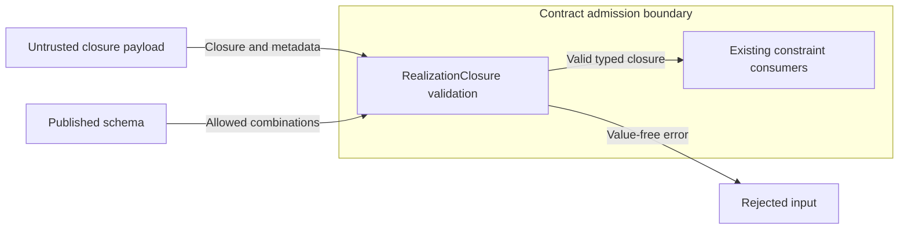

# Posture vocabulary preflight

Issue #2016 calls for one semantic mapping table, with existing meanings intact.
The issue is the contract for this requirement-free change.
This review uses repository commit `136d8bbcd2b94b8440d741824b740feead11654e`.
It records design boundaries before the mapping is written.

## Authority and scope

Reuse the separate posture and closure axes in
[envelope semantics](../../specs/formal/realization/envelope-semantics.md#required-semantics)
and [ADR-070](adrs/adr-070-realization-envelope-semantics.md).
Posture constrains a value or child scope.
Closure governs extra realizable dimensions or members.
[ADR-105](adrs/adr-105-recursive-partial-description-semantics.md)
already separates those axes from presence, knowledge, origin, and authority.
No new ADR or executable model is needed.

The authoring overview in [sections.md](../../specs/sdl/sections.md) can own the single normative mapping table.
Keep that table outside the checked top-level field catalog.
The recursive constraint specification can link to it beside its closure vocabulary.
Keep catalog headings, rows, counts, links, and required schema fields intact.
This note is guidance; `docs/` does not become language authority.

The table needs source context, both axes, and rules for defaults.
An axis that a source term does not address must remain unstated.
Distinguish local declarations from effective resolved values.
One shared model needs neither a shared enum nor a new wire format.

## Semantic guardrails

- Value posture and closure stay independent. Exact children can exist within open records.
  Closed membership does not make every child value exact.
- Author defaults and scopes govern otherwise unspecified realizable concerns. Explicit leaf constraints still take precedence.
  This includes exact leaves under open defaults.
- An author `unspecified` declaration contributes no concrete local default. A concrete governing scope still applies; otherwise the apparatus policy decides.
  Omitted `realization` keeps the legacy closed fallback. Explicit delegation keeps its source record, even when the apparatus selects closed.
- Recursive `undefined` supplies no local closure. Lexical scopes and the document default resolve it.
  The pure recursive relation reports `unsupported` if effective closure stays undefined. It does not choose an apparatus policy itself.
- A concrete recursive closure names its universe and profile revision. Closure limits additions only within that universe.
  It does not describe every incidental file, dependency, or backend setting.
- Presence, cardinality, literal null, empty values, unknown knowledge, and redaction remain distinct.
  Knowledge gaps grant no permission. Closure alone grants no observation, retention, export, or conformance claim.
- Author scope resolution respects namespaces and ignores declaration order. Equal-scope duplicates stay invalid.
  Recursive local closure and envelope binding overrides keep their own rules. One generic precedence algorithm would lose those distinctions.
- The omitted compute-substrate constraint remains intentionally open under its owning rule.
  `augmentation_scope` has its own open default and governs added in-world effects. Neither rule sets the default for all realization.

The source contracts are the
[scoped default cascade](../../specs/formal/realization/explicitness-and-realization.md#scoped-default-cascade),
[recursive closure rules](../../specs/sdl/recursive-realization-constraints.md#2-records-scopes-and-closure),
and [augmentation scope](../../specs/sdl/augmentation-scope.md).
Keep envelope binding restrictions separate from the author-default cascade.
The envelope's `overrideable` condition does not restrict either direction of lexical default override.

## Existing owners to reuse

Implementation paths below are relative to `implementations/python/packages/`.
They show current behavior. Normative specifications retain authority.

| Concern | Canonical incumbent |
| --- | --- |
| Author declarations and scope resolution | `raes/realization_designation.py`: existing designation records and `resolve_realization_designation`. |
| Value posture, typed domains, and envelope closure | `raes_contracts/realization_posture.py`, `bounded_domains.py`, `realization_envelope.py`, and `vocabulary.py`. `raes_contracts/compute_substrate.py` checks the allowed posture/domain pairs for that concern. |
| Recursive closure, identities, and bounded relations | Public `raes_contracts.realization_structure` models, `normalize_realization_literal`, `validate_realization_constraint_document`, and `evaluate_realization_constraint`. Keep internal modules behind that public owner. |
| Compiler projection and apparatus policy | `raes_processor/compiler/realization_authority_posture.py` and `raes_processor/semantics/realization_apparatus_defaults.py`. Existing decisions are resolved once. Plan projections share them. |
| Portable artifacts | Published SDL, recursive constraint, envelope, and provisioning-plan schemas under `contracts/schemas/`. Keep existing phase provenance and authenticated plan authority. |

Aggregate `ExplicitnessClass` and `RealizationAuthorityMode` are existing projections.
They cannot replace the recursive model or serve as a fourth author vocabulary.
Backend support and offered envelopes describe capability. They grant no author permission.

## Cross-cutting boundaries

The protected assets are author intent, plan integrity, secret values, and truthful evidence.
The threat is a reader treating shared terms as permission to weaken an admission gate.
The existing path starts with source admission, compilation, and planning.
It then passes through backend result admission and snapshot publication.
This change adds no data flow, trust boundary, component, or storage format.
Existing architecture diagrams need no change.

| Layer | Required boundary |
| --- | --- |
| Source parser and structural validation | `sdl-yaml/v1`, `SDLModel`, and `ContractModel` keep bounded parsing and reject unknown fields. Open semantic closure never admits unknown SDL keys. Keep enum spellings and domain validators intact. |
| Recursive validation and policy | `realization_structure` keeps bounded admission and evaluation. Preserve member identities, named universes/profiles, and distinct failure outcomes. `runtime_value_limits` owns limits. Only `conformant` is success. |
| Planning, config, and backend results | Keep manifest capability checks, envelope/config identities, authenticated plan bindings, preparation checks, and result/snapshot gates. No new config field, migration, environment switch, or backend-specific branch is needed. |
| Authentication and authorization | `raes_runtime/control_plane_security.py`, `control_plane_api/_auth.py`, and API guards keep identity, role/scope, request-size, and audit checks. No endpoint or controller change is needed. |
| Secrets, environment shapes, and host exposure | `RuntimeEnvironmentVariable`, `ImageBuildArg`, and `ImageEnvironmentDefault` keep their value-source and redaction checks. Semantic openness never bypasses them. No secret lookup, shell command, process argument, host setting, or new service is introduced. |
| Errors and observability | Reuse `raes_contracts.diagnostics`, `errors`, and `operational_logging`. SDL errors keep the stages and envelopes in `specs/sdl/diagnostics.md`. API handlers in `control_plane_api/_operation_routes.py` keep generic errors and value-free audit records. No raw values or framework input dumps enter examples, errors, or logs. |
| Persistence and replay | Existing phase provenance, plan digests, snapshot DTOs, and `raes_runtime/control_plane_store*` keep their meanings. Do not rewrite stored tokens, recompute historical identities, or add a mapping store. |

### Existing validation discrepancy

A synthetic read-only probe found a schema/model mismatch at the reviewed revision.
`RealizationClosure(posture="undefined", universe="synthetic-universe")` is accepted by the Python model.
A document containing that default closure fails the published recursive constraint schema.
The predicate in `realization_structure/_models.py` checks whether both metadata fields exist.
It misses the single-field case.

The normative undefined state supplies neither universe nor profile.
The mapping must preserve that rule. Permissive model construction does not prove valid portable input.
The implementation repairs this predicate in the existing validator.
Both metadata fields must be absent or null for `undefined`.
Both fields must contain names for concrete closure.

The regression also found that the published schema permits null metadata for concrete closure.
Its conditional requires both keys but does not require non-null names.
The schema correction rejects null names for concrete closure in each embedded definition.
Omitted posture retains the same metadata rule as explicit `undefined`.

## Implementation design

The single table stays in `specs/sdl/sections.md`.
It maps each source term to the axes already defined by envelope semantics.
An unset axis retains its independent declaration and resolution rules.
The recursive specification links to this table instead of copying it.

The public `raes_contracts.realization_structure.RealizationClosure` model owns the validation repair.
Its existing validator checks each metadata field against the selected closure state.
Its schema annotation must generate the same corrected conditional as the published contracts.
The shared definition appears in six existing schemas: recursive constraints, provisioning plans, plan profiles, experiment runs, evidence records, and trial outcomes.
Invalid input keeps the existing generic error without raw values.
There is no new interface, dependency, storage, or network operation.

The following data flow shows the existing contract-admission boundary.
Only the metadata predicate changes.

The threat is inconsistent admission of authority metadata across Python and portable JSON.
The control rejects partial metadata before a typed closure reaches consumers.
Parameterized tests compare Python admission with the published schema for all posture and metadata-presence combinations.
Restoring the old predicate must fail the regression tests.
The source/default resolution rules and relation limits remain unchanged.

Existing schemas supply the checkable architecture and contract policy.
Only their concrete-closure metadata conditional changes.
No new policy engine, schema record, architecture model, or ADR is needed.
This repair enforces the existing undefined-state rule.
It does not add a new realization permission.

Reference sources reviewed before implementation:

- [JSON Schema object reference](https://json-schema.org/understanding-json-schema/reference/object), Draft 2020-12: property constraints and additional-property closure remain separate.
- [Diataxis reference pattern](https://diataxis.fr/reference/), current guide reviewed 2026-11-11: keep the mapping concise and organized by the described model.
- [ASD-STE100](https://www.asd-ste100.org/), Issue 9: preserve technical names, use short sentences, and keep each document true to its purpose.

The writing review preserves obligations, source identifiers, and qualified default rules.
The reference table gives semantics; this record gives design reasons.
The issue plan carries implementation tasks and verification commands.

### Deadline test scheduling repair

CI exposed a scheduling assumption in `test_issue_1362_review_regressions.py`.
The test's 200 ms execution budget can expire before dispatcher binding completes.
No timer is armed in that case, so waiting for its callback cannot test store-lane isolation.
A controlled 250 ms binding delay reproduced the same failure locally.

The test must retain the default admission budget and capture timer registration.
After successful admission, it arms the real timer with an immediately due deadline.
The real expiry callback still uses the deadline lane and the single store slot.
Its terminal-state and context-cleanup assertions remain unchanged.
The adjacent callback-failure test uses the same controlled registration to avoid the same setup race.
This changes test scheduling only; runtime deadlines, authorization, and durability rules remain unchanged.

## Extensibility and verification boundaries

New domains and collection profiles should use existing owners.
They supply typed domains, a semantic universe, a profile revision, and identity metadata.
That variation changes neither the posture axis nor the meaning of closure.

Apparatus policy already has the injected `ApparatusRealizationDefaultResolver` seam and frozen per-concern decisions.
Keep that seam. The current closed fallback is not the permanent meaning of `unspecified`.
Source vocabulary and resolution context belong beside a mapping entry.
Later variants then need no new global enum.

Existing semantic evidence includes these targeted test modules:

- `test_sem_218_realization_designation.py`: leaf precedence, both scope directions, omission versus explicit delegation, and namespace isolation.
- `test_issue_1203_recursive_normal_form.py`: inherited closure, exact descendants, presence, knowledge, identity, and bounded relation outcomes.
- `test_issue_1204_recursive_defaults.py`: one apparatus decision shared with recursive plan authority, without losing exact leaves.
- `test_realization_envelope_relation.py`: value-domain and closure relations.

These modules live in `implementations/python/tests/`.
They are semantic review anchors, not a reason to add tests that assert prose wording.
The validator predicate and concrete-closure schema conditional are the executable mutation targets.
Use existing changed-path `docs-prose` and file-local repository policy checks for guidance edits.
`tools/check_sdl_catalog_parity.py` guards the future catalog edit.
Full verification remains in CI/CD under `.github/workflows/canonical-verification.yml`.

## Non-goals and anti-patterns

This issue does not rename public enum values, alter defaults, or add schema fields.
It changes no valid runtime behavior or policy engine.
It does not merge capability, realization permission, augmentation, knowledge, presence, or evidence into one concept.

Avoid a second mapping table, duplicated resolvers, new DTOs, exception hierarchies, loggers, registries, and workflow checks.
Do not replace existing paths with string-prefix matching or positional collection identity.
Keep accepted ADR content, pinned captures, schema publication records, release files, and requirement traceability intact.
The authority manifest, Ground Control rules, ADR pin policy, and schema publication rules still apply across the repo.
