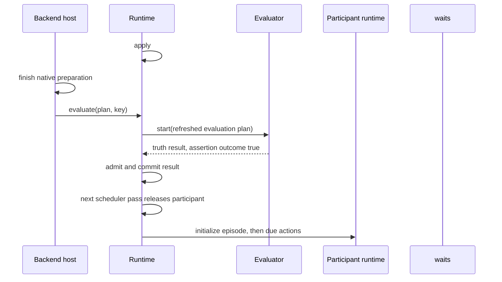

# Release autonomous participants on starting assertions

This design covers issue #2020 on `go-cutover`.
The issue has no requirement UID.
The [preflight note](issue-2020-participant-release-readiness-preflight.md) gives the binding guardrails.
The Python runtime is the behavior reference until the Go cutover.
The Go runtime port (#1795) carries this behavior.
This change adds no SDL field, published schema, Go package, or backend role.

## Decision

`agents.*.starting_assertions` is the release condition of an autonomous participant.
The runtime starts the participant only when every listed assertion has a `true` assertion outcome.
The backend reports that outcome through its evaluator role.
An agent without starting assertions starts as before.

| Need in the issue | Owner |
| --- | --- |
| The SDL states the release precondition | Existing `agents.*.starting_assertions`; the validator requires precondition assertions |
| The backend reports that the range is ready | Existing evaluator truth results, collected by `RuntimeManager.evaluate()` |
| The runtime holds participants until release | `raes_runtime/participant_release.py` and the participant scheduler |

## Components

The compiler already resolves `ParticipantBehaviorRuntime.starting_assertion_addresses`.
The runtime maps each participant behavior address to these assertion addresses.
`participant_release_assertions(model)` builds this map from the compiled model.
The runtime keeps the map with the autonomous policies.
It sets both in the participant execution phase and in durable run restoration.

The backend evaluator returns `proposition_truth_results` keyed by assertion address.
`evaluate()` is the existing typed, idempotent, receipt-bearing operation for later evidence.
The backend host calls it after native preparation is complete.
For LilRAE, that preparation includes tool servers, SOC seeding, and participant tool configuration.
RAES does not perform or inspect those native steps.

`release_disposition(snapshot, assertion_addresses)` reads the current snapshot.
It revalidates each result against the admitted proposition and assertion entries.
It returns one of three dispositions.

| Truth state of the starting assertions | Disposition | Runtime behavior |
| --- | --- | --- |
| No assertions | released | Start as before |
| All results valid with assertion outcome `true` | released | Initialize the episode, then schedule |
| Any result missing, invalid, `false`, or `unknown` | waiting | No native call; emit info diagnostic `runtime.participant-release-waiting` |
| Any result `unsupported` | unsupported | Fail the scheduler pass with `runtime.participant-release-unsupported` |

A refused pass follows the existing scheduler refusal path.
Its operation needs explicit resolution before more effects.

A negative assertion releases only when its assertion outcome is `true`.
Missing evidence never becomes `true`.

## Scheduler behavior

`ParticipantScheduler.initialize` and `run_due` take the release map as a required keyword.
A caller cannot omit the gate.

- `initialize` initializes released participants only.
  It still creates the policy execution-service state and resource budgets.
  These are service facts, not proof of range readiness.
- `run_due` first releases each waiting participant whose disposition is now released.
  Release occurs only while the policy execution service accepts work.
  Release calls the native episode `initialize`, then writes the initial scheduler state.
  The pass then runs due work for released participants only.
- Released means the participant has scheduler state.
  Serial, concurrent, capacity, and reset loops skip participants without state.
- Coordinated clock reset sends native reset requests only for released participants.

All scheduler passes use `run_due`.
These include the start phase, `run_due_participant_actions`, the wall-paced clock driver, and time control.
One helper therefore decides release on each path.
No release occurs before the run reaches its participant start phase.
The setup phase starts only participants without starting assertions.
The runtime keeps the release map empty until the start phase runs.
Durable restoration fills the map only when the start phase has succeeded.
`evaluate()` refuses a new evaluation until the run applied its evaluation phase.
An early refresh would create the evaluation entries before that phase and break it.
`evaluate()` runs one scheduler pass after it commits, when a waiting participant can be released.
The wall-paced clock driver runs a pass when a committed result makes a waiting participant releasable.
This covers an evaluation result that a worker commits later.
Every native start uses one admission decision.
The service must accept work, and the gate must release the participant.
Direct episode initialization of a waiting autonomous participant uses the same decision.
Clock pause and resume also update the execution service of a policy whose participants wait.
Clock pause, clock resume, and shared-clock reset keep a draining, quiescent, tearing-down, terminated, or failed service.
A shared-clock reset still advances the service generation.
A paused, drained, or terminated service releases no participant.

Delayed release keeps the authored cadence.
A v1 policy starts at the first authored cadence tick at or after the release tick.
A v2 or v3 policy already computes its first occurrence from the current tick.
A waiting participant consumes no random draws, attempts, or reservations.

## Lifecycle decisions

Release is a start precondition, not a continuous invariant.
A released participant stays released for the run.
Shared-clock reset keeps release, because a reset does not undo range preparation.
Stop, teardown, failure, and recovery keep their existing owners.
A late truth result cannot restart a stopped run.

The native start uses the existing scheduler composition operation and invocation ledger.
`_ensure_participant_episode` does not repeat an episode that already has a result.
Durable recovery restores the policies and the release map from the admitted plan.
A durable run reports `pending` after its last phase while participants wait.
Each later `advance_plan` call runs one release pass and reports `succeeded` after release.
Completed phases do not run again.

## Difference from the preflight note

The preflight note proposes a scoped runtime operation for reports.
`evaluate()` already is that operation.
It binds the target, run, plan, actor, and idempotency key.
It invokes only the installed evaluator, and existing ownership checks limit its writes.
A second report operation would duplicate this authority surface.
The note also requires evaluator support for assertions; that admission gate stays unchanged.

## Data flows

```mermaid
flowchart LR
    Author[Scenario author] -->|starting_assertions| Compiler[SDL compiler]
    Compiler -->|assertion addresses| Runtime[Runtime manager]
    Host[Backend host] -->|evaluate request| Runtime
    Runtime -->|evaluation plan| Evaluator[Backend evaluator]
    Evaluator -->|truth results| Admission[Truth and ownership admission]
    Admission -->|committed results| Store[(Runtime snapshot store)]
    Store -->|current results| Gate[Release gate]
    Gate -->|released participants| Scheduler[Participant scheduler]
    Scheduler -->|episode initialize and actions| Participants[Backend participant runtime]
```

The backend host, evaluator, and participant runtime are outside the RAES trust boundary.
The runtime manager, admission, store, gate, and scheduler are inside it.

## Security and data flows

Assets are participant start authority, committed truth results, and run integrity.

| Threat | Control | Verification |
| --- | --- | --- |
| A provisioner or other role forges readiness | Snapshot ownership gives truth results to evaluation only | Existing backend effect ownership tests |
| A malformed or foreign truth result releases a participant | Gate revalidates the model, key, proposition, polarity, and assertion entries | Invalid, mismatched, and wrong-polarity result tests |
| Missing, `false`, or `unknown` evidence releases a participant | Only a `true` assertion outcome releases | Disposition tests for each outcome and negative polarity |
| An unavailable producer holds participants forever | `unsupported` fails the pass with a diagnostic | Unsupported outcome test |
| A code path bypasses the gate | Required keyword; one start admission for every native start, including direct episode initialization | Native-call counters on start, direct run, direct episode, clock, and durable paths |
| Duplicate reports repeat native start | Existing evaluate receipts; episode initialization is idempotent | Replay test with an initialize counter |
| Delayed release creates stale cadence work | v1 alignment to the next authored tick; v2 and v3 relative timing | Cadence tests after delayed release |
| Diagnostics disclose backend data | Diagnostics carry addresses and fixed text only | Diagnostic content assertions |

The change adds no route, credential, store, listener, or data destination.
The residual risk is a backend evaluator that reports `true` falsely.
RAES cannot prove native truth; the evaluator owns that claim and its evidence.

## Checks and supporting artifacts

ADR-092 gains an amendment for the release rule.
ADR-079 keeps its truth semantics unchanged.
The Go architecture model has no change, because no Go code changes.
No published schema changes, so the schema publication manifest has no change.
No policy-as-code gate changes.
ADR-092 and the runtime architecture document describe the release rule.

Sources:

- [Kubernetes Pod lifecycle](https://kubernetes.io/docs/concepts/workloads/pods/pod-lifecycle/), Pod readiness gate, v1.37.
- [W3C SCXML](https://www.w3.org/TR/scxml/), transition `cond` guards, 2015 Recommendation.
- [Python collections.abc](https://docs.python.org/3/library/collections.abc.html), `Mapping`, Python 3.14.

Kubernetes readiness gates require every external condition to be `True`, and a missing condition is not ready.
This design applies the same rule to starting assertions.
