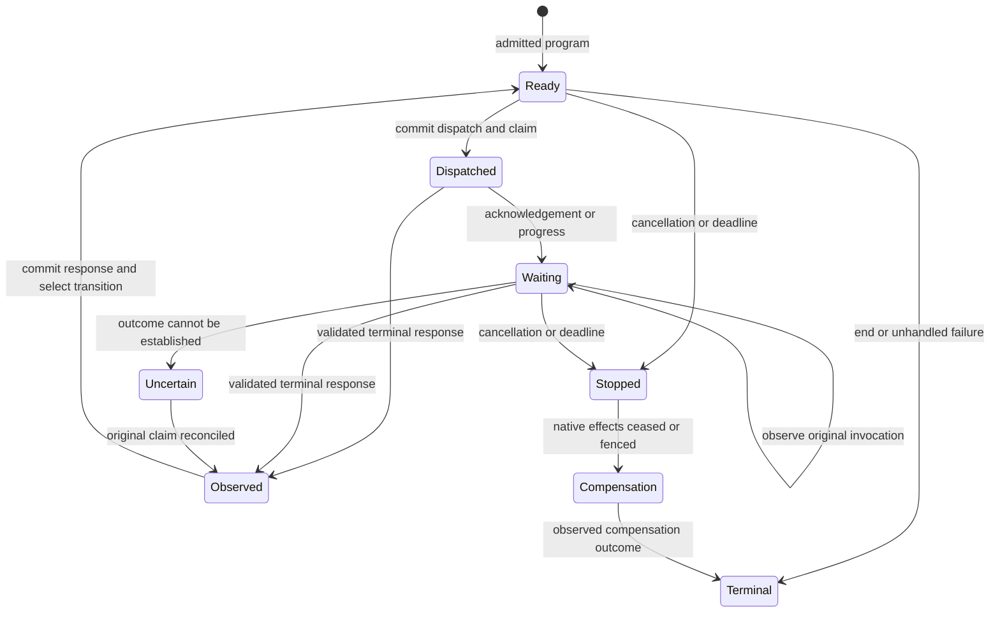
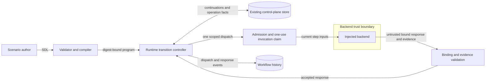

# Runtime workflow step dispatch

This design applies the [preflight](issue-2041-runtime-step-dispatch-preflight.md) to issue #2041.
The [workflow state machine](../../specs/formal/workflows/state-machine.md) remains the semantic authority.
All eight step kinds retain their meaning.

## Components and interfaces

`raes_runtime` owns workflow transitions.
One controller serves manager apply, control-plane submission, and run progress.
It reads the admitted compiled program from the portable orchestration plan.
The compiler includes each next step and call target.

It also includes predicates and realization references.
The plan digest covers these values.
Backend snapshots cannot supply a replacement program.

`raes_contracts.contracts.workflow_dispatch` owns closed dispatch and response models.
Each dispatch binds one program and root operation.
It names the invocation, branch, step, attempt, and prior revision.
It includes only the current step's execution inputs.

It contains no successor names or retry permission.
The backend method receives this dispatch and returns its bound response.
Decision and switch responses report predicate observations.
They cannot select a successor.

Control-only acknowledgements contain no observable step outcome.

`Orchestrator.start()` installs non-workflow orchestration resources.
It receives no executable workflow program.
Runtime installation creates workflow state without dispatching backend work.
Call and compensation targets remain definitions until the runtime invokes them.

The manifest must declare the dispatch contract.
The registry also checks the installed method.
An unsupported backend receives a refusal before effects.

The controller uses the existing operation executor for each dispatched step.
Local execution and the operation provider consume the same bound command.
The native command digest and execution-policy readers explicitly support the step carrier.
The provider resolves a content-bound step response through its existing evidence resolver.

It does not receive the whole program as an executable command.
The existing backend-operation request carries the current dispatch in a typed optional field.
Its request commitment binds these inline inputs to the command and operation context.
Older requests omit the field and retain their existing digest.

No additional artifact-resolution service is required.
Existing claims still govern each call.
Budgets, reservations, and reconciliation keep their current owners.

## Durable control state

Closed workflow continuation records extend the existing operation-record codec.
They use the existing store transactions, snapshot revisions, and audit records.
No cursor is stored in arbitrary snapshot metadata or history details.
Each continuation names its root operation.

Its sequence always increases.
It stores step state for each invocation.
It also stores branch locations and barriers.
It tracks suspended calls and compensation.

The root retains the admitted workflow setup.
It uses the existing plan-operation carrier.
It does not retain non-workflow script bodies or resolved secrets.
An unfinished checkpoint retains its proposed continuation and predecessor revision.

Recovery commits that proposal only when the predecessor still matches.
A changed predecessor cancels the unused checkpoint without effects.
Recovery then reads the last committed state and current stop facts.
Non-workflow setup must succeed before the first step receives permission.

The runtime commits dispatch history and its continuation before backend execution.
The existing operation claim prevents another execution of that dispatch.
The runtime checks the response.
It commits that response before it chooses the next step.

On restart, it reads the continuation.
It also reads the original invocation record.
A missing response does not allocate another attempt.
An uncertain effect retains its reservation and uses existing reconciliation.

Restored facts grant no new execution permission.

Root orchestration bookkeeping grants no native effect authority.
Step operations hold the actual effect reservations.
This separation allows a caller to suspend while its callee runs.
It also avoids a parent reservation that would block every child dispatch.

## Transition rules

Observable steps execute once per invocation.
Shared branch arrivals reuse one execution.
They also share one retry budget.
Decision and switch visits retain their branch identity.

Each retry attempt receives a separate dispatch under the authored limit.
Intermediate failures remain in history.
Ordered cases and prior-step predicates use admitted observations and visible state.
Missing or invalid evidence stops progress; it does not select a false branch.

Parallel branches advance through permitted interleavings.
Each owning barrier retains every branch arrival.
Nested barriers have separate identities.
Each callee invocation has its own identity too.

A failed barrier cannot release later.
The runtime dispatches control steps without waiting for undispatched child work.
It determines invocation completion after the end-step response.

The runtime mutation owner serializes each change.
This includes cancellation, timeout, response acceptance, and dispatch.
A terminal primary workflow cannot acquire another normal dispatch.
Late responses can resolve effects under their original claim.

They cannot resume normal control flow.
Workflow deadlines retain the existing exact elapsed-time and monotonic-clock checks.
Operation watchdogs and scenario time remain separate.

Compensation uses the same dispatcher.
Successful compensable completions register once, in accepted history order.
Compensation follows that order in reverse, including equal timestamps.
Completion requires observed target-workflow completion.

Trigger and failure policies retain their existing meaning.
Compensation status does not replace the primary terminal reason.

## Data flow and security

Protected assets are dispatch authority, authored order, scoped evidence, and durable history.
A foreign response cannot select a step.
A duplicate, stale, or altered response cannot select one either.
Typed inputs enforce this boundary.

Effect checks and revision checks enforce it too.
History prefixes cannot change.
Tests remove or weaken each new admission decision to check these protections.
The protocol does not contain a compromised backend's native effects.

Existing backend containment remains necessary.

Dispatch uses references and existing governed provenance.
It adds no credential source, environment dictionary, listener, service, or host process.
Existing secret resolution keeps its owner.
Participant disclosure keeps its owner too.

Errors stay redacted.
Logs stay structured.
No resolved secret enters durable commands or history.

## Supporting artifacts and compatibility

Existing ADRs establish the module owners; no ADR change is required.
The existing formal state machine is the architecture model permitted by ADR-007.
Its transition rules govern the executable dispatcher.
No new SDL syntax, graph rule, or repository policy is introduced.

Existing checks still apply to modules and schema publication.

New published dispatch and response schemas have publication records and conformance fixtures.
Existing schema changes retain their publication records and generator parity.
Migration guidance distinguishes plan installation from step execution.
Legacy whole-graph execution is not a compatibility fallback.

External backend releases require their own adoption evidence.

## Sources and document review

[Python 3.14 typing](https://docs.python.org/3.14/library/typing.html) describes protocol typing and its runtime limits.
Explicit carrier and registry validation remain necessary.
[Temporal workflow execution](https://docs.temporal.io/workflow-execution) supplies the command, response, and history separation pattern.
RAE retains its own state authority and transition rules.

[SCXML 1.0](https://www.w3.org/TR/2015/REC-scxml-20150901/), sections 3.1.3 and 6.4, supplies comparative barrier and invocation patterns.
It does not replace RAE semantics.

This document explains architecture, boundaries, and decisions.
The issue plan lists tasks and commands.
Review preserves technical names, conditions, and normative meaning.
Sentences follow the repository's terse description rules.

The pinned documentation skill and local style guide supply the writing guidance.
Direct access to the official STE site returns HTTP 403.
A clean prose check does not establish full STE conformance.

## Recovery and remaining allowance

Each checkpoint retains its proposed state.
It also retains the exact prior revision.
Only committed checkpoints supply the next transition state.
Recovery completes an interrupted checkpoint at that revision.

A changed predecessor cancels the unused checkpoint without effects.
Recovery uses committed state and current stop facts.
The seed retains the portable workflow installation operations and initial history.
It excludes non-workflow script bodies.

Resource installation must succeed before step admission.
A missing resource installation requires resubmission of the admitted source plan.

The selected execution policy does not change.
A separate value tracks the apparatus budget left.
Time spent reduces that value.
A step override replaces the entire policy.

Workflow deadlines and apparatus budgets have distinct causes.
Governed success requires accepted assertion truth.
The runtime resolves each truth reference.
A participant report cannot establish success.

An arbitrary reference cannot establish it either.

Workflow cancellation and timeout records use the existing supervisory state writer.
They grant no native effect authority.
They do not release an uncertain effect reservation.
A step response changes no resource snapshot.
Its settlement preserves the current snapshot, including concurrent cancellation.
Only the runtime checkpoint can advance the graph.

Terminal callees return before the runtime assesses readiness.
Result reuse propagates call completion until no further return is possible.
A known child-operation failure cannot leave its parent waiting for a missing result.
Resource setup failure stops the root before any step runs.
A consumed step with proved cessation can terminate without a step-result artifact.
The original operation keeps its diagnostics and effect evidence.

Readiness also observes compensation callees that finish during result reuse.
The root cannot complete with unobserved compensation outcomes.
A terminal root replay returns its original receipt before resource admission.
