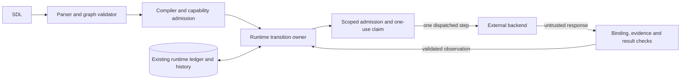

# Issue 2041 runtime step dispatch preflight

Issue: #2041, requirement-free. The supplied issue is the delivery contract.
Sources inspected at `2facde281e118231fdbfe91df72003847324b73d`.
This note sets design limits.
It gives no code plan and proves no dispatch behavior.

## Authority and boundary

The runtime decides which step runs next.
It owns dispatch, retry permission, graph transitions, and workflow termination.
The backend runs one admitted step and reports its result.
It cannot select the next step or start another attempt.
It cannot release a barrier, invoke a callee, or start compensation on its own.
Loading a plan grants no right to execute it.

[ADR-036](adrs/adr-036-sdl-processor-runtime-module-boundaries.md),
[ADR-104](adrs/adr-104-runtime-control-plane-architecture.md),
[ADR-113](adrs/adr-113-reusable-execution-machinery.md), and
[ADR-115](adrs/adr-115-concrete-backends-owned-outside-raes.md) already establish the owners.
No new ADR or general execution engine is needed.
The runtime needs the missing workflow transition behavior behind those existing boundaries.
Native effects and readiness remain external backend responsibilities.

The processor retains authored meaning and checks backend support.
It validates and compiles the program.
The runtime uses that admitted program; it does not parse SDL again.
`WorkflowRuntime.control_steps` supplies labeled continuations, ordered cases, predicates, and realization references.
`WorkflowExecutionContract` supplies execution constraints, and `WorkflowResultContract` constrains observable results.

The unlabeled `control_edges` alone cannot distinguish success from failure.
They also lack the ordered switch cases.
Sorted `observable_steps` and plan `startup_order` are not workflow execution order.

Control-plane `submit_orchestration()` receives a phase plan, not the composite `RuntimeModel`.
Plan projection excludes the internal `resources` map.
The executable program must survive that portable, digest-bound handoff.
Do not depend on a manager-only model or recover execution authority from backend-supplied snapshot payloads.

Use one runtime transition owner through `RuntimeManager` and `RuntimeRunContext`/`RuntimeControlPlane`.
Use its public runtime entry point to advance the workflow.
Do not reach into another module's private cursor or helpers.
`Orchestrator` in `raes_backend_protocols/protocols.py` remains the backend seam whose execution contract needs narrowing.
Contract values belong in `raes_contracts`; processor compilation remains in `raes_processor`.
Keep ADR-036 dependency directions and ADR-117 structural boundaries.

Whole-graph callers include `interaction.py`, `runtime_run_context.py`, and `control_plane_injects.py` in `raes_runtime`.
All workflow execution paths need the same dispatch owner.
Keep inject admission and non-workflow event/script control with their existing owners.
A loaded workflow is not always a root invocation.
Listing a call or compensation target in plan `startup_order` must not start that target.

Protect dispatch authority, authored order, scoped observations, and durable history.
A matching schema or digest grants no permission.
It also proves no native effect.
Keep backend containment and effect evidence.
A protocol cannot prevent arbitrary native behavior by a compromised backend.

## Dispatch and transition invariants

- Bind each dispatch to the admitted program and existing operation authority.
  Keep its target/run, workflow invocation, step, and attempt.
  Retain branch/control-visit identity where arrivals differ.
  Backend responses must match that dispatch and its current generation and predecessor state.
  Reject reports for a step that was not dispatched.
  Reject foreign or stale reports too.
  A duplicate report cannot change its content.
  Reports after termination cannot alter workflow state.
- Permit only one outstanding step execution per backend execution context.
  The runtime can interleave enabled parallel branches.
  This needs no simultaneous native effects.
  Keep cancellation and observation available while a step runs.
  Admission, acknowledgement, and progress do not prove step completion.
  Neither does transport success.
- The runtime dispatches each retry attempt separately under the shared authored attempt budget.
  Backend or transport retries must not run another objective attempt.
  Reconcile a lost response or uncertain effect.
  Do not assign a fresh dispatch identity to retry it.
- Decision and switch responses supply predicate observations, not successor names.
  The runtime combines admitted external observations with visible prior step state.
  It then selects the edge.
  Preserve assertion polarity, objective satisfaction, and ordered switch cases.
  Keep guaranteed-state visibility.
  Missing, stale, or invalid evidence cannot silently become a false predicate.
  It cannot select an alternate branch either.
- End-step acknowledgement covers that dispatched step only.
  The runtime determines invocation termination and caller continuation.
  Control-only step responses do not create observable step-state entries.
  They do not add `WorkflowStepOutcome` values either.

Preserve all eight kinds from the
[state machine](../../specs/formal/workflows/state-machine.md), including `switch`, `parallel`, `join`, and `call`.
That model and the [issue 2009 design](issue-2009-workflow-transition-design.md) retain shared observable execution.
Each invocation has its own state.
Different branch arrivals do not restart a completed observable step or allocate another retry budget.
Control-only decisions and switches still evaluate on each visit.

Branches can overlap and fanout can nest.
Do not collapse branches that reach the same step.

Keep owning barrier identities, suspended callers, and callee state separate.
Successful joins require every branch arrival.
A failure bypass cannot later release the barrier.
It cannot expose abandoned sibling state.
A handled failure need not fail its workflow.

Repeated calls to one workflow need separate invocation state.
Overwriting a workflow-address result does not isolate calls.
The earlier preflight leaves branch choice with the backend.
That describes the old boundary; issue 2041 moves this choice to the runtime.
No fairness or physical concurrency guarantee follows.

A parallel, join, or call response must not wait on work that the runtime has not dispatched.
The runtime retains fanout, barrier, and call state between backend requests.
A suspended call is control state, not an outstanding backend execution that blocks its callee's steps.

Step kind and realization mode remain separate.
Reuse `WorkflowStepAttemptProvenance` for governed objective or scaffolded execution.
Keep the existing evaluation/proposition-truth contracts.
A participant's completion claim does not establish objective satisfaction.
The dispatcher adds no predicate language or truth schema.
It adds no action-family taxonomy or retry policy.

## Canonical layers and required treatment

Package paths below are relative to `implementations/python/packages/`.
The table names the cross-cutting layers the intended design must pass.

| Layer and canonical incumbents | Required treatment |
| --- | --- |
| SDL parsing and graph policy: `raes/orchestration/_steps.py`, `raes/validator/_workflows_verify.py`, `_workflows_analysis.py`, `raes_contracts/workflow/semantics.py`, `graphs.py` | Preserve field shapes, positive retry bounds, reference resolution, reachability, acyclicity, join ownership, and predicate visibility. Reuse shared graph helpers; do not copy graph validation into runtime execution. |
| Compiled program and portable ingress: `raes_processor/compiler/workflow_steps.py`, `workflows.py`, `models/behavior_resources.py`; `raes_contracts/contracts/plan_projection.py`; `raes_runtime/control_plane_api_models.py`, `backend_input_contracts.py` | Bind the full compiled semantics to the admitted artifact, including mode and predicate inputs. Retain closed published carriers, bounded portable values, plan projections, and native-input isolation. Typed dataclasses and permissive `from_mapping()` normalization do not replace strict ingress validation. |
| Configuration, capabilities, and installed components: `raes_processor/planner/manifest_validation.py`; `raes_backend_protocols/capabilities.py`; `raes_runtime/registry.py`, `registry_target_validation.py`, `control_plane_configuration.py`, `control_plane_composition.py`, `control_plane_profiles.py` | Require declared contract support and the installed single-step method shape together. Existing `supports_workflows` does not prove runtime dispatch support. Keep local and distributed profile/store constraints; refuse unsupported compositions before effects. Do not infer support from method presence or silently fall back to whole-graph `start()`. |
| Authentication and plan authorization: `raes_runtime/control_plane_security.py`, `control_plane_api/_auth.py`, `control_plane_admission.py`, `control_plane_plan_authorization.py`, `control_plane_operation_context.py`, `control_plane_api_guards.py` | Retain strict identity defaults, role/target/run scopes, exact planner-artifact authorization, request bounds, sealed route authority, and denial audit. Derive step permission only from the admitted program and current runtime state. Backend reports, step names, references, and task tokens grant no authority. No new public dispatch route is needed. |
| Invocation admission and supervision: `raes_contracts/contracts/backend_operation.py`, `backend_operation_validation.py`; `raes_runtime/operation_provider_execution.py`, `operation_invocation_ledger.py`, `operation_command_commitment.py`, `operation_execution_adapter.py` | Reuse exact bindings, capability/willingness checks, command commitments, one-use consumption, remaining budgets, response sequencing, and effect reservations. Existing native-plan policy validation and `runtime_plan_digest()` accept only the three plan types. A step carrier needs explicit owner-supported validation and commitment; it cannot masquerade as an `OrchestrationPlan` or hide in an unchecked payload. |
| Secrets, environment, and participant disclosure: `raes_contracts/secret_references.py`; `raes_runtime/runtime_fact_bindings.py`, `runtime_fact_dispatch.py`, `participant_crossing_mediation.py`; `raes/runtime_environment.py`, `runtime_generated_value.py`, `runtime_values.py` | Resolve protected references only at the authorized execution sink. Preserve run/episode/action freshness, selected sink types, environment-name uniqueness, classification/provenance, literal versus `value_from` exclusivity, and generated-value restrictions. Keep values out of dispatch history, durable commands, engine payloads, diagnostics, and audit. Do not add an arbitrary environment dictionary or reuse a resolved value across reset episodes. |
| Host/process exposure: `raes_backend_protocols/naming.py`; `raes_runtime/control_plane_store_paths.py`, `operation_remote_authority.py`; external backend containment | No new listener, subprocess, credential source, or hosting service follows from step dispatch. Native adapters retain safe names/paths, private storage, controlled environments, and bounded execution. Keep tokens out of argv, URLs, shell interpolation, and workload environments. Existing authenticated transport carries references; hostile workloads remain outside trusted runtime workers. |
| Backend result and effect boundary: `raes_runtime/backend_calls.py`, `backend_apply_results.py`, `backend_entry_transitions.py`, `backend_effect_transitions.py`, `backend_result_diagnostics.py`, `workflow_result_contract_checks/`, `evaluation_result_contracts.py`, `proposition_truth_contracts.py` | Preserve isolation, finite result validation, scoped entry/carrier changes, changed-address accounting, evidence checks, and redacted disclosure before commit. Add dispatch correspondence to these owning boundaries. Current workflow history checks alone do not establish graph causality or prove runtime permission. A backend must not rewrite the program, runtime cursor, other steps, or runtime-authored history. |
| Persistence and recovery: `raes_runtime/runtime_decisions.py`, `runtime_decision_store.py`, `control_plane_store.py`, `control_plane_durability.py`, store codecs/migrations, `control_plane_store_history_rows.py`; `raes_contracts/immutable_history.py`, `snapshot_histories.py` | Retain existing decision claims, scoped ownership/generations, snapshot revisions, append-only prefixes, and atomic operation/snapshot/audit boundaries. Persist enough continuation and dispatch state to reconcile interruption without guessing. Extend the closed decision/store contracts where needed; arbitrary snapshot metadata or a separate scheduler database is not a continuation store. |
| Errors, logs, and public envelopes: `raes_contracts/errors.py`, `diagnostics.py`, `operational_logging.py`; `raes_runtime/backend_result_diagnostics.py`, `control_plane_api/_responses.py`, `_operation_routes.py` | Reuse error categories, stable diagnostics, `portable_diagnostic_payload()`, module loggers, `foreign_failure_record()`, and fixed redacted HTTP errors. Separate workflow failure from invalid backend protocol or unavailable apparatus. Correlate safe operation/dispatch identities without raw payloads, exception text, validator inputs, stdout/stderr, secrets, or host paths. Use existing audit records; logs are not workflow truth. |

The current whole-plan validators also control resource and snapshot-carrier authority.
Do not weaken them globally to admit a step response.
A new narrow command/response shape, if required, belongs at the existing contract seam with one validation owner.
Keep portable values separate from injected services and private execution state.
No duplicate DTO family, exception hierarchy, validation framework, or backend-specific command schema is justified.

## History, interruption, and recovery

Record runtime dispatch before the backend call.
Record its validated response before selecting the next step.
History must distinguish runtime dispatch from backend observations.
This applies to every visited step, including decision and end.

Retain attempt correlation for intermediate retry failures, not only the final retry outcome.
Reused observable results need no second backend execution; history must not fabricate one.
Control completion is distinct from observable step outcome.

Reuse `WorkflowHistoryEvent`, its existing step events, and the published history stream where their meaning fits.
Any new event or correlation field needs an explicit portable contract.
It also needs a validation rule.

The open `details` mapping is not permission for a hidden protocol or a second event stream.
History order establishes accepted completion order, including ties in wall-clock timestamps.
Backend timestamps alone must not determine dispatch authority or compensation order.

Cancellation and timeout stop further normal dispatch through the same runtime owner.
Their state changes must serialize with dispatch and outcome acceptance.
A race cannot publish a successor after termination.
Preserve `control_plane_workflow_control.py`, `control_plane_timeouts.py`, and their timestamp checks:
explicit offsets, monotonic persisted times, positive integral durations, and exact inclusive elapsed-time comparison.
Keep workflow deadlines, operation watchdogs, semantic scenario time, and Temporal timers distinct.
Use the injected `WallClock` and parsers from `raes_contracts.timestamps`; do not restart budgets during recovery.

Reuse [compensation semantics](../../specs/formal/workflows/compensation.md).
Successful compensable completion registers once per invocation.
Run compensation workflows through runtime dispatch in reverse actual completion order.
Preserve trigger and failure policy.

`control_plane_workflows.py:maybe_apply_compensation()` currently synthesizes compensation completion events without executing the target workflows.
That helper cannot certify compensation under the new execution boundary.
Preserve the primary terminal reason while reporting real compensation progress and failures separately.
Before conflicting compensation starts, require cessation or fencing evidence for outstanding native effects.

A cancelled operation, expired callback, or dead process does not prove native effects stopped.
Keep unresolved reservations and the existing reconcile/observe path.
Stale workers cannot publish or acquire another grant.
Persisted decisions and histories are facts, not reusable execution permission.

Late reports can support effect reconciliation under the original claim.
They cannot advance a terminated workflow.
The parent workflow and step operations must fit existing target/run reservation rules.
Avoid deadlock and retain exclusion.

Do not claim atomic execution across the store and backend.
An uncertain acknowledgement cannot prove exactly-once physical effects.

## Extension seam and whole-repository boundary

The extension seam is the injected `RuntimeTarget` and its negotiated single-step contract.
Keep the existing execution adapter/provider.
Use admitted invocation, branch, attempt, and remaining-budget values.
Do not hard-code reset/blue/red names or backend-name switches.
The runtime transition owner must work with local delivery and existing Temporal reference delivery.

`runtime_run_driver.py` and `runtime_temporal_workflow.py` drive application progress; they are not an SDL graph interpreter.
`operation_temporal_workflow.py` delivers operations with one transport attempt.
Temporal must not acquire authored transition or retry authority.
No additional queue, timer framework, service, or deployment is required.

The purple-team example motivates ordering; it does not define new semantics.
Victim readiness requires an admitted observation of the loaded build, not successful submission or a fixed sleep.
Participant episode reset, time-segment reset, provisioning, workflow retry, and a fresh trial remain different operations.
Reuse their existing runtime owners when a dispatched effect reaches those domains.
Participant schedulers do not become workflow engines; experiment ordering and scoring remain outside this issue.

In-scope contract surfaces include the orchestration plan, backend manifest/profiles, backend-operation carriers, workflow results/history, and runtime snapshot.
`contracts/schemas/` remains the published authority under ADR-009; keep `schema_bundle()` parity and existing conformance fixtures.
New schemas need `contracts/schema-publication/entries/` records; removals need tombstones; existing-schema edits retain their existing records.
Assess protocol/version compatibility against the [evolution policy](../../specs/evolution/versioning-deprecation-and-migration.md).
Keep compatibility imports one-way under ADR-010.

Migrate stubs, registry probes, conformance readers, and public runtime/backend documentation together with the eventual contract change.
Downstream backend adoption needs that backend's own release evidence.
This repository's fixtures cannot supply it.

Repository gates remain `.ground-control.yaml`, `.gc/plan-rules.md`, `specs/authority/authority-boundary.yaml`,
`tools/check_repo_policy.py`, `tools/check_generated_schemas.py`, `noxfile.py`, `tools/verification_plan.py`, and canonical CI workflows.
Use the requirement-free route without inventing a UID.
Keep tooling locks, Python package boundaries, schema publication, and changed-path prose checks intact.

Behavioral incumbents include `test_runtime_manager.py`, `test_runtime_control_plane.py`, `test_runtime_registry.py`,
`test_runtime_models.py`, `test_workflow_semantics_properties.py`, and `test_runtime_workflow_timeout_reconciliation.py`.
Supervision and recovery patterns live in `test_issue_1360_backend_operations.py` and `test_issue_1186_control_plane_recovery_operations.py`.
Required evidence covers runtime dispatch causality, control-only history, and bounded retry.
It also covers duplicate/foreign/stale reports, interruption races, and crash reconciliation.
Include shared steps, nested barriers/calls, and compensation effects.
Check for secret/error disclosure across the touched boundaries.

Use targeted local checks and mutation checks for transition/admission decisions.
Full, integration, fuzz, and completion suites remain CI-only.
Existing tests are reuse points, not proof that the new dispatch behavior already works.

This preflight changes no runtime code.
Non-goals include new SDL syntax or step kinds, changed branch visibility, and fairness.
They also include parallel native execution and physical exactly-once guarantees.
Concrete backends, deployment, new public APIs, and study/scoring logic remain outside scope.
Do not add new retry defaults or unrelated cleanup.
Do not preserve autonomous whole-graph execution behind a compatibility wrapper and call it runtime dispatch.
