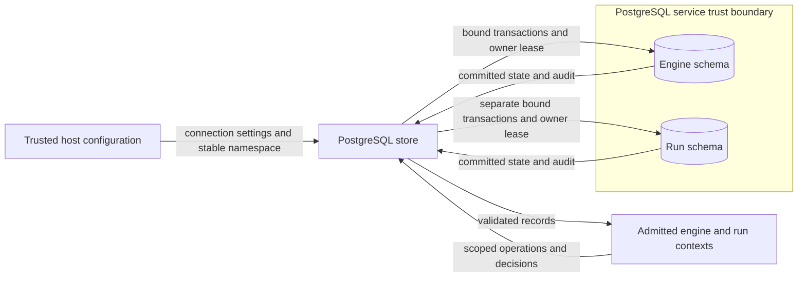

# Ledger namespaces in one database

Issue: #2044.
This document explains the storage boundary.
The [preflight](issue-2044-postgresql-ledger-scopes-preflight.md) gives the binding guardrails.

## Components and contracts

`PostgreSQLStoreConfiguration.namespace` selects one PostgreSQL schema.
The value is immutable, optional, and supplied by the trusted host.
It accepts lowercase ASCII identifiers of at most 63 characters.
It rejects `public`, system schema names, and names that start with `pg_`.

Omitting it selects the legacy ledger in `public`.
No request, SDL field, or workflow selects a schema.

`PostgreSQLControlPlaneStore` owns connections and admission.
Each connection selects only its ledger schema, then `pg_temp`.
PostgreSQL implicitly searches `pg_catalog` first.
No connection inherits a user-specific or public fallback path.

The provider quotes identifiers with `psycopg.sql.Identifier`.
It continues to bind values as query parameters.

Explicit `initialize_schema()` creates the named schema and existing ledger tables in one transaction.
A transaction advisory lock excludes bootstrap and runtime ownership of the same ledger.
Admission never creates a schema.
The stored target and run remain the semantic scope authority.

Direct admission checks nonempty scope strings of at most 256 characters before connection.
Reopening with different scope values fails.

Each named schema has a stable, domain-separated advisory lock derived from its exact name.
The owner session and lease assertion use the same key.
A hash collision can refuse ownership but cannot select another schema.
Owner generations and transaction fencing remain in each ledger's metadata.

The legacy ledger retains its original lock key.
Trigger functions retain their creation search path and use invoker privileges.

`runtime_resource_ownership.ledger_identity()` adds the namespace only for named stores.
Legacy identity tuples and retained decision digests remain unchanged.
The existing engine can therefore distinguish its store from each factory-created run store.
Factories must select stable names after restart.

The existing mutation, projection, history, decision, and codec modules need no parallel implementations.

## Data flows and trust boundaries

The engine owns backend resource claims independently of these storage boundaries.
Separate schemas do not grant permission to drive the same backend.
The diagram also defines the component relationship; no new deployment service is required.

## Security and failure behavior

Assets include operations, snapshots, audit, decisions, history, stop markers, and owner generations.
All belong to one bound ledger.
The host and database administrator remain trusted.

| Threat | Control and verification |
| --- | --- |
| Another store reads or changes ledger records | Fixed connection search paths; overlapping-identity tests across all store surfaces. |
| Missing objects resolve to another ledger | No public or user fallback; catalog checks inspect the selected schema; CI tests populate public decoys. |
| Trigger writes change another ledger | Function-local search paths; CI compares independent changes and history generations. |
| Two writers claim one ledger | Namespace lock and generation checks; contention, lease-loss, and stale-generation tests. |
| Bootstrap changes a live ledger | Matching transaction lock; CI tests refusal and concurrent bootstrap behavior. |
| Namespace text changes SQL or connection options | Bounded identifier validation and quoted SQL; hostile-input tests. |
| A new namespace bypasses unresolved resource claims | Namespace-aware ledger identity; engine and resource-claim regression tests. |

Database grants govern access by database roles.
Schema selection is not a tenant authorization boundary against a role with broader grants.
Keep workload roles outside ledger schemas and retain existing host authorization checks.
Bootstrap needs schema creation and ownership permissions.

Runtime connections need the established ledger permissions and a dedicated owner session.
Transaction pooling cannot retain that session lease.
Each open ledger retains one owner connection plus temporary transaction connections.
Operators must size connection capacity and maintain backups.

Legacy custom search paths no longer select another ledger location.
The legacy mode selects `public` explicitly to prevent aliases with named locks.
No data is copied, relocated, or deleted.
Missing or damaged ledgers retain existing conflict and integrity errors.

Private schema version 5 and portable contracts remain unchanged.

## Architecture and policy evidence

The immutable configuration, connection binding, and ledger identity express the architecture in code.
Behavioral tests check these invariants.
Existing ADR-036 and ADR-117 checks continue to enforce package dependencies.
No new policy gate, portable schema, or control inventory is needed.

ADR-104 already permits one owner for each scope; no ADR amendment is needed.
The existing shared-engine resource claim remains authoritative.

## References and review

- [PostgreSQL 17 schemas](https://www.postgresql.org/docs/17/ddl-schemas.html), sections 5.10.3–5.10.6: trusted schema lookup and grants.
- [PostgreSQL 17 locking](https://www.postgresql.org/docs/17/explicit-locking.html), section 13.3.5: session and transaction advisory locks.
- [PostgreSQL 17 client defaults](https://www.postgresql.org/docs/17/runtime-config-client.html), search_path: catalog and temporary schema resolution.
- [Psycopg SQL composition](https://www.psycopg.org/psycopg3/docs/api/sql.html), Psycopg 3.3 API, pinned runtime 3.3.8: quoted identifiers.
- [Unit of Work](https://www.cosmicpython.com/book/chapter_06_uow.html), 2020, chapter 6: reuse existing transaction boundaries.

The design review checks terminology, sentence length, brevity, and explanation purpose against the repository style guide.
Official ASD-STE100 access returned HTTP 403; no full standard-conformance claim is made.
Automated prose checks supplement the meaning review.
