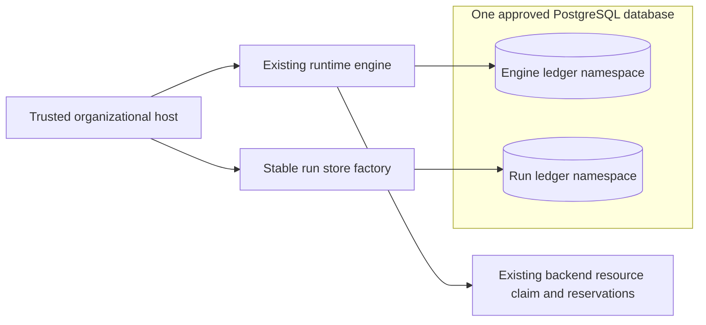

# Many PostgreSQL ledgers in one database

Issue #2044 defines the scope of this review.
It has no formal requirement attached.
This note gives design rules.
It does not describe shipped behavior or give an implementation plan.
Source revision: `6a8d43e1e947b4c14f29f2c83241780753e15913`.

## Boundary and storage choice

Use an optional PostgreSQL schema namespace for each store.
Keep that choice fixed.
Reuse one ledger DDL definition in each namespace.
Each store still binds to exactly one `(target_scope, run_scope)` through runtime admission.

The namespace locates storage.
It does not define the run or grant access.
Keep the full scope tuple in ledger metadata and reject a mismatched reopen.

This preserves [ADR-104](adrs/adr-104-runtime-control-plane-architecture.md)'s one-scope store boundary.
The physical database can contain several such stores.
This needs no ADR amendment.

The [shared engine](issue-1629-shared-runtime-design.md) still owns backend services and resource reservations.
Its engine ledger and `store_factory(run_id)` select distinct stable namespaces.
They use the same database settings.
The factory must return the same ledger after restart, including retired runs needed for recovery.

Put the optional namespace parameter on `PostgreSQLStoreConfiguration`.
Keep existing constructor calls and the legacy mode that omits the namespace.
Check the namespace once.
Use that checked value for connections, bootstrap, owner admission, and store identity.
Keep this seam in the PostgreSQL provider.
Do not add database concepts to `ControlPlaneStore` or portable runtime DTOs.

Do not build SQL names by cutting, cleaning, or joining authored target or run names.

Schema namespaces reuse the current SQL helpers.
They avoid new scope predicates in every query.
Row partitioning would change every key, unique index, join, trigger, cursor, and shared SQL helper.
That adds risk without meeting a further need here.

The diagram separates the store choice from the right to act.
Separate ledgers do not permit separate engines to drive the same backend resources.
Stateless host request handlers still need the admitted state owner and existing delivery boundary.
This change does not let any worker become the state writer.

## Cross-cutting layers and canonical owners

Bare module filenames below belong to `implementations/python/packages/raes_runtime/`.
Other package and repository paths are explicit.

| Layer and incumbent | Required constraint |
| --- | --- |
| Configuration: `raes_runtime/control_plane_store_postgresql.py`, `PostgreSQLStoreConfiguration.__post_init__` | Validate the namespace once before connecting. Use one bounded lowercase ASCII identifier, at most 63 bytes. Reject empty, dotted, quoted, reserved, and `pg_` names; reserve `public` for legacy use. Do not reuse the database/role regex, which permits dots and hyphens. Reject invalid values rather than normalize aliases. |
| Scope admission: `control_plane_configuration.py`, `ControlPlaneConfiguration`; `control_plane_operation_context.py`, `runtime_target_scope`; `raes_contracts/planning.py`, `PlanScope` | Keep normalized run and bounded target validation. Namespace validity does not establish semantic scope validity. Direct store admission must also enforce its scope contract before taking ownership or writing metadata. |
| Auth: `control_plane_security.py`, `ControlPlaneSecurityConfig`; `control_plane_api/_auth.py`; `control_plane_plan_authorization.py` | The trusted host selects the store. Keep actor, role, target/run, subject, and exact-plan checks. Add no request-selected schema, endpoint, credential, route, or shared authorization namespace. |
| Secret and host exposure: `PostgreSQLStoreConfiguration`, `_connect()`; `docs/public/guides/supervised-execution.md` | Keep `SecretStr`, explicit connection keyword arguments, TLS selection, and bounded connection/statement/lock budgets. Never put credentials in URLs, argv, log fields, workflow payloads, or namespace names. No subprocess or shell is needed. |
| Environment and config shapes | There is no PostgreSQL ledger CLI/env-binding model to extend. Keep typed host configuration; add no SDL setting or free-form libpq options. Named selection must override ambient search-path settings. Preserve the existing optional `distributed` extra and frozen locks. |
| SQL resolution: `_connect()` and `control_plane_store_postgresql_schema.py` | Establish the selected namespace on every connection, including bootstrap and the owner session. Use `psycopg.sql.Identifier` for dynamic identifiers and parameters for values. Never interpolate identifiers into libpq `options` or rewrite arbitrary SQL text. |
| Persisted shape and integrity: `control_plane_store_local_codec.py`, `control_plane_store_records.py`, `control_plane_store_claim_columns.py`, `control_plane_store_snapshots.py` | Keep bounded decoding, digests, record reconstruction, durable-key/claim-column agreement, and `require_operation_record_scopes`. Keep existing snapshot and participant-state validators. Do not create parallel payload models or validators. |
| Atomic writes: `control_plane_store_postgresql_mutations.py`, `control_plane_store_revision.py`, `operation_ledger_transactions.py` | Preserve revision CAS, operation transitions, scoped idempotency, inject claims, supervision cuts, and atomic snapshot/record/audit commits. Namespace selection must precede every read as well as every write. |
| Projections: `control_plane_store_postgresql_projection.py`, `control_plane_store_history_rows.py`, `runtime_decision_store.py` | Isolate history rows/heads, changes, audit sequences, runtime decisions, and metadata alongside operations and snapshots. Reuse `HistoryConnection` and `SQLRuntimeDecisionStoreMixin`; do not fork their algorithms. |
| Engine identity: `runtime_resource_ownership.py`, `ledger_identity`; `runtime_decisions.py`, `runtime_store_digest`; `runtime_engine.py` | Include named namespace selection in durable store identity. Keep wrappers using `raw_store` consistent. Duplicate objects for one ledger must still be refused. Preserve unresolved-resource bindings and committed decision replay. |
| Failures and observability: `raes_contracts/errors.py`, `raes_contracts/operational_logging.py`; `control_plane_api/_responses.py` | Reuse `ConflictError`, `OperationalError`, `EvidenceIntegrityError`, and `SnapshotRevisionConflict`. Value-object validation keeps `ValueError`/`TypeError` conventions. Keep redacted HTTP envelopes and value-free logging at the handling boundary. Never echo driver errors, SQL, connection configuration, or persisted payloads. |

Schema selection cannot stop a database role that has grants to read other schemas.
The host and database administrator remain trusted under ADR-104.
Use existing PostgreSQL grants for database access.
Do not claim tenant isolation or give ledger credentials to workloads.
Untrusted roles must not create objects in a selected ledger schema.
Bootstrap credentials can own DDL; runtime credentials need only the established ledger access and lock session.

## Isolation, ownership, and compatibility guardrails

Named connections must never fall back to `public`, `$user`, another ledger, or temporary objects.
Missing schemas, tables, or columns must fail within the selected namespace.
Catalog checks must inspect those same objects.
They must not accept a relation from another schema on the search path.
If a fixed search path supports the existing SQL, keep system catalogs first and place `pg_temp` last.

Pin each trigger function to its own ledger, or qualify its references.
Keep functions as invoker functions; no elevated `SECURITY DEFINER` helper is needed.
Bootstrap must cover tables, indexes, sequences, functions, triggers, and `runtime_decisions` consistently.

Use a stable advisory lock key for each named namespace.
Acquisition and `_PostgreSQLOwner.assert_owner()` must check the exact same lock identity.
The lock cannot depend on run input, process hash, user, password, or connection spelling.
Two owners of the same namespace must conflict.
This holds even when they request different scopes or use different roles.

A hash collision may deny admission; it must never authorize access to another namespace.
Owner generation and its `FOR UPDATE` check remain namespace-local on every transaction.

Keep the dedicated owner connection alive until confirmed drain and lease release.
A transaction-pooled connection cannot hold this session-level lease.
Preserve stale-generation refusal, rollback, and failed-admission cleanup.
Bootstrap or migration must exclude a live owner and concurrent bootstrap of the same namespace.
Different namespaces must not share a metadata-row or decision-table lock.

Keep the legacy owner-lock key and exact legacy `ledger_identity` tuple when the namespace is omitted.
Appending even `None` changes `runtime_store_digest` and can invalidate stored run decisions.
Do not silently relocate or copy existing records into a named namespace.
Legacy and named selection must not reach one physical ledger under different locks.
Refuse such aliases before access if historical custom search paths make them possible.
An explicit name for `public` must not bypass the legacy lock.

Keep `initialize_schema()` as explicit operator bootstrap, using the incumbent schema/version and corruption checks.
Do not add runtime database creation, role creation, or automatic schema creation during admission.
Do not overwrite foreign objects or repair a damaged bound ledger into an empty successful run.
Preserve supported legacy versions, payload digests, decisions, revisions, and stop markers.
Change the private schema version only when its stored contract changes.
The namespace choice alone needs no portable schema change.

Operators still own backup and restore.
Reopening must retain unknown effects and block conflicting work.

Many open runs retain many owner sessions, plus bounded transaction connections.
Document this connection cost; sharing a database does not remove it or establish high availability.
Keep Temporal history separate from RAE ledger authority and credentials.
Workflows retain bounded references; effect workers gain no direct database write access.

## Behavioral evidence and whole-repository boundaries

The store and engine tests check the existing design rules.
Extend those checks to two namespaces in one database.
Use the same operation IDs, decision IDs, idempotency keys, and participant IDs in both.
Check independent snapshots, revisions, history generations, changes, audit records, stop markers, and decision claims.
Check same-namespace owner contention, different-namespace admission, lost leases, stale generations, and failed bootstrap rollback.
Missing-object tests must include a populated `public` schema and hostile search-path settings to expose accidental fallback.

Trigger tests must show that activity in one namespace cannot change another namespace's counters or history.
Legacy reopening must preserve both records and committed store digests.
The experiment check must reopen its engine and factory-created run ledgers in one database through the public runtime path.
Keep target reservation and quarantine refusal across runs.

Reuse these test owners rather than adding another harness:

- `implementations/python/tests/test_issue_1362_postgresql_store.py` for configuration and admission boundaries.
- `test_issue_1435_profile_clause_verification.py` and `test_issue_1678_cycle2_store.py` for integrity refusal.
- `test_issue_1689_operation_claim_columns.py` for durable identity and claim-column checks.
- `test_issue_1373_postgresql_history.py` for live projections and reopening.
- `test_issue_1629_runtime_decisions.py` and `test_issue_1362_resource_ownership.py` for replay and ownership.
- `test_issue_1629_temporal_integration.py` and `postgresql_ledger_fixtures.py` for durable experiments and approved service fixtures.

Use targeted unit checks locally; live PostgreSQL, integration, and full suites remain in CI/CD.
Targeted mutation checks should expose removed namespace binding, shared lock keys, and omitted namespace identity.
Mocks alone cannot establish PostgreSQL search-path, trigger, session-lock, or transaction behavior.
The integration test must exercise one database; database-per-test fixtures alone cannot prove the acceptance criteria.

Keep `.ground-control.yaml`, `.gc/plan-rules.md`, `tools/check_repo_policy.py`, and ADR-036/ADR-117 package checks in force.
Keep ADR-104 ownership and ADR-116 exception/logging rules.
Use existing `.github/workflows/canonical-verification.yml`, `.github/workflows/ci.yml`, and `tools/nox_support/` verification lanes.
Reuse the PostgreSQL artifact pin in `implementations/tooling/artifacts.lock.json` and the Python `distributed` dependency lock.

Keep published schema authority, publication records, and generator parity.
The delivery docs should explain the namespace choice and required grants.
Update `docs/migration/runtime-lifetime.md` and `docs/public/guides/supervised-execution.md` for that purpose.
Use the existing style guide, `docs-prose`, `.vale.ini`, and the shared package's `.ste.yml` for changed prose.
This issue supplies no requirement UID.
Do not invent one.

## Non-goals and anti-patterns

No P3 profile, automatic failover, multi-writer run, tenant router, global coordinator, or new scheduling policy belongs in this issue.
Do not replace engine reservations with database locks or conflate schema names with SDL `deployment_tenants`.
Do not add an ORM, connection pool, generic SQL proxy, parallel store protocol, exception hierarchy, or second migration framework.
Do not duplicate portable schemas, decision validation, recovery logic, or experiment sequencing.
Do not add per-operation schema switching or mutable store retargeting.
No new service, hosting, credential source, data transfer, local SQLite fallback, or schema garbage collector is authorized.

## External design references

- [PostgreSQL 17 schemas](https://www.postgresql.org/docs/17/ddl-schemas.html), sections 5.10.3–5.10.6: namespace lookup, privileges, and trusted search paths.
- [PostgreSQL 17 explicit locking](https://www.postgresql.org/docs/17/explicit-locking.html), section 13.3.5: session advisory-lock lifetime.
- [PostgreSQL 17 function definitions](https://www.postgresql.org/docs/17/sql-createfunction.html): function-local settings and object resolution.
- [Psycopg 3 SQL composition](https://www.psycopg.org/psycopg3/docs/api/sql.html): separate identifiers from value parameters. The repository pins Psycopg 3.3.8.

These references support storage mechanics, not new RAE authorization or coordination guarantees.
