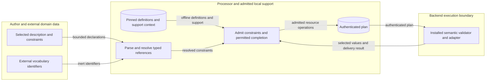

# Industrial, maritime and power descriptions

## Recommendation and status

Reuse the current recursive and typed-profile contracts.
The three cases below show no gap in realization semantics.
They need domain terms. They also need a public host and rules to name new subjects.
Parts remain backend implementations of how requirements are realized.

Issue [#2059](https://github.com/OpenRAE/rae/issues/2059) requests one design PR.
This design gives boundaries and review cases. It does not define SDL syntax.
It adds no equipment inventory, schema, profile definition, adapter, or execution capability.

## Existing owners and limits

The assessment uses revision `1f4d05ed50d2bcca151bbf8318fd0e01b4de7ba7`.
The issue's starting revision is `33c09e9dfe9e26699489745809699a43e42d7630`.
Both revisions describe plan profiles as programmatic inputs rather than public SDL syntax.

| Owner | Available meaning | Limit relevant to these cases |
| --- | --- | --- |
| [ADR-105](adrs/adr-105-recursive-partial-description-semantics.md), [SEM-218](../requirements/SEM-218/requirement.md) | Authors constrain selected details; backends choose permitted realizations. | A candidate notation does not become SDL syntax through an example. |
| [Recursive constraints](../../specs/sdl/recursive-realization-constraints.md), `raes_contracts.realization_structure` | Records, keyed collections, local closure, domains and graph references. | A graph identity edge is not an SDL declaration or execution target. |
| [Typed profiles](../explain/reference/domain-profiles.md), `raes_contracts.domain_profiles` | Pinned definitions, explicit binding owners, offline admission and operation-specific support. | A generic contract supplies no OT, navigation or CIM vocabulary by itself. |
| [Plan profiles](../../specs/sdl/plan-realization-profiles.md) | Authenticated constraints on existing provisioning resources. | Profiles cannot add resources, dependencies or participant affordances. |
| `raes.nodes.Node`, `NodeType` | `compute`, `switch`, `description`, and compute-specific `resources`, `architecture`, `services`, `runtime`. | There is no general equipment node kind or arbitrary node profile field. |
| [Sections](../../specs/sdl/sections.md), `raes.scenario.ScenarioContent` | Closed declaration surfaces with named owners. | There is no general domain-description section. |
| [References](../../specs/sdl/references.md) | Typed addresses, purpose-specific candidate sets and semantic validation. | Dotted strings do not register new declaration kinds. |

`features` and `conditions` on a compute node are string mappings with existing meanings.
They are not arbitrary typed domain-profile hosts.
`entities` describes organizations, teams and people; it is not an equipment escape hatch.
Legacy identity-domain profiles describe identity topology, not every use of the word domain.

## Standards comparison

These are small description cases, not claims of standards conformance.
The mappings below are design inferences. They use the cited sources and repo contracts.

### Controller with one sensor and one actuator

Consider a controller with one temperature input and one valve output.
An author requires the input's unit and the valve's permitted command range.
The author leaves processor model, firmware packaging and internal wiring open.

[OPC UA Devices 1.05.0, section 4.1](https://reference.opcfoundation.org/specs/OPC-10000-100/4.1)
separates device structure, components and functional groups.
[Section 4.7](https://reference.opcfoundation.org/specs/OPC-10000-100/4.7)
defines device properties and optional connection points.
These structures suggest profile terms. SDL authors need not copy a full OPC UA server model.

[SOSA/SSN, Recommendation of 19 October 2017](https://www.w3.org/TR/2017/REC-vocab-ssn-20171019/)
separates sensors, actuators, observations, procedures and hosting relationships.
Sections 4.1, 4.3 and 4.9 supply the comparison terms.
A sensor description is not an observation, and a hosting edge does not select a backend.

| Selected concern | Existing surface | Missing work |
| --- | --- | --- |
| Emulated network endpoint | `nodes.<id>.type: compute`, `services`, `runtime.software_components` | Backend support for the chosen controller service. |
| Input unit and output range | Typed profile values constrained by recursive records and bounded domains | A pinned controller vocabulary with units and value validation. |
| Sensor and actuator membership | Keyed collections with stable profile-defined identities | Public profile attachment if authored directly in SDL. |
| Hosting or signal relationship | Profile-owned graph references | Graph validation and public reference registration when external targeting is required. |

The compute mapping applies only when the scenario actually requires a compute endpoint.
An abstract controller description does not require an invented operating system or machine inventory.
OPC UA service behavior needs installed execution support, not merely a device label.

### Navigation computer with a route-monitoring function

Consider a navigation computer that consumes a position source and provides route monitoring.
The author selects that function and an input link. Hardware and setup details stay open.

[IMO MSC.252(83), adopted 8 October 2007](https://wwwcdn.imo.org/localresources/en/KnowledgeCentre/IndexofIMOResolutions/MSCResolutions/MSC.252%2883%29.pdf),
Module B, section 7.1.1, separates navigational tasks in a modular design.
Route monitoring, route planning and collision avoidance are distinct tasks.
This comparison uses that resolution's task taxonomy, not a current vessel certification checklist.

| Selected concern | Existing surface | Missing work |
| --- | --- | --- |
| Navigation application host | Compute node, service and software-component fields | A supported application or simulator backend. |
| Route-monitoring function | Optional typed domain-profile record | A pinned function vocabulary and admitted host context. |
| Position source and consumer | Profile graph identities; existing node/service references where their purposes admit them | Typed cross-description reference rules for newly addressable functions. |
| Measured navigation output | Separate observation demand and evidence owners | An observation adapter if the experiment requires measurement. |

A named function does not prove timing, integrity, alert handling or safety.
The remaining tasks are not automatically required or prohibited by selecting one task.
SOSA can describe the position sensor and its observations without equating that sensor with the navigation computer.

### Power equipment with terminal connections

Consider one breaker, two terminals and their connection identities.
The author constrains terminal membership and connectivity but leaves the equipment's implementation open.

[IEC 61970-301:2020, edition 7](https://webstore.iec.ch/en/publication/62698)
describes CIM as an abstract model of power-system objects, attributes and relationships.
Only the public product description was used; the paid standard's clauses were not inspected.
The public [ENTSO-E RCP data exchange specification 2.3.1](https://eepublicdownloads.entsoe.eu/clean-documents/CIM_documents/Grid_Model_CIM/RCP/2.3.1/RCP_DES_v2-3-1.pdf)
provides CIMXML examples with `Terminal.ConductingEquipment` and `Terminal.ConnectivityNode` references.
Those examples show identity edges. They do not prove a full CIM mapping or conformance.

| Selected concern | Existing surface | Missing work |
| --- | --- | --- |
| Equipment identity and selected attributes | Profile record with stable identity | A pinned power-equipment vocabulary and units. |
| Terminal membership | Recursive keyed collection, locally closed when requested | A profile-defined terminal identity and collection universe. |
| Electrical connectivity | Governed graph references | Profile validation of target kind, identity and cycle policy. |
| Simulator control endpoint | Compute node only when such an endpoint is required | Simulator integration and independently declared execution support. |

A CIM connectivity node is not an SDL compute node or network switch.
An electrical connection is not an IP link.
A description of breaker connectivity does not supply load-flow equations or switching behavior.
Those functions require a supported semantic contract and backend integration.

## Minimum proposed additions

Classification alone already has a separate contract:
[external concept bindings](../../specs/concept-authority/external-concept-bindings.md).
It binds an exact RAES subject to a concept in a versioned external scheme.
Use `raes.external_concept_subjects.external_concept_subjects()` to obtain the subject and its phase-bound digest.
Use `admit_external_concept_bindings()` with pinned scheme data for offline admission.

For example, classify an existing controller endpoint or navigation service without adding a node kind.
That assertion does not constrain domain values or prove protocol support.
It also does not create a new equipment subject.
No new host is needed for this classification use.

For programmatic resource constraints, the existing plan host is sufficient within its declared resource boundary.
The reference target's installed `portable-resource-labels` contract supplies labels only.
It cannot execute controller, navigation or electrical semantics.

To author these typed descriptions in SDL, add one optional public host for domain-profile bindings.
Prefer one host at scenario level. It can describe non-compute objects and link them to declared subjects.
Do not require each object to become a deployable node.
Reuse exact profile coordinates, admitted contexts, recursive constraints and provenance.
Select the field name and schema only in a separately reviewed language change.

Public addresses need a declared category. Each reference purpose needs its own candidate set.
Use canonical identities across composition, validation and runtime projection.
Repeated module imports must retain distinct owners and reject name collisions.
Composition cannot safely rewrite arbitrary strings inside private profile values.
Each admitted host must define how its governed references survive composition.

Internal graph members can stay profile-local when no external SDL reference needs them.
Reference visibility alone grants no action, observation or execution authority.
No new resource lifecycle or realization relation is proposed.

Each selected domain needs an optional profile and an installed validator.
They can use standard or private namespaces under the same admission rules.
An adapter is necessary only when execution or measurement is requested.
These cases need no full standards import. They need no required nameplate or global equipment list.

## Data flow and security boundaries

The diagram describes the proposed host's reuse of existing boundaries.
The public host and domain-specific adapters are not implemented by this design.

| Asset and threat | Control at the boundary | Verification obligation |
| --- | --- | --- |
| Private descriptions leak through schema resolution | Offline resolution; no remote retrieval or ambient secret lookup. | Reject remote schema references before mutation. |
| Profile data selects code or exceeds work limits | Installed handlers, exact semantic-contract coordinates and bounded validation. | Reject executable fields, excessive depth and unsupported operations. |
| Graph strings acquire broader authority | Typed targets, exact ownership and purpose-specific candidate sets. | Reject missing, ambiguous, relocated and disallowed targets. |
| A backend replaces an exact child under an open parent | Conjoin core and profile constraints; validate preparation and delivery. | Reject a changed exact child and accept permitted open siblings. |
| Labels are presented as measurements | Separate author, backend-selected and observed provenance. | Require observation evidence only for an observed claim. |

Descriptions contain public execution data only when carried by the existing plan host.
They do not carry credentials or grant equipment-control authority.
Real device access requires separate authorization, isolation and backend policy.
Residual risks include incorrect domain mappings and dishonest or incomplete backend reports.
Pinned content proves identity, not physical truth or safety certification.

## Acceptance examples

These are review examples. They are not runnable SDL fixtures or new formal evidence.
Future host and profile work must test these cases at the relevant boundary.

| Case | Permitted result | Refused result |
| --- | --- | --- |
| Controller: input unit fixed; other record fields open | Preserve the unit while choosing permitted firmware and extra unspecified details. | Change the unit because the parent is open. |
| Controller: optional actuator with a command range | Omit the actuator or supply it within the range. | Treat optional presence as permission to violate the range. |
| Navigation: only route monitoring is selected | Preserve that function without requiring a hardware inventory. | Invent mandatory processors or claim collision-avoidance support. |
| Navigation: selected position-source edge | Resolve exactly one admitted target of the required kind. | Guess a target from spelling or accept an unresolved graph identity. |
| Power: two terminals in a closed named universe | Preserve their identities despite collection order changes. | Add a third terminal inside that closed collection. |
| Power: terminal collection closed; equipment record open | Keep terminal membership fixed while allowing unrelated permitted equipment refinements. | Close unrelated sibling records. |
| Any case: profile is structurally valid but execution support is absent | Preserve only explicitly admitted opaque exchange without semantic claims. | Execute or report conformance from schema validity alone. |
| Any case: permitted backend choice without observation demand | Return a backend-selected description at the requested depth. | Require collection, retention or export merely because detail exists. |
| Classification of an existing node or service | Admit an exact external concept assertion with its current subject digest. | Treat a stale digest or missing scheme snapshot as an active assertion. |
| Repeated imports of a domain description | Qualify owners and governed references without losing identity. | Merge same-named equipment from distinct imports or guess private string references. |
| Power: a permitted electrical topology cycle | Retain the cycle under the graph profile's explicit cycle policy. | Reject physical cycles merely because schema definitions must be acyclic. |

## Effect on governing artifacts

ADR-105 and SEM-218 remain unchanged; this design applies their existing distinctions.
The recursive normal form already supplies the required record, collection and graph operators.
This design adds no algebra or required inventory. It changes no runtime behavior or public schema.
This design PR needs no change to policy or architecture checks.

A later public host needs a published schema. It also needs registered references and boundary tests.
Before execution, each profile needs exact support and semantic checks.
The acceptance examples define the minimum review boundary for those additions.
