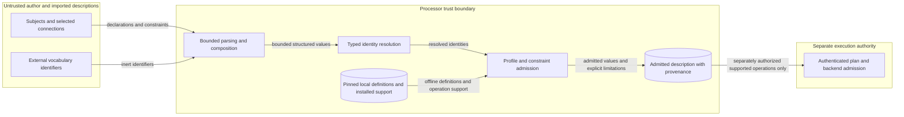

# Connections across application, network and electrical domains

## Recommendation and status

Reuse native SDL relationships for existing application connections.
Reuse infrastructure links for their current deployment-network meaning.
Use profile-owned records and graph references for electrical descriptions.
The recursive contract needs no new connection operator.
Public SDL still needs the optional domain-profile host proposed by the
[#2059 investigation](issue-2059-domain-description-design.md).

The shared concept is a typed connection between named subjects.
Endpoint detail adds constraints. A port or terminal need not be specified.
Domain profiles give each connection its meaning. A common view keeps those meanings.

Issue [#2060](https://github.com/OpenRAE/rae/issues/2060) requests a design PR.
This design adds no SDL field, schema, adapter or code.
The examples are review cases. They are not runnable SDL or proof of conformance.
The [preflight](issue-2060-shared-connections-preflight.md) records the supporting boundary assessment.

## Repository assessment

This assessment uses revision `3eb5790183b3f757a7fcdada9167c488fa5c9f5e`.
The issue pins revision `33c09e9dfe9e26699489745809699a43e42d7630`.
Their reference and recursive-constraint specifications are identical.
Module names below are relative to `implementations/python/packages/`.

| Owner | Existing meaning | Limit |
| --- | --- | --- |
| `raes.relationships.Relationship` | Named directed edge with typed source and target resolution. | Generic `connects_to` and string properties provide no electrical validation. |
| [ADR-052](adrs/adr-052-typed-runtime-relationship-subtypes.md), `RelationshipProxyUpstream` | Optional typed detail for a route-to-origin connection; cross-scope agreement checks. | Runtime metadata does not execute HTTP or prove reachability. |
| [Infrastructure](../../specs/sdl/document-model.md#10-infrastructure), `InfraNode.links` | Switch-backed network attachments; separate explicit deployment prerequisites. | Links also contribute provisioning dependency addresses in the current compiler. |
| [References](../../specs/sdl/references.md), `DeclarationIndex`, reference-purpose policy | Exactly one eligible declaration, with collision and ambiguity rejection. | A private profile member is not automatically a public SDL target. |
| [Recursive constraints](../../specs/sdl/recursive-realization-constraints.md), `raes_contracts.realization_structure` | Records, keyed identity, local closure, graph edges, conjunction and refinement. | The scalar graph evaluator does not validate the whole topology. |
| [Typed profiles](../explain/reference/domain-profiles.md), `raes_contracts.domain_profiles` | Exact definitions, offline admission and operation-specific installed support. | Generic contracts supply neither domain vocabulary nor a public SDL attachment field. |
| [Plan profiles](../../specs/sdl/plan-realization-profiles.md) | Constraints on existing authenticated provisioning resources. | Profiles cannot add resources, dependencies or participant affordances. |

`raes_processor.compiler.provisioning` owns the current infrastructure-to-plan mapping.
`raes_processor.planner.prepared_node_admission` checks the corresponding required resource addresses.
Neither path should receive electrical topology through an analogy with network attachment.
Ordinary relationships remain metadata in the compiler's `_metadata_specs()` path.

## Three comparison cases

These sources and repo contracts inform the design choices below.
These choices do not imply conformance to those standards.

### Application service connection

Consider an HTTP reverse proxy that forwards its `api` route to an origin service.
[RFC 9110, June 2022, section 3.7](https://www.rfc-editor.org/rfc/rfc9110.html)
describes gateways and their upstream communication.
The request path has its own roles. Transport connections carry those requests.

SDL already has the applicable connection detail in `RelationshipProxyUpstream`.
Its route, upstream node, optional service and selected TLS facts remain under their existing validators.
The author can instead state a coarse `connects_to` edge between eligible declarations.
That coarse statement does not assert the omitted route or TLS facts.
Neither case needs an invented TCP port.

If both records give an upstream target, the existing agreement checks apply.
An open parent does not permit a change to an exact origin.
A service connection proves no startup order, successful request or causal effect.

### Network link and device interface

Consider a controller interface attached to a communication network.
[OPC UA Devices 1.05.0, section 5.4](https://reference.opcfoundation.org/specs/OPC-10000-100/5.4)
defines a device's logical network interface with protocol-specific connection-point types.
[Section 5.5](https://reference.opcfoundation.org/specs/OPC-10000-100/5.5)
gives `ConnectsTo` symmetric topology meaning.
[Section 4.7](https://reference.opcfoundation.org/specs/OPC-10000-100/4.7)
permits optional connection points in the device structure.
This connection point is not a TCP port or an electrical terminal.

[RFC 8345, March 2018, sections 4.2 and 4.4.5](https://www.rfc-editor.org/rfc/rfc8345.html)
supplies a second network comparison: directed point-to-point links between nodes and termination points.
Its bidirectional representation uses two directed links.
Each profile thus needs its own direction rules.
Neither source gives a direction rule for all domains.

For supported deployment networks, existing SDL `infrastructure.links` already supplies switch attachment.
It does not describe arbitrary cables or preserve a complete OPC UA or YANG topology.
A profile can describe interface ownership and network membership when those details are selected.
An author who selects only the subjects need not invent interface names or protocol details.

### Electrical connection and CIM terminals

Consider a breaker terminal and a line terminal connected at junction `j1`.
The breaker and line are separate subjects.
Each terminal keeps its equipment owner. Both name the same junction.
A third terminal can join that junction. It need not create three pairwise connections.

The public
[ENTSO-E RCP data exchange specification 2.3.1, 16 October 2024](https://eepublicdownloads.entsoe.eu/clean-documents/CIM_documents/Grid_Model_CIM/RCP/2.3.1/RCP_DES_v2-3-1.pdf),
page 74, shows `Terminal.ConductingEquipment` and `Terminal.ConnectivityNode` references.
These examples support the ownership and junction comparison.
The paid IEC 61970-301 clauses were not inspected.
This design asserts no IEC-wide cardinality rules.
The preflight's historical CIM14 source is separate evidence, not an interchangeable profile revision.

Profile records can retain equipment, terminals and junctions as distinct keyed identities.
Governed graph references express terminal ownership and junction incidence.
A CIM connectivity node is neither an SDL compute node nor a network switch.
The owning profile checks electrical kinds, multiplicity, units and selected compatibility rules.
Topology alone supplies no energized state, impedance model, load-flow solution or safe switching operation.

Terminal detail is necessary for this terminal-level example.
A coarse equipment connection can omit it. That description is not a complete CIM terminal model.
Omission leaves the detail open. It does not forbid terminals or assert that none exist.

## Minimum common concepts

This table describes a common interpretation, not a new public record or base class.

| Concept | Common meaning | Domain-owned constraints |
| --- | --- | --- |
| Connection identity | Stable identity within an explicit owner and profile revision. | Parallel links remain distinct even when endpoint subjects coincide. |
| Connection kind | Exact semantics supplied by the native contract or admitted profile. | Protocol, electrical compatibility, symmetry and graph cycle policy. |
| Endpoint subject | One identified subject of an admitted kind. | Consumer, provider, device, network, equipment or junction eligibility. |
| Endpoint refinement | Selected child identity owned by that subject. | Route, interface or terminal membership; no universal socket requirement. |
| Roles and incidence | Domain-defined association between connection participants. | Directed pairs, symmetric membership or shared-junction incidence. |

Retain the junction identity instead of projecting it into all possible endpoint pairs.
The profile defines direction. Field order alone does not define power flow.
A profile can encode incidence with ordinary records and governed scalar graph references.
It needs no hyperedge operator in the recursive algebra.
No endpoint acquires deployment or action authority through this common interpretation.

## Compatibility and the smallest extension

The existing surfaces suffice for supported application metadata and switch-backed deployment networks.
They do not suffice for public authoring of arbitrary electrical subjects and their typed connections.
The gaps are a public host, domain terms and admitted semantics.
The recursive contract already meets the structural needs.

Reuse #2059's proposed optional scenario-level profile host for non-compute descriptions.
Do not add a second universal connection section or require a physical-equipment node kind.
Each selected profile owns connection records, member identities and validation rules.
Keep profile-local members local unless another SDL declaration must address them.

That use needs a registered declaration kind. It also needs rules for each reference purpose.
This design leaves the field name and published schema to a separate language change.

Existing native relationship types and their typed details keep their current meanings and defaults.
For example, omitted integration direction currently defaults to bidirectional; projection must preserve that fact.
There is no new interpretation of `properties` strings as governed references.
There is no change to existing infrastructure compilation or provisioning admission.

Public references still resolve exactly once within their purpose's candidate set.
A refined child must belong to the specified subject and have the required kind.
Profile admission constructs governed identity domains from admitted subjects, not unchecked reference strings.
Definition references remain acyclic; permitted topology cycles do not relax that rule.
Whole-graph cycle checks belong to installed profile semantics.

Repeated imports keep each owner, profile and member identity distinct.
New governed fields need explicit rewriting at the composition boundary and revalidation after instantiation.
Private strings are not rewritten by guessing from dots or JSON Pointers.
Current relationship rewriting is selective; it is not evidence that every nested integration identifier is composition-safe.
If native and profile records repeat a fact, admission requires agreement.
Import order cannot select a winner.

Open records keep exact children. Closed collections keep their named universe and profile revision.
Keyed members keep their identities when reordered.
Open membership permits extra conforming members. It does not permit a change to an explicit endpoint.

Refinement uses existing conjunction and `realization_constraint_refines()` relations.
Unknown, redacted, delegated, optional, forbidden, empty and null remain distinct states.
No universal endpoint inventory or implicit observation request follows from these rules.

## Connectivity, dependency and causal claims

| Statement | Owning meaning | Inference it does not permit |
| --- | --- | --- |
| Service uses an origin | Application relationship and any selected typed detail. | Deployment order, successful traffic or business effect. |
| Device attaches to a network | Network topology; existing infrastructure also feeds provisioning dependencies. | Arbitrary physical wiring or authorization to exchange traffic. |
| Terminal joins a junction | Electrical incidence under its admitted profile. | Power direction, energized state or equipment-control permission. |
| Resource requires another resource | Existing deployment prerequisite contract. | A physical connection or a causal explanation. |
| An action caused an outcome | Separate model or evidence under [ADR-081](adrs/adr-081-behavioral-relation-taxonomy-and-claim-discipline.md). | Proof from an adjacent topology edge alone. |

A permitted electrical ring can contain three equipment branches and three junctions.
That loop stays in its domain graph; it creates no provisioning dependency cycle.
Deployment dependencies and recursive definition references retain their independent cycle rules.
No rule infers a direct connection from a multi-hop path or a dependency from physical adjacency.

## Data flow and security

The diagram describes the proposed profile path alongside current boundaries.
It does not depict a new executing component.

| Asset and threat | Control at the boundary | Verification obligation |
| --- | --- | --- |
| Private topology leaks through external references. | Offline definitions; inert, credential-free locators; no device discovery. | Reject remote retrieval and executable profile payloads before mutation. |
| A connection crosses the wrong owner or kind. | Exact declaration lookup and purpose policy; child ownership checks. | Reject dangling, ambiguous, wrong-kind and relocated targets. |
| Graph data exhausts admission resources. | Existing finite byte, depth, member, identity and diagnostic budgets. | Return bounded `limit-exceeded` separately from semantic refusal. |
| Description implies device access or traffic permission. | Existing caller, target and authenticated-plan checks remain independent. | Refuse execution without separately admitted support and authority. |
| Schema validity becomes a false domain claim. | Exact semantic-contract support and whole-graph validation. | Keep unsupported semantics `unsupported`; opaque exchange is not conformance. |
| Topology is presented as observed state. | Separate author, backend-selected and observed provenance. | Require observation evidence for reachability, energized state or delivery claims. |

Connection data contains no credentials or handler locations.
Existing secret-reference, diagnostic and logging rules remain in force.
Errors contain bounded safe identities, not raw connection strings or private values.
Residual risks include incorrect domain mappings and incomplete backend reports.
A valid description proves neither physical truth nor operational safety.

## Positive and rejected review cases

All cases concern design admission, except where the table explicitly identifies existing SDL behavior.
They do not claim that the proposed host or domain validators are implemented.

| Case | Permitted result | Rejected result |
| --- | --- | --- |
| Existing proxy route with typed upstream detail. | Resolve the selected route and origin; preserve concrete shared TLS facts. | Accept contradictory route and relationship targets. |
| Sparse connection between whole subjects. | Retain the selected subject identities without inventing ports or terminals. | Require an OS socket or terminal inventory for every connection. |
| Refined network endpoint. | Preserve the named interface's owner and admitted protocol constraints. | Substitute a same-named interface on another device or an electrical terminal. |
| OPC UA symmetric membership. | Preserve symmetry under the selected profile. | Treat serialization orientation as one-way communication. |
| RFC 8345 directed link. | Preserve direction; retain two links for the bidirectional case. | Merge both directions into one indistinguishable edge. |
| Two parallel links between the same subjects. | Retain separate connection identities. | Deduplicate by endpoint pair. |
| Three electrical terminals share junction `j1`. | Preserve all terminal owners and the one junction identity. | Replace the junction with pairwise edges or an IP switch. |
| Allowed electrical ring. | Retain the loop under the profile's cycle policy. | Feed it into deployment ordering or infer causal influence. |
| Forbidden deployment or definition cycle. | Apply that graph owner's existing refusal independently. | Waive the refusal because electrical loops can be valid. |
| Exact endpoint under an open record. | Add permitted detail without changing the endpoint. | Retarget the endpoint because its parent is open. |
| Closed terminal membership; open equipment details. | Keep the named terminal set while refining unrelated permitted fields. | Add a terminal inside that closed universe or close sibling records. |
| Keyed members reordered or imported twice. | Preserve identity and keep each import's owner distinct. | Match by list position, merge imports or guess dotted-string references. |
| Invalid target or child ownership. | Refuse missing, ambiguous, wrong-kind or wrongly owned identities. | Create declarations from reference spelling. |
| Unsupported electrical semantics. | Preserve only explicitly admitted opaque exchange with its limitations. | Report electrical conformance or execute a simulator from schema validity. |
| No observation demand. | Retain the authored connection description. | Infer capture, retention, export, reachability or energized state. |

## Effect on governing artifacts

ADR-052, ADR-105 and ADR-121 retain their existing decisions.
This investigation changes no normative specification or published schema.
It adds no policy enforcement, architecture checker, estate model or operational runbook.
The diagrams describe existing admission boundaries and a proposed use of them.
The existing policy and architecture checks therefore need no changes in this design PR.

A public host needs a separately reviewed schema, reference policy and composition rules.
Executable domain support needs targeted admission, refinement and refusal tests at those boundaries.
The cases above define their review scope without prescribing a universal ontology or replacing RAE semantics.
