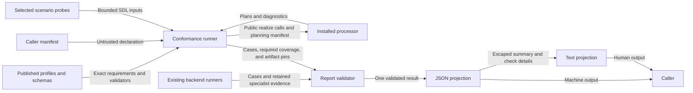

# Conformance and support reporting

This design serves ASR-526 and issue #222.
The [preflight](issue-222-conformance-support-reporting-preflight.md) maps the requirement clauses and sets the boundaries.

## Components and interfaces

`raes_conformance.conformance.report` owns the existing report, cases, validation, and JSON projection.
Additive fields identify the subject, exact artifacts, and required checks.
Existing backend fields retain their meanings.
Missing metadata remains unknown.

`raes_conformance.conformance.report_text` owns the text projection.
It reads the validated JSON projection.
It computes no separate verdict.
Both views retain every failed check, gap, limitation, and nonclaim.
Text escapes control characters before terminal output.

`raes_conformance.conformance.processor` owns `run_processor_conformance()`.
An explicit installed processor supplies `manifest_payload()` and `realize()`.
The runner validates the actual manifest through `ProcessorManifestV2Model`.
It exercises compilation and planning through that processor's public interface.
The caller supplies the backend manifest used for planning.
No backend operation runs.

The processor runner consumes the processing phase of `reference-stack-v1`.
It retains the semantic profile version and content digest.
Its own finite suite is `processor-compile-plan/v1`.
Passing this suite does not qualify the full semantic profile.
It checks required contract declarations and concept bindings.
Finite positive and negative probes check compilation, planning, and plan contract validity.
Additional requested features remain unverified when the runner has no matching check.
A declaration never substitutes for an observation.
The selected scenario probes and planning backend remain explicit parameters.

`raes_cli.conformance` owns format selection and process status.
JSON remains the default.
The processor command uses the reference processor and an explicit local planning manifest.
The existing command retains its operational error boundary.

## Results and failures

The requested profile stays visible on failure.
Achievement requires passing checks, complete required coverage, and no required gap or top-level error.
No profile ranking or fallback profile is inferred.
Case totals use verdicts, including expected rejections with error diagnostics.
Duplicate identities and missing required checks fail report validation.
Empty valid fixture directories produce a missing-fixture diagnostic.
Native qualification requires a passing report and applicable native observations.
Fixture and hermetic evidence cannot establish native qualification.

Support rows keep declared support and admission-effective support separate from observed outcomes.
Absent observations remain unknown.
The validation basis shows where each check ran.
It keeps the finite scope, evidence origin, and contract checks.
The governed validation catalog supplies profile identities where applicable.
No processor is labeled as a backend in a validation disclosure.
No disclosure strength is fabricated when its required gates did not run.

The existing modular-control and mixed-backend runners still own their results.
Their versions, bindings, unsupported combinations, producer references, and limitations pass through unchanged.
Report projection never reruns a probe.

## Data flow and boundaries

The caller trusts the installed processor code.
Manifest and result validation mark separate input boundaries.
Evidence references are inert identifiers.
No report grants execution authority.
No new store or network service exists.

## Security

The report must protect private inputs and secrets.
Its facts must show which checks passed and which checks failed.

| Threat and boundary | Control | Verification |
| --- | --- | --- |
| A false declaration becomes qualification | Validate actual manifests and compare executed checks with requested coverage | Missing declarations, false claims, absent probes, and unsupported feature tests |
| A partial report appears complete | Reject duplicate identities, absent required checks, and contradictory aggregate fields | Hand-built report and empty-corpus regression tests |
| Finite evidence becomes native assurance | Preserve execution basis, ownership, evidence origin, and specialist validation | Native overclaim and specialist compatibility tests |
| A processor error exposes private input | Reuse `sanitized_failure_message()` and shared diagnostic types | Secret sentinels in manifest and processor failures |
| Report text changes terminal behavior | Escape control characters in all rendered values | Terminal-control regression test |
| Report metadata causes external execution | Treat references as data; accept installed objects through explicit interfaces | No URL, command, or module loader is introduced |

A compromised host can forge processor results.
Finite probes establish no universal assurance.
Planning success establishes no native backend execution.

## Existing policy and architecture artifacts

ADR-008 and ADR-036 retain processor, runtime, and package ownership.
ADR-009 retains published contract authority.
ADR-061 retains report compatibility.
ADR-072 retains governed validation strength.
ADR-116 and ADR-117 retain safe diagnostics and public module boundaries.
No ADR, runtime policy, deployment file, or published schema needs a change.
The existing policy map adds ASR-526 after the reference stack.
The existing report remains an implementation output.
Targeted tests enforce the new report invariants through public projections.
Full, integration, and fuzz suites remain in CI.

## Reference basis and document review

- [Python dataclasses](https://docs.python.org/3.14/library/dataclasses.html), Python 3.14, module contents: additive dataclass fields preserve constructor compatibility.
- [SARIF](https://docs.oasis-open.org/sarif/sarif/v2.1.0/os/sarif-v2.1.0-os.html), version 2.1.0, sections 3.13, 3.19, and 3.20: separate tool identity, result facts, and invocation evidence.
- [ASD-STE100](https://www.asd-ste100.org/assets/files/ASD-STE100_ISSUE9.pdf), Issue 9, sections 1, 5, and 6: consistent technical names and short sentences.

The document review checked terminology, sentence length, and purpose against those writing rules.
The architecture describes components and controls.
Implementation tasks belong in the issue plan.
