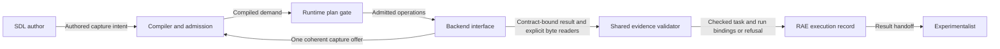

# Evidence integrity execution boundary

Requirement: EXP-717. Assurance level: FM1.

## Responsibility

RAE is the SDL, its language tools, and the runtime that controls backends through the interface.
It must execute effective SDL semantics or refuse them.
The experimentalist owns custody after export.
RAE does not supply a custodian trust service, key policy, or evidence archive assurance system.
No rule requires custody merely because an experiment makes a claim.
The effective authored requirements and defined language defaults govern execution.

## Existing coverage

| Concern | Existing owner | Guarantee and limit |
| --- | --- | --- |
| Authored intent | `raes_contracts.evidence_requirements` | Closed integrity and retention terms express intent, not completed custody |
| Translation | `raes_contracts.capture_dimensions` and `raes_processor.capture_admission` | Preserve effective capture dimensions and scoped requirement relations |
| Backend admission | `ObservationCaptureOffer` and `capture_admission_diagnostics` | Require one coherent backend offer for every mandatory demand |
| Content checks | `contracts.evidence_satisfaction` | Check exact bytes, size, checksum, schema, fields, source, and capture window |
| Execution proof | `validate_experiment_run_against_task` and `ValidatedRunEvidence` | Bind checked content to the exact task and run, including downstream evidence consumers |
| Runtime records | `runtime_record_publication` and `runtime_record_versions` | Retain RAE execution facts, frozen record versions, and run readback within existing interfaces |

Hashes and asserted provenance do not prove authenticated custody.
The current scientific evidence response contract has no custody or signature verifier.
A backend capability string cannot fill that gap.
The language must retain the requirement, and planning must refuse it before effects.
For example, an author asks for custody.
A backend says it can do that.
The current result contract cannot prove that it did.
RAE must refuse before the backend changes the experiment.
A file hash does not fill that gap.
If the author requests a supported checksum, the existing path remains valid.
The separate observation runtime already supports installed integrity policy providers.
Its configured provider contracts retain their existing behavior.

## Change and public interfaces

`raes_contracts.evidence_integrity` owns the modes that the shared content proof can check.
Its public functions list these modes and check the artifact checksum algorithm.
Both planning and post-run evidence validation use that owner.
This prevents a backend offer from promising a mode that the shared evidence proof cannot check.

`raes_processor.capture_admission.capture_admission_diagnostics` refuses unsupported mandatory modes before backend effects.
The existing SDL and capture-spec compilers preserve effective integrity requirements.
They treat `none` as the absence of an extra constraint.
The existing runtime invalid-plan gates enforce that refusal.
`contracts.evidence_satisfaction` keeps its public validation interface and checks integrity metadata before artifact I/O.
Checksum and SHA-256 requirements retain their existing meaning.
An authored `none` adds no integrity constraint to backend admission.
The artifact response still satisfies its existing content and checksum contract.
An explicit `none` must not count as stronger integrity in scoped refinement.
Signature, custody, timestamp, and unknown modes remain unsupported in this scientific response contract.
There is no fallback from custody to checksum.
A future supported mode needs an actual backend response contract and validator.
It does not require RAE to manage the external custody operation.

## Data and trust boundaries

The backend interface is the effect boundary.
The result handoff ends RAE's responsibility for downstream custody.
Existing authenticated adapters, protected runtime stores, and error boundaries retain their owners.
No validator fetches an artifact locator or opens an external archive.
The new checks add no endpoint, credential source, persisted record type, or public schema field.
ADR-064, ADR-065, ADR-066, ADR-116, and ADR-117 already govern these boundaries.
Their decisions need no replacement.

## Invariants and checks

- Preserve the authored integrity mode through compilation and scoped refinement.
- Refuse an unsupported mandatory mode even when a backend advertises that mode or a wildcard.
- Refuse before backend effects and before unnecessary artifact I/O.
- Never treat hashes, source names, or capability flags as authenticated custody.
- Keep supported checksum behavior and exact task/run proof binding.
- Do not introduce custody requirements when effective SDL semantics do not require them.

Tests exercise the public planner, runtime submission gate, capture-spec admission, and shared post-run validator.
Full-path tests resolve exact capture-spec pins at the installed owner's admission and capture calls.
They verify retention refusal before effects and reject changed bytes in returned evidence.
Targeted mutation checks remove the refusal gate and confirm that regression tests detect the bypass.
The supported-mode table supplies the small checkable semantic model.
No state machine is added because this change introduces no new lifecycle.
Published schemas and their ledger remain unchanged.

## References

- [Pydantic validators](https://docs.pydantic.dev/2.12/concepts/validators/), version 2.12, model validators and validation errors: keep the existing validation exception protocol.
- [JSON Schema validation](https://json-schema.org/draft/2020-12/json-schema-validation), Draft 2020-12, structural validation: schema validity does not establish that an execution guarantee was met.
- [SDL observation and evidence semantics](../../specs/sdl/observability-and-evidence.md): effective demand, backend admission, and response validation own the execution contract.
