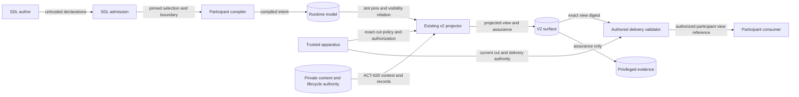
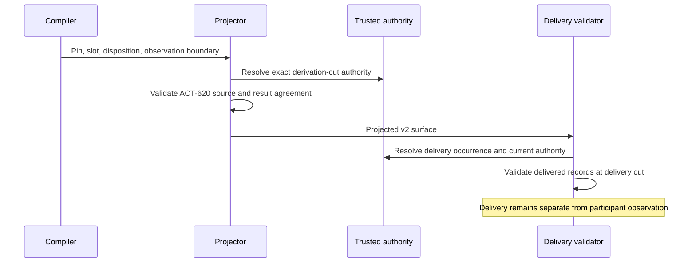

# Authored participant exposure

Requirement: DSL-125. This design applies ADR-095 and ACT-620.

## Architecture

SDL already declares observations through observation boundaries.
It declares pinned context assets through participant and reusable selection slots.
Sensitive boundary classes retain hidden, evaluator, and benchmark intent.
Role selectors establish authored applicability.
Run apparatus supplies live policy, roles, authorization, content transformations, and delivery evidence.
No new SDL syntax or published schema is required.

The processor owns the join from compiled selections to v2 surfaces.
Its public `AuthoredParticipantExposureV2` input carries slot records and trusted ACT-620 context.
The v2 projector checks this input whenever selected content enters the view.
It checks explicit withholding even when the apparatus permits disclosure.
Selected assets can remain absent from a surface.
A selected asset never grants disclosure authority.

Each exposed slot names one ACT-620 record and one existing context result.
The record pin must match the compiled pin.
ACT-620 checks source digest, transformation, audience, episode, lifecycle, and authority.
The source declaration must also be visible in the compiled observation boundary.
Ordinary context continues through the existing exact-cut exposure resolvers.
The existing participant projection contains authorized result references.
Assurance retains source bindings, cuts, evidence, and provenance.

The public `deliver_authored_participant_decision_surface_v2` processor function binds trusted delivery evidence.
It then checks delivered ACT-620 records against current delivery context.
Changed policy or role authority can refuse delivery after projection.
The portable delivery helper remains the lower-level trusted-record primitive.
It does not establish policy authorization itself.

Trial compilation retains admitted selections in the sealed participant configuration.
The typed exposure input can also carry that admitted configuration result.
The processor checks its participant, digest, declaration pin, and slot conflicts.
The SDL owner validator rechecks each reference against the concrete scenario.
Direct and reusable selections use the existing conflict checks.
No second configuration authority is introduced.

## Data flow and boundaries

## Systems security

| Threat | Boundary control | Verification |
| --- | --- | --- |
| Permissive apparatus erases withholding | Compiled slot and source checks | Withheld source and alias rejection |
| Unknown or substituted asset | Compiled pin agrees with ACT-620 record | Missing slot and stale pin rejection |
| Wrong participant or episode | Existing anchor and ACT-620 scope checks | Scope mutation cases |
| Stale policy or delivery cut | Exact-cut resolvers and current ACT-620 context | Changed authority and stale-cut rejection |
| Hidden or assurance-only source | Compiled observation relation and explicit authorization | Hidden-source rejection |
| Changed content | Existing ACT-620 content validator and bounded artifact readers | Existing checksum and size cases |
| Metadata disclosure | Participant-view serialization excludes assurance | Participant payload assertions |

References do not prove byte availability or content integrity.
The host must validate private bytes through ACT-620 before supplying content.
This interface adds no reader, transport, store, credential, subprocess, or logging mechanism.
The final participant content sink retains API-423 and RUN-319 obligations.
Passing this join does not certify a transport or prove participant understanding.

## Policy, compatibility, and references

Policy-as-code reuses observation visibility, SEM-226, and ACT-620 checks.
Architecture-as-code retains existing schemas and compiled typed selections.
ADR-095 already governs these interfaces; no new ADR decision is needed.
Historical v1 meaning remains unchanged.
V2 migration requires trusted reprojection and explicit authored exposure context.
Absent new authored selections, the existing v2 interface remains compatible.

- [Pydantic models](https://raw.githubusercontent.com/pydantic/pydantic/v2.12.5/docs/concepts/models.md), version 2.12.5, validation and model copying: revalidate mutable carriers.
- [NIST SP 800-162](https://csrc.nist.gov/pubs/sp/800/162/upd2/final), 2019 update, ABAC definition: separate subject, object, operation, and environment authority.
- [ASD-STE100](https://www.asd-ste100.org/assets/files/ASD-STE100_ISSUE9.pdf), Issue 9, rules 1, 4, 6, and 9: terminology, sentences, descriptions, and purpose.

The document review applies short descriptions and consistent project technical nouns.
Implementation tasks and test execution belong in the issue plan.

## Retained evidence integrity

Historical reproduction measurements retain the source pins from their original execution.
A later package change does not change that execution.
The existing fresh admission interface still requires current source equality.
The retained admission interface requires the repository's selected reproduction capture pin.
It checks the capture manifest digest, target subject, and measurement artifact digest.
It compares all remaining measurement fields with the selected finite subject.
It permits only the retained reproducer source map to differ from current source.
This interface establishes retained integrity, without fresh execution or reviewer authentication.
The selected manifest already binds the separate execution and review artifacts.
No historical artifact or acceptance record changes.
